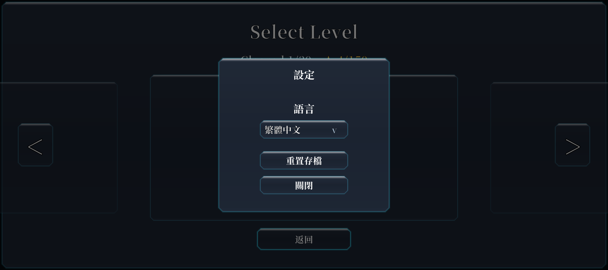
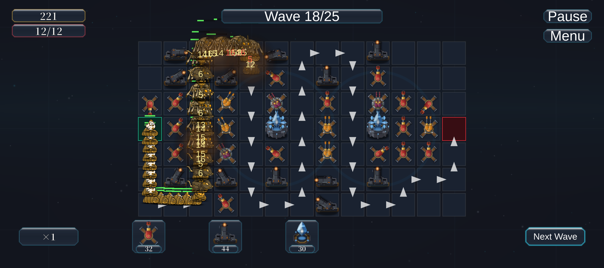

# 无声版本实施与验证记录（2026-10-23）

实际工程为 `D:\FreedomTower_1`，Unity `2022.3.62f3c1`。原 AGENTS.md 的 `E:\MyTowerGame` 已不存在；Unity 进程参数与 8082 MCP project/info 均指向 D 盘工程。本次没有使用 8080 / CatchFish_Android 的结果。AGENTS.md 已同步修正路径和实例名，并记录用户对声音表定点删除的授权。

证据：本目录旁的 [verification.json](AudioRemovalEvidence/2026-10-23/verification.json)、[编辑器测试结果](AudioRemovalEvidence/2026-10-23/editmode-tests.json)、[生成入口验证](AudioRemovalEvidence/2026-10-23/generator-verification.json)。

## 删除和修改

- 保留任务开始时 Assets/Audio 已处于待删除的状态；未恢复资源。删除其 16 个音频文件、目录说明及对应 meta。
- 删除 AudioManager、AudioFadeDriver、UiClickSfx、AudioName、AudioConfig、AudioCatalog 及 meta。
- 清理 Launcher、UIManager、BaseTower、BaseEnemy、GameFlowManager、PlayerDataManager 的声音调用。伤害、金币、生命、结算、动画、特效、后坐、震动及 UI 转场继续走原有流程。
- Configs / EditorCandidates 删除声音加载、缓存、预加载、回退及统计；ResTable 删除声音登记，ResBundle 删除声音包构造；编辑器自检同步调整。
- SettingView / prefab / UIPrefabBuilder 移除声音设置，面板改为 620×560，保留语言、重置及关闭。修正旧 prefab 底部按钮锚点，避免布局落到面板外；保留本地化绑定。
- Boot 场景仅移除 AudioListener，保留摄像机。自有资源未发现其他声音组件、轨道或声音事件。MonsterAnimEventReceiver 的 SetHead 和原包通用 Event 接收口保留。
- BundleCollectorSetting 和 YooAsset 向导均移除声音收集项。删除 PlaceholderBgmGenerator、gen_audio_catalog.py、apply_m2_audio_table.py；调整 UI、本地化生成器和检查器，旧塔型迁移脚本不再访问声音表。没有执行旧数值写表脚本。
- 更新程序设计、游戏设计、编辑器操作、SQLite 存储、YooAsset 接入文档和设置 SVG；历史发布产物、备份及证据保留。
- 工程 m_DisableAudio 已开启。Unity 在保存 AudioManager.asset 时自动补入默认 m_EnableOutputSuspension。

## 源表和 Luban

用户最新说明明确允许自动删除声音表与声音专用条目。本轮仅删除 AudioData.xlsx、__tables__.xlsx 中 TBAudio 的登记、Localization.xlsx 中 Volume {0}% / Volume + / Volume - / Mute / Unmute 五项；保留原工作簿的其他内容、样式和包结构。

随后在目标 Unity 中调用现有 LubanExporter.ExportInternal。由 Luban 删除旧 AudioData.cs、TBAudio.cs、tbaudio.json 及 meta，更新 Tables.cs 和 tblocalization.json。没有第三方脚本直接写 Assets/Gen 或 Assets/ConfigJson。

导出前后 257 个被审计文件中，249 个逐字节不变，仅上述 8 个预期导出文件发生变化或删除；全部受保护的数值源 XLSX 不变。FTProject.Gen.asmdef 及 meta 保护机制未改，文件哈希相同。声音和本地化不在 runtimeContentHash 覆盖范围内，因此未重封哈希，也未改动评级或关卡平衡。

Boot 实际启动日志：

```
[Rating] Runtime configuration SHA256 verified: 0135233bbe9cd3e5595063faf8ef222cfca1c0806565061d900f507fd56db4ce
```

## 存档兼容

- GameSettings 只保留语言设置，SaveManager 移除声音接口及调用。
- JSON 版本维持 2；JsonUtility 忽略旧声音键，新写出的 JSON 不再包含它们，语言、进度、评级和快照保留。
- SQLite schema 3→4：在原迁移事务中创建 game_settings_v4，复制 id/updated_at，删除旧设置表，再重命名。采用旧 SQLite 兼容的建表复制方式，不依赖 DROP COLUMN。语言仍在 kv_store，进度、评级载荷和快照不变。
- 新库、旧 v3 库、重复迁移、旧 JSON 升级/重写均用临时目录测试；调用项目实际 SQLite 后端，检查相关数据和旧载荷字节保留。
- 实际 Play 使用 BalanceTests 下的独立上下文。正式存档原有 16 个文件 SHA256 全部不变。编辑器生成预览时触发了存档懒加载连接；已关闭连接，只额外留下 freetower.db-shm（32768 字节）与空 freetower.db-wal（0 字节），没有通过清档、删库或重置正式进度解决兼容问题。

## 编译和运行

- 按要求 force / all / compile request 刷新；等待编译、域重载、资源更新均结束，ready_for_tools=true；scriptCompilationFailed=false。最终 read_console error 为 0。未调用清空 Console。
- EditMode 测试：48/48 通过，0 失败、0 跳过，包含 3 个新增存储兼容用例。
- 从 Boot 经资源/配置加载、Splash 到主菜单 Ready 正常。进入选关、设置、语言切换（英文、简体、繁体）、重置确认与取消、关闭、返回选关正常。
- 实际建塔后保存并返回选关，继续游戏成功恢复塔与金币状态；出售后余额正常更新。余额不足时升级被拒绝，后续实战验证了成功升级。
- 复用项目固定步长 PlayMode 回放器，只加载当前正式配置，不加载候选表、不跳波、不注入资金或成绩。


- 战斗中 AudioSource=0、AudioListener=0、Missing Script=0；结算后同样没有声音组件。回放后错误日志 0，has no receiver 命中 0。
- 266 个自有 prefab 的 Unity Missing Script 检查为 0。静态扫描覆盖 3 个场景、266 个 prefab、170 个动画、42 个控制器和 16 个 asset；声音对象/轨道、声音动画事件、已删除资源 GUID 引用均为 0。
- 设置生成器在临时目录实际生成验证，只有 Title、LanguageText、LanguageDropdown、ResetBtn、CloseBtn。临时资源已清理，生产 prefab GUID 保留。
- 实际重新运行 YooAsset 收集器向导：新增 0、已有 5，没有声音组。Luban 本轮重导已经证明声音表不再生成。
- HybridCLR 用当前 Android 热更新程序集执行标准 LinkGeneratorCommand.GenerateLinkXml，编译完成日志与输出日志确认 6 个程序集、316 个引用类型。已移除声音模块及 Slider 保留项；其他新增保留项来自当前动画/材质/Shader 真实引用。MCP 同步返回受内部编译影响，完成情况由日志、实际文件及最终编译共同核对。
- 编辑器已退出 Play、恢复 Boot 和原 playModeStartScene / Unity Remote / 测试上下文。





## 保留依赖和验证边界

DOTweenModuleAudio、DOTweenPro 的通用音频支持、iTween 及 Unity 内置 AudioModule 按共享插件编译依赖保留；通用资源加载说明、类型检查器和 prefab 类型识别器中的 AudioClip/AudioSource 名称也保留。这些命中不创建项目声音系统。业务脚本和编辑器声音配置路径已无被删除类型及调用。

初次启动编辑器 Unity Remote 选择了 Any Android Device，没有设备导致 ADB forward 异常。后续实战临时设为 None，错误未再出现，结束已恢复原设置。现有 YooAsset 重复 Location 警告仍在，源于原有同名资源寻址；本轮未改变该寻址机制。

本次已完成 Unity 编辑器编译和上述实际运行验证。未执行 Android Player 整包构建、设备安装或真机音频输出测试，也没有发布或覆盖线上资源；测试范围不等同于全部关卡和全部设备回归。根目录已有/并行新增的 prompt 文档与其他用户文件均予以保留。

## 后续变更（2026-10-27）

- 用户需要在 Inspector 里试听 `Assets/Audio/OriginalPack_20261023` 下的音频，但 `ProjectSettings/AudioManager.asset` 的 `m_DisableAudio: 1` 会让 AudioClip 预览报「AudioClip preview not available when Unity Audio is disabled in Project Settings」。
- 已把该项改回 `m_DisableAudio: 0`，恢复 Unity 音频引擎，仅用于编辑器试听与后续可能的音频接入。
- 此改动只影响播放器是否编译/初始化音频引擎，不恢复任何声音代码：AudioManager / AudioCatalog 等仍处于删除状态，Boot 场景无 AudioListener，prefab 无 AudioSource，游戏中依旧没有声音。若最终 APK 需要严格静音可再勾回该项（会导致预览再次不可用）。

## 后续原创声音接入（2026-10-27）

用户随后要求执行新的完整声音接入 prompt。现有 93 个原创 WAV 已接入新建的 `Assets/Scripts/Audio/` 服务、真实战斗/UI/流程节点、当前 Tactical Forge 设置、持久化与 YooAsset 收集。`m_DisableAudio=0` 继续保留；常驻声音根负责唯一有效 Listener、声源池和资源释放，不恢复旧声音表、旧目录或旧生成器。

此后当前维护要求以本工程 AGENTS 和[声音接入实施记录](AudioIntegration_Implementation_2026-10-27.md)为准。本文上方移除结果与“仅恢复编辑器试听”的补记保留其发生时的历史语境，不表示当前工程仍无声，也不作为此次新增声音的运行验收结果。

新设置使用独立 `GameSettings.audio` / `settings.audio.*`，schema 4 和旧 3→4 迁移保留，更早 JSON 的旧 volume/muted 仍忽略。新一轮本工程 MCP 编译通过、7 个隔离存储测试通过，三语言设置页预览已检查；未进入 Play Mode、执行整局回放、人工试听、Android 出包或设备验收，正式存档未被用于测试。
