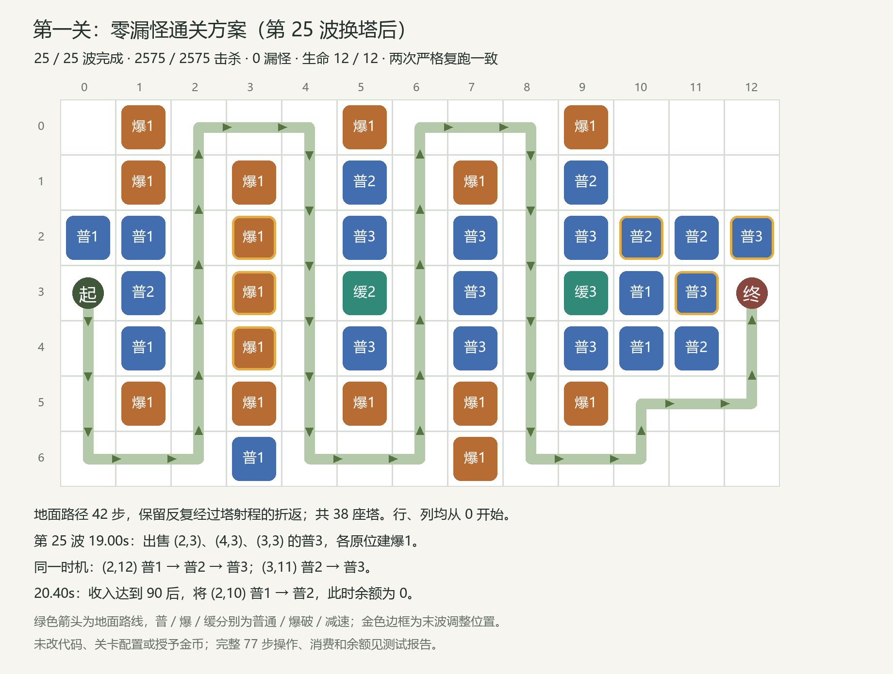

# 第一关零漏怪通关实测报告（2026-10-21）

已找到零漏怪通关方案，随后按实际时机和正常扣费严格复跑 2 次，结果均一致：25 波全部完成，2575 只怪全部击杀，漏怪 0，生命 12/12，最终金币 314。

## 本轮调整依据

对当前版本的基准回放加入只读死亡位置观测，第 25 波全部 133 只地面怪的死亡位置均已记录。最远到第 6 行、第 8 列（原 48 步路径约 75% 处），没有进入最后一段折返。原 (1,0)、(1,11)、(5,11)、(6,11) 的一级爆破塔在本波伤害均为零。

据此减少末段无贡献投入，将末段路线调整为 42 步；保留必要的地面爆破覆盖，同时在 (3,10)、(2,10)、(4,10) 增加低价普通塔，并在终点上侧 (2,12) 补塔。进一步把部分升级预算分配给 (1,5)、(1,9) 的二级普通塔。

在飞行队伍离开前段后，第 25 波 19.00 秒正常出售三座前段三级普通塔，原位补一级爆破塔以保持阻挡及地面覆盖，用退款升级末段普通塔；20.40 秒实际金币达到 90，再升级 (2,10)。零漏是布阵、购买顺序与末波资金回收共同得到的结果。

## 实测结果

| 回放 | 完成波数 | 击杀 | 漏怪 | 生命 | 最终金币 |
|---|---:|---:|---:|---:|---:|
| 首次零漏 | 25 | 2575 | 0 | 12/12 | 314 |
| 严格复跑 1 | 25 | 2575 | 0 | 12/12 | 314 |
| 严格复跑 2 | 25 | 2575 | 0 | 12/12 | 314 |

策略：`finish-residual-2-10-19000`；首次 runId：`b26534f8d9714505ae9b2acf3fc2c2cb`。两次复跑的逐波统计，以及全部 77 条操作的时机、消费和余额均与首次一致。当前评级为 4 星，5 星的战斗时间条件尚未满足；本次目标为零漏怪。

## 当前配置与执行范围

- 工程 E:/MyTowerGame，Unity 2022.3.62f3c1，unityMCP / 8082，现场核对实例、根目录和版本。
- 使用当前 Assets/ConfigJson；初始金币 100、初始生命 12；未指定候选配置目录，未改表或重导出。
- 当前运行配置 SHA256 已由 Unity 日志验证：`e18d8b9852997296abbfc910732d756da880bc62e6b668cff48f35b278702196`。
- 使用已有 BalancePlayModeVerifier，以 0.02 秒步长运行真实关卡、A*、当前攻击与减速逻辑、经济系统。游戏速度 1，保留现有波间等待。
- 所有建塔、升级、出售均通过原有 TryBuild / TryUpgrade / Sell 正常执行。没有补钱、改血、跳波或直接建高等级塔。
- 搜索时允许等待本波实际收入；复跑使用记录下来的实际操作时间，严格要求当时有足够金币，不再开启等待资金。
- 本轮新增 150 次候选实测（含当前版本基准回放）及 2 次严格复跑。找到并复现零漏后停止余下候选；没有穷举整个无限时间及操作组合空间。
- 使用隔离测试存档，未写入正式游戏进度。此结论覆盖自动固定步长下的合法玩法，未验证手动触控完成同秒多项操作的难度。

## 最终布阵与末波操作

[第 25 波开始前布局](ground-reallocation/zero-before-wave25.png)。所有坐标均为 (行,列)，从 0 开始；塔的数字表示等级。第 25 波开始前 38 座塔、余额 2；结束时仍为 38 座塔：普通 21、爆破 15、减速 2。

| 第25波时间 | 必须按顺序执行的操作 | 操作后余额 |
|---|---|---:|
| 0s | 升 (4,11) 普2；升 (2,11) 普2；升 (3,9) 缓3；建 (2,12) 普1 | 2 |
| 19.00s | 卖 (2,3) 普3，原位建爆1；卖 (4,3) 普3，原位建爆1；卖 (3,3) 普3，原位建爆1 | 534 |
| 19.00s | (2,12) 普1→普2→普3；(3,11) 普2→普3 | 84 |
| 20.40s | 在实际收入达到 90 后，将 (2,10) 普1→普2 | 0 |

三座普3各正常退还 211，共 633；原位三座爆1合计 132。19 秒的升级合计 450；20.40 秒的升级为 90。资金完全来自原有收入与正常出售。

## 完整逐波操作

以下均为本次实际执行的 77 条操作，不能只照最终布局提前购买。前 24 波全部在波前执行；第 25 波的非零时间为本波开始后的战斗时间。机器可读清单：[best-operations.json](best-operations.json)。

| 波次 | 实际时机 | 顺序与消费 |
|---:|---|---|
| 1 | 波前 | 建 (3,1) 普1（花 32，余68）；建 (2,1) 普1（花 32，余36）；建 (4,1) 普1（花 32，余4） |
| 2 | 波前 | 建 (2,7) 普1（花 32，余60）；建 (4,5) 普1（花 32，余28） |
| 3 | 波前 | 建 (4,9) 普1（花 32，余96）；建 (2,3) 普1（花 32，余64）；建 (2,11) 普1（花 32，余32）；建 (3,3) 普1（花 32，余0） |
| 4 | 波前 | 建 (3,5) 缓1（花 30，余70）；建 (3,7) 普1（花 32，余38）；建 (3,9) 缓1（花 30，余8） |
| 5 | 波前 | 建 (4,7) 普1（花 32，余87）；建 (4,3) 普1（花 32，余55）；建 (2,9) 普1（花 32，余23） |
| 6 | 波前 | 建 (2,5) 普1（花 32，余118）；建 (4,11) 普1（花 32，余86）；建 (6,7) 爆1（花 44，余42）；建 (6,3) 普1（花 32，余10） |
| 7 | 波前 | 建 (3,11) 普1（花 32，余104）；建 (0,5) 爆1（花 44，余60）；建 (0,9) 爆1（花 44，余16） |
| 8 | 波前 | 建 (1,9) 普1（花 32，余120）；建 (5,7) 爆1（花 44，余76）；建 (1,5) 普1（花 32，余44） |
| 9 | 波前 | 建 (5,3) 爆1（花 44，余145）；建 (2,0) 普1（花 32，余113）；建 (1,7) 爆1（花 44，余69） |
| 10 | 波前 | 建 (5,5) 爆1（花 44，余180）；建 (5,9) 爆1（花 44，余136）；建 (1,3) 爆1（花 44，余92） |
| 11 | 波前 | 建 (5,1) 爆1（花 44，余227）；建 (0,1) 爆1（花 44，余183） |
| 12 | 波前 | 建 (1,1) 爆1（花 44，余324）；升 (3,7) 普2（花 90，余234） |
| 13 | 波前 | 升 (3,3) 普2（花 90，余338）；升 (3,9) 缓2（花 85，余253）；建 (3,10) 普1（花 32，余221）；建 (2,10) 普1（花 32，余189）；建 (4,10) 普1（花 32，余157） |
| 14 | 波前 | 升 (3,5) 缓2（花 85，余278）；升 (3,11) 普2（花 90，余188） |
| 15 | 波前 | 升 (2,5) 普2（花 90，余313）；升 (2,5) 普3（花 180，余133） |
| 16 | 波前 | 升 (2,9) 普2（花 90，余283）；升 (4,3) 普2（花 90，余193） |
| 17 | 波前 | 升 (2,9) 普3（花 180，余251）；升 (4,7) 普2（花 90，余161） |
| 18 | 波前 | 升 (4,3) 普3（花 180，余229）；升 (2,3) 普2（花 90，余139） |
| 19 | 波前 | 升 (4,7) 普3（花 180，余217）；升 (4,9) 普2（花 90，余127） |
| 20 | 波前 | 升 (2,3) 普3（花 180，余215）；升 (4,5) 普2（花 90，余125） |
| 21 | 波前 | 升 (4,9) 普3（花 180，余240）；升 (2,7) 普2（花 90，余150） |
| 22 | 波前 | 升 (4,5) 普3（花 180，余261）；升 (3,1) 普2（花 90，余171） |
| 23 | 波前 | 升 (2,7) 普3（花 180，余292） |
| 24 | 波前 | 升 (3,7) 普3（花 180，余423）；升 (3,3) 普3（花 180，余243）；升 (1,5) 普2（花 90，余153）；升 (1,9) 普2（花 90，余63） |
| 25 | 波前 | 升 (4,11) 普2（花 90，余294）；升 (2,11) 普2（花 90，余204）；升 (3,9) 缓3（花 170，余34）；建 (2,12) 普1（花 32，余2） |
| 25 | 19.0s | 卖 (2,3) 普3（退 211，余244）；建 (2,3) 爆1（花 44，余200）；卖 (4,3) 普3（退 211，余411）；建 (4,3) 爆1（花 44，余367）；卖 (3,3) 普3（退 211，余578）；建 (3,3) 爆1（花 44，余534）；升 (2,12) 普2（花 90，余444）；升 (2,12) 普3（花 180，余264）；升 (3,11) 普3（花 180，余84） |
| 25 | 20.4s | 升 (2,10) 普2（花 90，余0） |

## 搜索记录与资金检查

| 本轮批次 | 已记录实测数 | 最佳完整通关漏数 |
|---|---:|---:|
| unity-01 | 16 | 8 |
| unity-02 | 60 | 5 |
| unity-03 | 43 | 3 |
| unity-04 | 25 | 1 |
| unity-05 | 6 | 0 |

150/150 次候选记录的账目相符、操作后余额非负，debugOverride 均为 false；两次严格复跑也通过相同核对。死亡后计划未完成的记录不计为通关。

零漏方案的总账：`100 + 击杀及过波收入 5189 + 出售退款 633 - 建塔 1488 - 升级 4120 = 最终金币 314`。

本轮以开始时的现有工程为基准，比对 379 个 C#、配置 JSON 与 Excel 文件，前后哈希变更 0。任务开始前已有的源码、美术层级与资源改动均保留。本轮与上一轮之间已有的修改不属于本次测试产生的改动。目标编辑器控制台错误 0，scriptCompilationFailed=false；回放及隔离存档标记已清除，编辑器恢复至原来的 Boot / EditMode。

## 证据文件

- [本轮150次候选索引](ground-reallocation/trial-index.json) / [CSV](ground-reallocation/trial-index.csv)。
- [最佳完整结果](best-result.json) / [77步实际操作](best-operations.json)。
- [两次严格复跑结果](ground-reallocation/zero-recheck/unity-results.json) / [逐波及操作一致性核对](ground-reallocation/zero-reproducibility.json)。
- Unity 现场截图：[第1波](ground-reallocation/zero-recheck/D04-L1-wave1.png)、[第10波](ground-reallocation/zero-recheck/D04-L1-wave10.png)、[第25波开始前](ground-reallocation/zero-recheck/D04-L1-wave25.png)。
- [当前版本基准死亡位置](ground-reallocation/deaths-01.csv)：包含基准第25波133只地面怪的完整死亡位置。
- [本轮源文件完整性](ground-reallocation/source-integrity.json) / [本轮开始时哈希](ground-reallocation/source-hashes-before.json)。
- 各 unity-01 至 unity-05 目录保留原始结果；已取消批次仅统计实际写入结果的候选。
- 主目录 actual-trial-index.json / .csv 另汇总先前46次及本轮150次，共196次候选记录，不含各轮复跑。

以漏怪数为目标，零漏已经达到最小值；本次未继续优化通关耗时、最终金币或手动操作数量。
