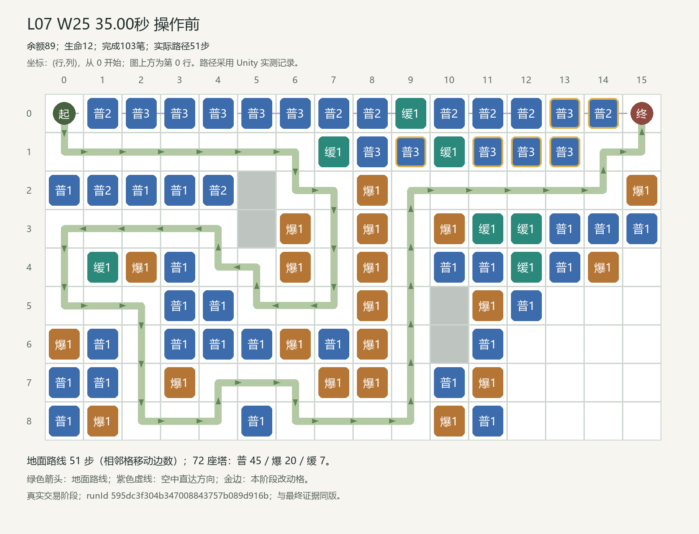
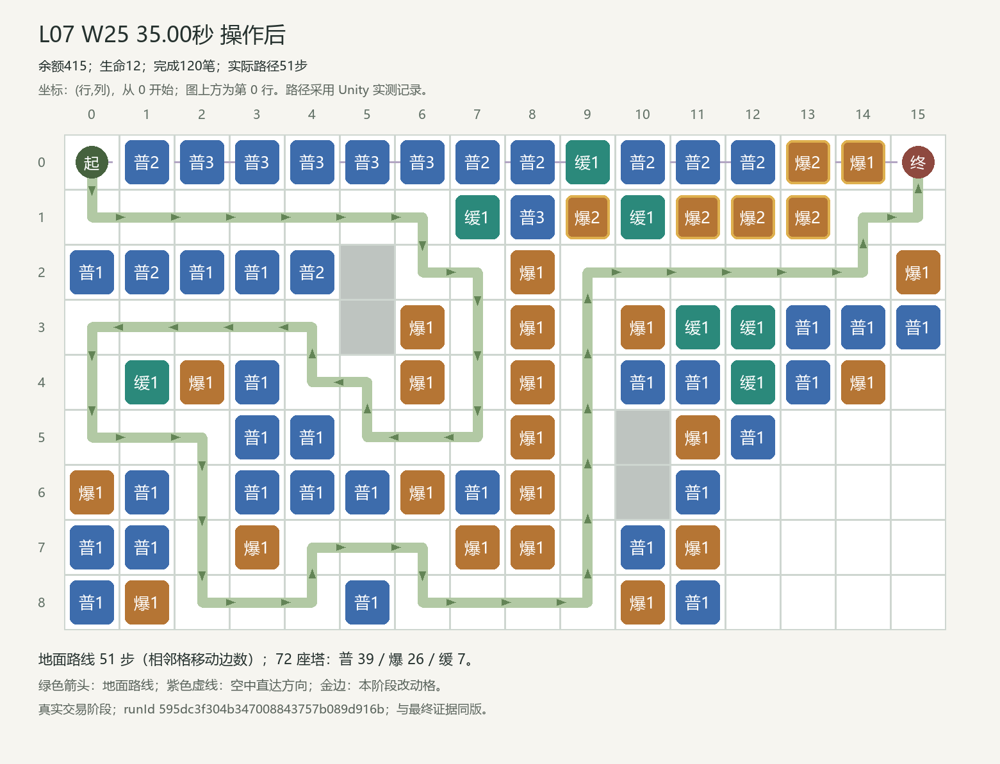

# L07 最佳玩法布局方案与完整逐波操作、测试报告

本方案是本轮已验证候选中的最佳推荐；有限搜索未覆盖全部玩家策略，不声称全局最优。

## 结果摘要

25/25 波 · 2725/2725 击杀 · 0漏怪 · 生命12/12 · 实际5星。实际出生2725、击杀2725、漏怪0、扣血0，终局金币794；模拟战斗976.44秒，完整关卡1036.94秒。零漏、正常胜利和五星均由当前正式配置的真实回放及唯一评级入口确认。

## 调整依据与方案选择

地图9行×16列，138个普通建造格。S=(行0,列0)，E=(行0,列15)；空中直达几何距离15.000格，减速后的真实飞行结算以事件记录为准。最终合法地面路线51步，72座塔（普通39、群攻26、减速7）；路线来自Unity寻路。 W5:出生61、战斗25.36秒、开战金16。 W15:出生121、战斗42.80秒、开战金22。 W25:出生181、战斗76.02秒、开战金25。

开发阶段的瓶颈与旧参考分析：空路沿上边缘经过，能有效拦截空袭的塔位比中央走廊少。参考先把高等级普通塔放在边缘覆盖带，内侧一级群攻和墙体则服务51步地面路线。 末波33.16秒最后一次空中结算、35秒开始六处回收。九处回收也曾零漏，但三处额外改造增加交易；现阶段优先保留六处版本，尚需最终数据下检查更宽的操作窗口。 这些文字保留开发候选语境；最终推荐的实际布局、交易和成绩以下方三次正式记录为准。

最终方案按已完成的同封印五星候选比较：优先较少波中交易，再比较总交易数与战斗时间。当前轨迹120笔交易，其中17笔波中交易，战斗976.44秒；首次与两次严格复跑使用固定时刻和相同顺序。有限候选中的推荐不等于全局最优。

同最终封印的实质替代：[实际完整结果](../raw-trials/final-suite-1/unity-results.json)索引39，runId `9f2c58c72d894c3fbb838078ed032e3d`。与推荐方案有7处最终塔位/等级差异，路线51步，120笔交易，完成25波，漏1、生命10、实际3星、战斗960.28秒；全部120笔现金前缀已对账。这证明至少两类具体合法投资可通关；替代有漏怪时不称零漏五星。

## 首次成功与两次严格复跑

|记录|runId|封印|波/击杀/漏|生命|金币|战斗秒|星级|
|---|---|---|---|---|---:|---:|---:|
|首次|595dc3f304b347008843757b089d916b|0135233bbe9cd3e5595063faf8ef222cfca1c0806565061d900f507fd56db4ce|25/2725/0|12/12|794|976.439978|5|
|严格复跑1|f25ce5d2f5de433697954b493dc2aee1|0135233bbe9cd3e5595063faf8ef222cfca1c0806565061d900f507fd56db4ce|25/2725/0|12/12|794|976.439978|5|
|严格复跑2|724fb35b6629406b89038f9b98582860|0135233bbe9cd3e5595063faf8ef222cfca1c0806565061d900f507fd56db4ce|25/2725/0|12/12|794|976.439978|5|

All wave, enemy outcome, operation affordability, cash, per-wave boundaries, operation stages, routes, final layout and tower contribution fields; runId, screenshot identity and global spawn serial excluded; numeric tolerance 0.00001。全部相同。原始结果和逐项比较分别见 [三次实测](evidence/three-actual-replays.json)、[一致性记录](reproducibility.json)。

## 当前配置与执行范围

初始金币100，初始生命12，25波；Unity 2022.3.62f3c1，MyTowerGame / unityMCP 8082。通过 BalancePlayModeVerifier.StartBatch，在空闲编辑器进入隔离 PlayMode；使用正式导出，无候选配置，无注资、回血、清怪、跳波或改倍率。步长0.02秒，倍速1，严格按实际时机购买，waitForFunds=false。正式存档与原场景由既有隔离机制保护。

版本：`D04|manual-100g-20261022-r1|manual-final-reference-20261022|67165675a7be624f2bee15107eef1d2bd15fd5231c82f69bf3b8ff2ccfc51c91`；封印：`0135233bbe9cd3e5595063faf8ef222cfca1c0806565061d900f507fd56db4ce`；校准状态：`unity_reference_calibrated`；Par=1060000ms。

Par=1060000ms为逐关确定的字面目标；校准依据为开发参考runId `1d08cecae8e54e169702fd801f4e3d3b` 的976.44秒，原余量83.56秒。最终推荐实际余量83.56秒，评级由唯一LevelRatingEvaluator真实给出5星；没有修改战斗时钟、开局金或L01门槛。

完整输入和源码指纹：[批次输入清单](../audit/batch-inputs/final-suite-1/input-manifest.json)。运行时加载：[正式封印日志](../audit/runtime-load-final.json)。

## 最终布阵与关键变化

### L07 W25 35.00秒 操作前

### L07 W25 35.00秒 操作后

[真实Unity截图](evidence/screenshots/run36-L7-wave25-at35000-op120.png)

### 最终逐塔清单

|坐标(行,列)|塔型等级|最后投资波/时机/序号|实际职责证据|伤害|对空命中|减速次数|重复生效敌人数|
|---|---|---|---|---:|---:|---:|---:|
|(0, 1)|普2|W18 / 0.00s / #85|地空单体；阻止捷径0步|9972.34|928|0|0|
|(0, 2)|普3|W21 / 0.00s / #91|地空单体；阻止捷径0步|13814.78|1004|0|0|
|(0, 3)|普3|W24 / 0.00s / #99|地空单体；阻止捷径0步|12224.10|992|0|0|
|(0, 4)|普3|W24 / 0.00s / #100|地空单体；阻止捷径0步|12344.01|882|0|0|
|(0, 5)|普3|W25 / 0.00s / #101|地空单体；阻止捷径0步|11324.55|648|0|0|
|(0, 6)|普3|W25 / 0.00s / #102|地空单体；阻止捷径0步|11248.64|426|0|0|
|(0, 7)|普2|W17 / 0.00s / #79|地空单体；阻止捷径0步|10063.33|276|0|35|
|(0, 8)|普2|W19 / 0.00s / #87|地空单体；阻止捷径0步|1704.50|188|0|0|
|(0, 9)|缓1|W2 / 0.00s / #5|缓速覆盖；阻止捷径0步|0.00|0|1306|0|
|(0, 10)|普2|W18 / 0.00s / #83|地空单体；阻止捷径0步|1316.86|116|0|0|
|(0, 11)|普2|W18 / 0.00s / #82|地空单体；阻止捷径0步|936.75|82|0|0|
|(0, 12)|普2|W17 / 0.00s / #81|地空单体；阻止捷径0步|699.94|65|0|0|
|(0, 13)|爆2|W25 / 35.00s / #118|地面群攻；阻止捷径0步|112.49|0|0|1|
|(0, 14)|爆1|W25 / 35.00s / #111|地面群攻；阻止捷径0步|37.44|0|0|0|
|(1, 7)|缓1|W5 / 0.00s / #15|缓速覆盖；阻止捷径0步|0.00|0|29236|2|
|(1, 8)|普3|W22 / 0.00s / #95|地空单体；阻止捷径0步|9808.20|174|0|3|
|(1, 9)|爆2|W25 / 35.00s / #120|地面群攻；阻止捷径0步|2237.00|0|0|0|
|(1, 10)|缓1|W7 / 0.00s / #25|缓速覆盖；阻止捷径0步|0.00|0|1274|0|
|(1, 11)|爆2|W25 / 35.00s / #119|地面群攻；阻止捷径0步|1168.50|0|0|0|
|(1, 12)|爆2|W25 / 35.00s / #117|地面群攻；阻止捷径0步|637.53|0|0|1|
|(1, 13)|爆2|W25 / 35.00s / #116|地面群攻；阻止捷径0步|281.47|0|0|0|
|(2, 0)|普1|W10 / 0.00s / #38|地空单体；阻止捷径18步|7193.34|0|0|83|
|(2, 1)|普2|W25 / 0.00s / #103|地空单体；阻止捷径16步|7779.31|48|0|77|
|(2, 2)|普1|W9 / 0.00s / #33|地空单体；阻止捷径14步|7466.31|0|0|68|
|(2, 3)|普1|W9 / 0.00s / #32|地空单体；阻止捷径12步|7323.42|0|0|54|
|(2, 4)|普2|W22 / 0.00s / #96|地空单体；阻止捷径10步|9018.26|206|0|55|
|(2, 8)|爆1|W2 / 0.00s / #4|地面群攻；阻止捷径32步|28787.62|0|0|53|
|(2, 15)|爆1|W8 / 0.00s / #30|地面群攻；阻止捷径0步|49.92|0|0|0|
|(3, 6)|爆1|W7 / 0.00s / #24|地面群攻；阻止捷径0步|26511.68|0|0|110|
|(3, 8)|爆1|W3 / 0.00s / #7|地面群攻；阻止捷径30步|25082.68|0|0|54|
|(3, 10)|爆1|W8 / 0.00s / #27|地面群攻；阻止捷径0步|1007.37|0|0|0|
|(3, 11)|缓1|W9 / 0.00s / #35|缓速覆盖；阻止捷径0步|0.00|0|872|46|
|(3, 12)|缓1|W12 / 0.00s / #55|缓速覆盖；阻止捷径0步|0.00|0|190|0|
|(3, 13)|普1|W13 / 0.00s / #58|地空单体；阻止捷径0步|97.37|0|0|0|
|(3, 14)|普1|W13 / 0.00s / #59|地空单体；阻止捷径0步|47.22|0|0|0|
|(3, 15)|普1|W13 / 0.00s / #62|地空单体；阻止捷径0步|18.72|0|0|0|
|(4, 1)|缓1|W11 / 0.00s / #45|缓速覆盖；阻止捷径2步|0.00|0|10777|0|
|(4, 2)|爆1|W11 / 0.00s / #44|地面群攻；阻止捷径4步|8448.46|0|0|26|
|(4, 3)|普1|W10 / 0.00s / #43|地空单体；阻止捷径0步|2449.24|0|0|25|
|(4, 6)|爆1|W9 / 0.00s / #34|地面群攻；阻止捷径2步|18503.15|0|0|0|
|(4, 8)|爆1|W4 / 0.00s / #10|地面群攻；阻止捷径28步|22070.14|0|0|59|
|(4, 10)|普1|W9 / 0.00s / #37|地空单体；阻止捷径0步|373.97|0|0|4|
|(4, 11)|普1|W13 / 0.00s / #61|地空单体；阻止捷径0步|10.20|0|0|0|
|(4, 12)|缓1|W14 / 0.00s / #67|缓速覆盖；阻止捷径0步|0.00|0|58|0|
|(4, 13)|普1|W15 / 0.00s / #72|地空单体；阻止捷径0步|0.00|0|0|0|
|(4, 14)|爆1|W15 / 0.00s / #73|地面群攻；阻止捷径0步|0.00|0|0|0|
|(5, 3)|普1|W11 / 0.00s / #46|地空单体；阻止捷径0步|2407.52|0|0|44|
|(5, 4)|普1|W10 / 0.00s / #42|地空单体；阻止捷径0步|2553.86|0|0|0|
|(5, 8)|爆1|W5 / 0.00s / #14|地面群攻；阻止捷径26步|18666.92|0|0|50|
|(5, 11)|爆1|W14 / 0.00s / #64|地面群攻；阻止捷径0步|0.00|0|0|0|
|(5, 12)|普1|W16 / 0.00s / #75|地空单体；阻止捷径0步|0.00|0|0|0|
|(6, 0)|爆1|W12 / 0.00s / #54|地面群攻；阻止捷径0步|6548.44|0|0|50|
|(6, 1)|普1|W12 / 0.00s / #52|地空单体；阻止捷径0步|1490.61|0|0|0|
|(6, 3)|普1|W12 / 0.00s / #51|地空单体；阻止捷径0步|1177.70|0|0|5|
|(6, 4)|普1|W11 / 0.00s / #49|地空单体；阻止捷径0步|2606.61|0|0|36|
|(6, 5)|普1|W10 / 0.00s / #41|地空单体；阻止捷径16步|3077.21|0|0|3|
|(6, 6)|爆1|W10 / 0.00s / #40|地面群攻；阻止捷径18步|17279.68|0|0|45|
|(6, 7)|普1|W10 / 0.00s / #39|地空单体；阻止捷径0步|4217.20|0|0|12|
|(6, 8)|爆1|W6 / 0.00s / #17|地面群攻；阻止捷径0步|17901.92|0|0|61|
|(6, 11)|普1|W14 / 0.00s / #68|地空单体；阻止捷径0步|0.00|0|0|0|
|(7, 0)|普1|W13 / 0.00s / #63|地空单体；阻止捷径0步|43.03|0|0|0|
|(7, 1)|普1|W12 / 0.00s / #53|地空单体；阻止捷径0步|908.91|0|0|0|
|(7, 3)|爆1|W12 / 0.00s / #50|地面群攻；阻止捷径2步|3225.99|0|0|0|
|(7, 7)|爆1|W11 / 0.00s / #47|地面群攻；阻止捷径0步|1875.08|0|0|12|
|(7, 8)|爆1|W6 / 0.00s / #20|地面群攻；阻止捷径0步|1775.44|0|0|0|
|(7, 10)|普1|W12 / 0.00s / #56|地空单体；阻止捷径0步|381.71|0|0|0|
|(7, 11)|爆1|W15 / 0.00s / #70|地面群攻；阻止捷径0步|0.00|0|0|0|
|(8, 0)|普1|W15 / 0.00s / #74|地空单体；阻止捷径0步|0.00|0|0|0|
|(8, 1)|爆1|W13 / 0.00s / #60|地面群攻；阻止捷径0步|3071.18|0|0|0|
|(8, 5)|普1|W11 / 0.00s / #48|地空单体；阻止捷径2步|607.25|0|0|0|
|(8, 10)|爆1|W13 / 0.00s / #57|地面群攻；阻止捷径0步|1686.81|0|0|0|
|(8, 11)|普1|W15 / 0.00s / #71|地空单体；阻止捷径0步|0.00|0|0|0|

## W1—W25 完整操作

“波前”指该波启动前的准备/结算阶段；波中时刻从该波 combatStartSeconds 起算。相同时刻的交易必须保持编号顺序。

|波|实际时机|序号/动作|坐标|等级变化|支出/退款|操作后余额|
|---:|---|---|---|---|---:|---:|
|1|波前|#1 建造|(0,8)|空格 → 普1|支出32|68|
|1|波前|#2 建造|(1,8)|空格 → 普1|支出32|36|
|1|波前|#3 建造|(0,7)|空格 → 普1|支出32|4|
|2|波前|#4 建造|(2,8)|空格 → 爆1|支出44|58|
|2|波前|#5 建造|(0,9)|空格 → 缓1|支出30|28|
|3|波前|#6 建造|(0,6)|空格 → 普1|支出32|112|
|3|波前|#7 建造|(3,8)|空格 → 爆1|支出44|68|
|3|波前|#8 建造|(0,10)|空格 → 普1|支出32|36|
|3|波前|#9 建造|(0,5)|空格 → 普1|支出32|4|
|4|波前|#10 建造|(4,8)|空格 → 爆1|支出44|81|
|4|波前|#11 建造|(0,11)|空格 → 普1|支出32|49|
|4|波前|#12 建造|(0,4)|空格 → 普1|支出32|17|
|5|波前|#13 建造|(0,12)|空格 → 普1|支出32|122|
|5|波前|#14 建造|(5,8)|空格 → 爆1|支出44|78|
|5|波前|#15 建造|(1,7)|空格 → 缓1|支出30|48|
|5|波前|#16 建造|(0,3)|空格 → 普1|支出32|16|
|6|波前|#17 建造|(6,8)|空格 → 爆1|支出44|143|
|6|波前|#18 建造|(0,13)|空格 → 普1|支出32|111|
|6|波前|#19 建造|(0,2)|空格 → 普1|支出32|79|
|6|波前|#20 建造|(7,8)|空格 → 爆1|支出44|35|
|6|波前|#21 建造|(0,14)|空格 → 普1|支出32|3|
|7|波前|#22 建造|(0,1)|空格 → 普1|支出32|138|
|7|波前|#23 建造|(1,9)|空格 → 普1|支出32|106|
|7|波前|#24 建造|(3,6)|空格 → 爆1|支出44|62|
|7|波前|#25 建造|(1,10)|空格 → 缓1|支出30|32|
|7|波前|#26 建造|(1,11)|空格 → 普1|支出32|0|
|8|波前|#27 建造|(3,10)|空格 → 爆1|支出44|151|
|8|波前|#28 建造|(1,12)|空格 → 普1|支出32|119|
|8|波前|#29 建造|(1,13)|空格 → 普1|支出32|87|
|8|波前|#30 建造|(2,15)|空格 → 爆1|支出44|43|
|8|波前|#31 建造|(2,4)|空格 → 普1|支出32|11|
|9|波前|#32 建造|(2,3)|空格 → 普1|支出32|174|
|9|波前|#33 建造|(2,2)|空格 → 普1|支出32|142|
|9|波前|#34 建造|(4,6)|空格 → 爆1|支出44|98|
|9|波前|#35 建造|(3,11)|空格 → 缓1|支出30|68|
|9|波前|#36 建造|(2,1)|空格 → 普1|支出32|36|
|9|波前|#37 建造|(4,10)|空格 → 普1|支出32|4|
|10|波前|#38 建造|(2,0)|空格 → 普1|支出32|183|
|10|波前|#39 建造|(6,7)|空格 → 普1|支出32|151|
|10|波前|#40 建造|(6,6)|空格 → 爆1|支出44|107|
|10|波前|#41 建造|(6,5)|空格 → 普1|支出32|75|
|10|波前|#42 建造|(5,4)|空格 → 普1|支出32|43|
|10|波前|#43 建造|(4,3)|空格 → 普1|支出32|11|
|11|波前|#44 建造|(4,2)|空格 → 爆1|支出44|182|
|11|波前|#45 建造|(4,1)|空格 → 缓1|支出30|152|
|11|波前|#46 建造|(5,3)|空格 → 普1|支出32|120|
|11|波前|#47 建造|(7,7)|空格 → 爆1|支出44|76|
|11|波前|#48 建造|(8,5)|空格 → 普1|支出32|44|
|11|波前|#49 建造|(6,4)|空格 → 普1|支出32|12|
|12|波前|#50 建造|(7,3)|空格 → 爆1|支出44|212|
|12|波前|#51 建造|(6,3)|空格 → 普1|支出32|180|
|12|波前|#52 建造|(6,1)|空格 → 普1|支出32|148|
|12|波前|#53 建造|(7,1)|空格 → 普1|支出32|116|
|12|波前|#54 建造|(6,0)|空格 → 爆1|支出44|72|
|12|波前|#55 建造|(3,12)|空格 → 缓1|支出30|42|
|12|波前|#56 建造|(7,10)|空格 → 普1|支出32|10|
|13|波前|#57 建造|(8,10)|空格 → 爆1|支出44|221|
|13|波前|#58 建造|(3,13)|空格 → 普1|支出32|189|
|13|波前|#59 建造|(3,14)|空格 → 普1|支出32|157|
|13|波前|#60 建造|(8,1)|空格 → 爆1|支出44|113|
|13|波前|#61 建造|(4,11)|空格 → 普1|支出32|81|
|13|波前|#62 建造|(3,15)|空格 → 普1|支出32|49|
|13|波前|#63 建造|(7,0)|空格 → 普1|支出32|17|
|14|波前|#64 建造|(5,11)|空格 → 爆1|支出44|244|
|14|波前|#65 升级|(0,2)|普1 → 普2|支出90|154|
|14|波前|#66 升级|(0,13)|普1 → 普2|支出90|64|
|14|波前|#67 建造|(4,12)|空格 → 缓1|支出30|34|
|14|波前|#68 建造|(6,11)|空格 → 普1|支出32|2|
|15|波前|#69 升级|(0,3)|普1 → 普2|支出90|206|
|15|波前|#70 建造|(7,11)|空格 → 爆1|支出44|162|
|15|波前|#71 建造|(8,11)|空格 → 普1|支出32|130|
|15|波前|#72 建造|(4,13)|空格 → 普1|支出32|98|
|15|波前|#73 建造|(4,14)|空格 → 爆1|支出44|54|
|15|波前|#74 建造|(8,0)|空格 → 普1|支出32|22|
|16|波前|#75 建造|(5,12)|空格 → 普1|支出32|289|
|16|波前|#76 升级|(0,4)|普1 → 普2|支出90|199|
|16|波前|#77 升级|(0,5)|普1 → 普2|支出90|109|
|16|波前|#78 升级|(0,6)|普1 → 普2|支出90|19|
|17|波前|#79 升级|(0,7)|普1 → 普2|支出90|228|
|17|波前|#80 升级|(1,13)|普1 → 普2|支出90|138|
|17|波前|#81 升级|(0,12)|普1 → 普2|支出90|48|
|18|波前|#82 升级|(0,11)|普1 → 普2|支出90|280|
|18|波前|#83 升级|(0,10)|普1 → 普2|支出90|190|
|18|波前|#84 升级|(1,12)|普1 → 普2|支出90|100|
|18|波前|#85 升级|(0,1)|普1 → 普2|支出90|10|
|19|波前|#86 升级|(0,14)|普1 → 普2|支出90|258|
|19|波前|#87 升级|(0,8)|普1 → 普2|支出90|168|
|19|波前|#88 升级|(1,11)|普1 → 普2|支出90|78|
|20|波前|#89 升级|(1,13)|普2 → 普3|支出180|241|
|20|波前|#90 升级|(1,12)|普2 → 普3|支出180|61|
|21|波前|#91 升级|(0,2)|普2 → 普3|支出180|251|
|21|波前|#92 升级|(0,13)|普2 → 普3|支出180|71|
|22|波前|#93 升级|(1,9)|普1 → 普2|支出90|369|
|22|波前|#94 升级|(1,8)|普1 → 普2|支出90|279|
|22|波前|#95 升级|(1,8)|普2 → 普3|支出180|99|
|22|波前|#96 升级|(2,4)|普1 → 普2|支出90|9|
|23|波前|#97 升级|(1,11)|普2 → 普3|支出180|208|
|23|波前|#98 升级|(1,9)|普2 → 普3|支出180|28|
|24|波前|#99 升级|(0,3)|普2 → 普3|支出180|245|
|24|波前|#100 升级|(0,4)|普2 → 普3|支出180|65|
|25|波前|#101 升级|(0,5)|普2 → 普3|支出180|295|
|25|波前|#102 升级|(0,6)|普2 → 普3|支出180|115|
|25|波前|#103 升级|(2,1)|普1 → 普2|支出90|25|
|25|本波35.00秒|#104 出售|(1,13)|普3 → 空格|退款211|300|
|25|本波35.00秒|#105 出售|(0,14)|普2 → 空格|退款85|385|
|25|本波35.00秒|#106 出售|(1,12)|普3 → 空格|退款211|596|
|25|本波35.00秒|#107 出售|(0,13)|普3 → 空格|退款211|807|
|25|本波35.00秒|#108 出售|(1,11)|普3 → 空格|退款211|1018|
|25|本波35.00秒|#109 出售|(1,9)|普3 → 空格|退款211|1229|
|25|本波35.00秒|#110 建造|(1,13)|空格 → 爆1|支出44|1185|
|25|本波35.00秒|#111 建造|(0,14)|空格 → 爆1|支出44|1141|
|25|本波35.00秒|#112 建造|(1,12)|空格 → 爆1|支出44|1097|
|25|本波35.00秒|#113 建造|(0,13)|空格 → 爆1|支出44|1053|
|25|本波35.00秒|#114 建造|(1,11)|空格 → 爆1|支出44|1009|
|25|本波35.00秒|#115 建造|(1,9)|空格 → 爆1|支出44|965|
|25|本波35.00秒|#116 升级|(1,13)|爆1 → 爆2|支出110|855|
|25|本波35.00秒|#117 升级|(1,12)|爆1 → 爆2|支出110|745|
|25|本波35.00秒|#118 升级|(0,13)|爆1 → 爆2|支出110|635|
|25|本波35.00秒|#119 升级|(1,11)|爆1 → 爆2|支出110|525|
|25|本波35.00秒|#120 升级|(1,9)|爆1 → 爆2|支出110|415|

## 逐波结果与现金流

波前金是上一波结束余额；开战金已经扣除本波准备期操作。波中击杀金只在对应敌人实际结算后可用。

|波|波前金|开战金|击杀金|清波金|建造|升级|退款|清波结余|生/杀/漏|扣血/生命|战斗秒|峰值/暂缓|
|---:|---:|---:|---:|---:|---:|---:|---:|---:|---|---|---:|---|
|1|100|4|74|24|96|0|0|102|37/37/0|0 / 12|19.52|22 / 0|
|2|102|28|86|30|74|0|0|144|43/43/0|0 / 12|19.46|24 / 0|
|3|144|4|85|36|140|0|0|125|49/49/0|0 / 12|19.54|26 / 0|
|4|125|17|95|42|108|0|0|154|55/55/0|0 / 12|24.68|20 / 0|
|5|154|16|135|36|138|0|0|187|61/61/0|0 / 12|25.36|29 / 0|
|6|187|3|133|34|184|0|0|170|67/67/0|0 / 12|27.78|22 / 0|
|7|170|0|145|50|170|0|0|195|73/73/0|0 / 12|21.10|33 / 0|
|8|195|11|157|38|184|0|0|206|79/79/0|0 / 12|27.48|28 / 0|
|9|206|4|169|42|202|0|0|215|85/85/0|0 / 12|27.92|29 / 0|
|10|215|11|181|34|204|0|0|226|91/91/0|0 / 12|37.46|23 / 0|
|11|226|12|200|44|214|0|0|256|97/97/0|0 / 12|32.18|29 / 0|
|12|256|10|215|40|246|0|0|265|103/103/0|0 / 12|35.78|26 / 0|
|13|265|17|225|46|248|0|0|288|109/109/0|0 / 12|33.84|36 / 0|
|14|288|2|238|56|106|180|0|296|115/115/0|0 / 12|29.96|54 / 0|
|15|296|22|255|44|184|90|0|321|121/121/0|0 / 12|42.80|41 / 0|
|16|321|19|263|36|32|270|0|318|127/127/0|0 / 12|49.08|33 / 0|
|17|318|48|276|46|0|270|0|370|133/133/0|0 / 12|42.92|44 / 0|
|18|370|10|288|50|0|360|0|348|139/139/0|0 / 12|41.86|49 / 0|
|19|348|78|301|42|0|270|0|421|145/145/0|0 / 12|49.10|44 / 0|
|20|421|61|316|54|0|360|0|431|151/151/0|0 / 12|55.32|86 / 0|
|21|431|71|326|62|0|360|0|459|157/157/0|0 / 12|51.94|102 / 0|
|22|459|9|337|42|0|450|0|388|163/163/0|0 / 12|59.50|59 / 0|
|23|388|28|349|48|0|360|0|425|169/169/0|0 / 12|56.08|77 / 0|
|24|425|65|360|50|0|360|0|475|175/175/0|0 / 12|69.76|44 / 0|
|25|475|25|379|64|264|1000|1140|794|181/181/0|0 / 12|76.02|129 / 0|

逐关复核目标：W5开战0～35金，W25开战10～60金。上边缘防空成本高，终局使用正常出售回收，波前避免闲置整次升级。 当前实测W5开战16，W25准备前475、开战25、结算794；最小交易后余额0。区间以开发观察为基础确定，属于复核目标，不冒充事前预测。普通/对空首次升级成本90，原轨迹在W6 22.00s（现金阈值首次达到）首次观察到前置等级已存在且现金足够；实际在W14 0.00s升级。 群攻首次升级成本110，原轨迹在W25 35.00s（现金阈值首次达到）首次观察到前置等级已存在且现金足够；实际在W25 35.00s升级。 该阈值只说明原轨迹上现金和前置塔等级，不证明提前购买后其他施工仍可完成；更早投资需要另一条真实回放。替代与对照可能保留更多现金，不能仅凭终局金币证明紧凑或宽松。

关键升级现金阈值还覆盖各类型首次到达三级以及全部波中升级，完整观测见[关键升级可负担阈值](evidence/upgrade-cash-thresholds.json)。

|操作|坐标(行,列)|目标塔/级|实际升级|首次前置等级与现金足够|成本/当时现金|
|---:|---|---|---|---|---:|
|#65|(0,2)|普通2|W14 0.00s|W6 22.00s，现金阈值首次达到|90 / 92|
|#89|(1,13)|普通3|W20 0.00s|W17 26.42s，现金阈值首次达到|180 / 180|
|#116|(1,13)|群攻2|W25 35.00s|W25 35.00s，现金阈值首次达到|110 / 1185|
|#117|(1,12)|群攻2|W25 35.00s|W25 35.00s，现金阈值首次达到|110 / 1097|
|#118|(0,13)|群攻2|W25 35.00s|W25 35.00s，现金阈值首次达到|110 / 1053|
|#119|(1,11)|群攻2|W25 35.00s|W25 35.00s，现金阈值首次达到|110 / 1009|
|#120|(1,9)|群攻2|W25 35.00s|W25 35.00s，现金阈值首次达到|110 / 965|

## 搜索范围与全部对照

本关已归档32次真实试验，按批次为：campaign-r1-L05-L12 6次、campaign-r1-L13-L30-and-refinements 4次、comparisons-r4-u 3次、final-suite-1 7次、followups-r2-h 3次、ground-r1-fixed 4次、last-mile-r5 4次、targeted-r3-r4 1次。全部实际候选含失败、非法、取消或超时，见候选索引；这些状态不计为成功。搜索包括折返/短路、三塔配比、升级顺序、一次合法出售改造和实测资金再投资，未穷举无限塔位/逐帧操作空间。当前封印另有保留几何改变减速配资、地面专用火力、减少稳定路墙三类对照；早期normal/power分别只买最多8塔，mistake只买1塔，只是受限投资对照，不能代表全部玩家。 `final-control-ground-only-L07`：4波、漏12、生命0、0星、状态operation_incomplete、未完成操作104（[原始](../raw-trials/final-suite-1/unity-results.json)索引40）；`final-control-slow-allocation-L07`：25波、漏1、生命10、3星、状态finished、未完成操作0（[原始](../raw-trials/final-suite-1/unity-results.json)索引41）；`final-control-fewer-walls-L07`：14波、漏10、生命0、0星、状态operation_incomplete、未完成操作46（[原始](../raw-trials/final-suite-1/unity-results.json)索引42） 三类对照按本批最初参考的坐标与投资构造，原参考来源是 raw-trials/last-mile-r5/unity-results.json 索引1；若比较后改选其他候选为主推荐，此处保留这些对照的实际原参照对象。 减少路墙对照实际删除6处稳定1级塔位：[[2, 0], [2, 8], [3, 8], [4, 8], [5, 8], [6, 6]]。 本关减速配资对照的实际请求规则：将原减速建造替换为普通1并省去减速升级，保留差额现金。

|批次/策略|波数|漏怪|生命|星|状态|操作数|原始结果|
|---|---:|---:|---:|---:|---|---:|---|
|campaign-r1-L05-L12 / campaign-r1-greedy-mixed|24|12|0|0|finished|76|[结果](../raw-trials/campaign-r1-L05-L12/unity-results.json)|
|campaign-r1-L05-L12 / campaign-r1-air-upgrades|19|12|0|0|finished|58|[结果](../raw-trials/campaign-r1-L05-L12/unity-results.json)|
|campaign-r1-L05-L12 / campaign-r1-folded-maze|13|12|0|0|finished|51|[结果](../raw-trials/campaign-r1-L05-L12/unity-results.json)|
|campaign-r1-L05-L12 / normal|6|12|0|0|finished|15|[结果](../raw-trials/campaign-r1-L05-L12/unity-results.json)|
|campaign-r1-L05-L12 / power|19|12|0|0|finished|24|[结果](../raw-trials/campaign-r1-L05-L12/unity-results.json)|
|campaign-r1-L05-L12 / mistake|0|12|0|0|finished|1|[结果](../raw-trials/campaign-r1-L05-L12/unity-results.json)|
|ground-r1-fixed / ground-r1-3-at-37000|24|12|0|0|operation_incomplete|76|[结果](../raw-trials/ground-r1-fixed/unity-results.json)|
|ground-r1-fixed / ground-r1-6-at-37000|24|12|0|0|operation_incomplete|76|[结果](../raw-trials/ground-r1-fixed/unity-results.json)|
|ground-r1-fixed / ground-r1-9-at-37000|24|12|0|0|operation_incomplete|76|[结果](../raw-trials/ground-r1-fixed/unity-results.json)|
|ground-r1-fixed / ground-r1-6-at-40000|24|12|0|0|operation_incomplete|76|[结果](../raw-trials/ground-r1-fixed/unity-results.json)|
|campaign-r1-L13-L30-and-refinements / early-ground-r2-0-count3-at0|24|12|0|0|finished|85|[结果](../raw-trials/campaign-r1-L13-L30-and-refinements/unity-results.json)|
|campaign-r1-L13-L30-and-refinements / early-ground-r2-1-count6-at0|24|12|0|0|finished|94|[结果](../raw-trials/campaign-r1-L13-L30-and-refinements/unity-results.json)|
|campaign-r1-L13-L30-and-refinements / early-ground-r2-2-count9-at0|24|12|0|0|finished|102|[结果](../raw-trials/campaign-r1-L13-L30-and-refinements/unity-results.json)|
|campaign-r1-L13-L30-and-refinements / early-ground-r2-3-count6-at15000|24|12|0|0|finished|94|[结果](../raw-trials/campaign-r1-L13-L30-and-refinements/unity-results.json)|
|targeted-r3-r4 / coverage-r3-coverage72|25|2|9|3|finished|103|[结果](../raw-trials/targeted-r3-r4/unity-results.json)|
|last-mile-r5 / ground-r5-3-at-35000|25|1|10|3|finished|111|[结果](../raw-trials/last-mile-r5/unity-results.json)|
|last-mile-r5 / ground-r5-6-at-35000|25|0|12|3|finished|120|[结果](../raw-trials/last-mile-r5/unity-results.json)|
|last-mile-r5 / ground-r5-9-at-35000|25|0|12|3|finished|127|[结果](../raw-trials/last-mile-r5/unity-results.json)|
|last-mile-r5 / ground-r5-3-at-38000|25|1|10|3|finished|111|[结果](../raw-trials/last-mile-r5/unity-results.json)|
|followups-r2-h / normal|6|12|0|0|finished|15|[结果](../raw-trials/followups-r2-h/unity-results.json)|
|followups-r2-h / power|19|12|0|0|finished|24|[结果](../raw-trials/followups-r2-h/unity-results.json)|
|followups-r2-h / mistake|0|12|0|0|finished|1|[结果](../raw-trials/followups-r2-h/unity-results.json)|
|comparisons-r4-u / comparisons-r4-u-alternatives-r2-m-15|25|1|10|3|finished|121|[结果](../raw-trials/comparisons-r4-u/unity-results.json)|
|comparisons-r4-u / comparisons-r4-u-alternatives-r2-m-16|25|1|10|3|finished|122|[结果](../raw-trials/comparisons-r4-u/unity-results.json)|
|comparisons-r4-u / comparisons-r4-u-no-slow-same-geometry|25|1|10|3|finished|120|[结果](../raw-trials/comparisons-r4-u/unity-results.json)|
|final-suite-1 / final-reference-L07-0|25|0|12|5|finished|120|[结果](../raw-trials/final-suite-1/unity-results.json)|
|final-suite-1 / final-reference-L07-1|25|0|12|5|finished|120|[结果](../raw-trials/final-suite-1/unity-results.json)|
|final-suite-1 / final-reference-L07-2|25|0|12|5|finished|120|[结果](../raw-trials/final-suite-1/unity-results.json)|
|final-suite-1 / final-alternative-L07|25|1|10|3|finished|120|[结果](../raw-trials/final-suite-1/unity-results.json)|
|final-suite-1 / final-control-ground-only-L07|4|12|0|0|operation_incomplete|16|[结果](../raw-trials/final-suite-1/unity-results.json)|
|final-suite-1 / final-control-slow-allocation-L07|25|1|10|3|finished|120|[结果](../raw-trials/final-suite-1/unity-results.json)|
|final-suite-1 / final-control-fewer-walls-L07|14|10|0|0|operation_incomplete|68|[结果](../raw-trials/final-suite-1/unity-results.json)|

开发候选和失败保留原始封印与版本；本报告最终五星结论只引用上方同版三次严格回放。完整索引：[JSON](trial-index.json)、[CSV](trial-index.csv)。

## 总账与证据完整性

`100 + 实际击杀5588 + 清波1090 + 出售退款1140 − 建造2794 − 升级4330 = 794`。实际结算事件共2725条，已核对全部120个操作前缀，最低操作后余额0。所有逐波与逐笔余额均一致，无负余额。

[独立事件对账和现金流](evidence/cashflow-and-prefixes.json) · [完整实际操作](best-operations.json) · [可回放操作](evidence/replay-operations.json) · [最佳完整结果](best-result.json)

## 操作可执行性与限制

W25 35.00s，17笔顺序交易；该波最后空中结算33.16s，距本波结束41.02s 已认证的是这些离散时刻与顺序；没有把最后空中结算和本次操作之间的间隔冒充连续安全窗口。

验证为Unity2022.3.62f3c1编辑器内0.02秒固定步长、真实GameClock、正式数据与正常现金的隔离PlayMode。未验证Android实际帧率、手动鼠标/触控照做或连续时机容错范围。暂停与建造输入路径已有静态代码边界记录，未做人工暂停交易认证。不能从同一模拟时刻脚本顺序执行推断玩家无需暂停就能完成集中交易。

固定步长脚本运行成功不等于已验证手动触控。相同时刻多笔交易按列表顺序执行，期间模拟不推进；人工是否可利用当前暂停交互完成这些操作，仍应按已验证的操作范围理解，不能由脚本结果推断。

## 原始证据与配置明细

[全部25波正式变体、顺序及源位置](设计与725波明细.md) · [首轮及两次复跑](evidence/three-actual-replays.json) · [正式配置审计](../audit/formal-integrity-final.json) · [30关总索引](../README.md)

- [W1实际截图](evidence/screenshots/run36-D04-L7-wave1.png)
- [W10实际截图](evidence/screenshots/run36-D04-L7-wave10.png)
- [W25实际截图](evidence/screenshots/run36-D04-L7-wave25.png)
