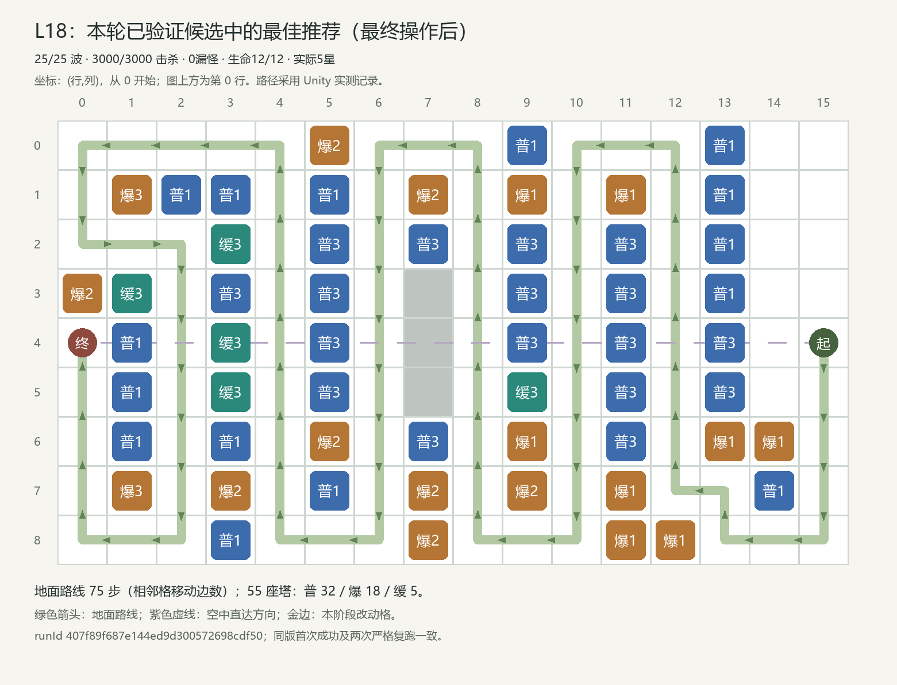

# L18 最佳玩法布局方案与完整逐波操作、测试报告

本方案是本轮已验证候选中的最佳推荐；有限搜索未覆盖全部玩家策略，不声称全局最优。

## 结果摘要

25/25 波 · 3000/3000 击杀 · 0漏怪 · 生命12/12 · 实际5星。实际出生3000、击杀3000、漏怪0、扣血0，终局金币779；模拟战斗1259.24秒，完整关卡1319.74秒。零漏、正常胜利和五星均由当前正式配置的真实回放及唯一评级入口确认。

## 调整依据与方案选择

地图9行×16列，139个普通建造格。S=(行4,列15)，E=(行4,列0)；空中直达几何距离15.000格，减速后的真实飞行结算以事件记录为准。最终合法地面路线75步，55座塔（普通32、群攻18、减速5）；路线来自Unity寻路。 W5:出生72、战斗24.60秒、开战金16。 W15:出生132、战斗51.16秒、开战金47。 W25:出生192、战斗122.02秒、开战金87。

开发阶段的瓶颈与旧参考分析：反向终点附近需要同时预留空路覆盖与地面折返。此前末波追加升级仍有9只地面漏过，其中Boss残血749.5；延路而非继续沿原短线加伤害，把真实地面路线扩展到75步。 混合延路方案3000全杀、55塔、111笔交易且全在准备期；开战87金币、最小交易后余额4。普通延路并末波转换的另一方案也零漏且战斗更快，但需要129笔交易与波中转换；当前以少波中操作优先。 这些文字保留开发候选语境；最终推荐的实际布局、交易和成绩以下方三次正式记录为准。

最终方案按已完成的同封印五星候选比较：优先较少波中交易，再比较总交易数与战斗时间。当前轨迹111笔交易，其中0笔波中交易，战斗1259.24秒；首次与两次严格复跑使用固定时刻和相同顺序。有限候选中的推荐不等于全局最优。

同最终封印的实质替代：[实际完整结果](../raw-trials/final-suite-3/unity-results.json)索引31，runId `2d3ef8644b344ec9aa2f5a239fb69bf2`。与推荐方案有3处最终塔位/等级差异，路线75步，113笔交易，完成25波，漏0、生命12、实际5星、战斗1259.42秒；全部113笔现金前缀已对账。这证明至少两类具体合法投资可通关；替代有漏怪时不称零漏五星。

## 首次成功与两次严格复跑

|记录|runId|封印|波/击杀/漏|生命|金币|战斗秒|星级|
|---|---|---|---|---|---:|---:|---:|
|首次|407f89f687e144ed9d300572698cdf50|0135233bbe9cd3e5595063faf8ef222cfca1c0806565061d900f507fd56db4ce|25/3000/0|12/12|779|1259.239972|5|
|严格复跑1|50fb19fe01424567ba0c481e70050536|0135233bbe9cd3e5595063faf8ef222cfca1c0806565061d900f507fd56db4ce|25/3000/0|12/12|779|1259.239972|5|
|严格复跑2|494b40b4a37b429ba0a9b40eb95f9b81|0135233bbe9cd3e5595063faf8ef222cfca1c0806565061d900f507fd56db4ce|25/3000/0|12/12|779|1259.239972|5|

All wave, enemy outcome, operation affordability, cash, per-wave boundaries, operation stages, routes, final layout and tower contribution fields; runId, screenshot identity and global spawn serial excluded; numeric tolerance 0.00001。全部相同。原始结果和逐项比较分别见 [三次实测](evidence/three-actual-replays.json)、[一致性记录](reproducibility.json)。

## 当前配置与执行范围

初始金币100，初始生命12，25波；Unity 2022.3.62f3c1，MyTowerGame / unityMCP 8082。通过 BalancePlayModeVerifier.StartBatch，在空闲编辑器进入隔离 PlayMode；使用正式导出，无候选配置，无注资、回血、清怪、跳波或改倍率。步长0.02秒，倍速1，严格按实际时机购买，waitForFunds=false。正式存档与原场景由既有隔离机制保护。

版本：`D04|manual-100g-20261022-r2|manual-final-reference-20261022|1884065d28afcf3b33b28765e71d9cd7679c5b19302fcb6e418777767864b951`；封印：`0135233bbe9cd3e5595063faf8ef222cfca1c0806565061d900f507fd56db4ce`；校准状态：`unity_reference_calibrated`；Par=1340000ms。

Par=1340000ms为逐关确定的字面目标；校准依据为开发参考runId `76b94bf570684dcea266b40fc25f38cf` 的1259.24秒，原余量80.76秒。最终推荐实际余量80.76秒，评级由唯一LevelRatingEvaluator真实给出5星；没有修改战斗时钟、开局金或L01门槛。

完整输入和源码指纹：[批次输入清单](../audit/batch-inputs/final-suite-3/input-manifest.json)。运行时加载：[正式封印日志](../audit/runtime-load-final.json)。

## 最终布阵与关键变化

无波中动态改造；各波准备期交易均在下表按真实顺序列出。

### 最终逐塔清单

|坐标(行,列)|塔型等级|最后投资波/时机/序号|实际职责证据|伤害|对空命中|减速次数|重复生效敌人数|
|---|---|---|---|---:|---:|---:|---:|
|(0, 5)|爆2|W25 / 0.00s / #106|地面群攻；阻止捷径16步|11260.77|0|0|54|
|(0, 9)|普1|W8 / 0.00s / #36|地空单体；阻止捷径16步|6844.93|0|0|97|
|(0, 13)|普1|W10 / 0.00s / #47|地空单体；阻止捷径8步|6014.08|0|0|0|
|(1, 1)|爆3|W25 / 0.00s / #108|地面群攻；阻止捷径2步|3614.58|0|0|0|
|(1, 2)|普1|W25 / 0.00s / #94|地空单体；阻止捷径4步|363.76|0|0|2|
|(1, 3)|普1|W25 / 0.00s / #98|地空单体；阻止捷径0步|453.30|0|0|3|
|(1, 5)|普1|W10 / 0.00s / #51|地空单体；阻止捷径14步|1961.23|0|0|14|
|(1, 7)|爆2|W25 / 0.00s / #107|地面群攻；阻止捷径2步|4896.46|0|0|0|
|(1, 9)|爆1|W9 / 0.00s / #38|地面群攻；阻止捷径14步|25745.70|0|0|171|
|(1, 11)|爆1|W9 / 0.00s / #43|地面群攻；阻止捷径2步|27724.64|0|0|0|
|(1, 13)|普1|W10 / 0.00s / #45|地空单体；阻止捷径8步|6260.06|0|0|0|
|(2, 3)|缓3|W12 / 0.00s / #57|缓速覆盖；阻止捷径8步|0.00|0|3037|38|
|(2, 5)|普3|W21 / 0.00s / #88|地空单体；阻止捷径12步|4086.29|4|0|11|
|(2, 7)|普3|W20 / 0.00s / #83|地空单体；阻止捷径4步|7269.97|99|0|0|
|(2, 9)|普3|W22 / 0.00s / #90|地空单体；阻止捷径12步|10607.03|101|0|41|
|(2, 11)|普3|W19 / 0.00s / #79|地空单体；阻止捷径4步|14315.68|408|0|16|
|(2, 13)|普1|W10 / 0.00s / #48|地空单体；阻止捷径8步|6591.86|0|0|0|
|(3, 0)|爆2|W25 / 0.00s / #102|地面群攻；阻止捷径12步|1674.58|0|0|8|
|(3, 1)|缓3|W13 / 0.00s / #59|缓速覆盖；阻止捷径0步|0.00|0|1056|0|
|(3, 3)|普3|W20 / 0.00s / #82|地空单体；阻止捷径10步|1461.14|1|0|6|
|(3, 5)|普3|W17 / 0.00s / #73|地空单体；阻止捷径10步|4256.12|57|0|7|
|(3, 9)|普3|W18 / 0.00s / #75|地空单体；阻止捷径10步|14457.15|453|0|17|
|(3, 11)|普3|W17 / 0.00s / #71|地空单体；阻止捷径6步|18774.55|1059|0|3|
|(3, 13)|普1|W5 / 0.00s / #16|地空单体；阻止捷径8步|10574.21|1132|0|4|
|(4, 1)|普1|W9 / 0.00s / #40|地空单体；阻止捷径8步|205.56|0|0|0|
|(4, 3)|缓3|W8 / 0.00s / #33|缓速覆盖；阻止捷径12步|0.00|0|2544|33|
|(4, 5)|普3|W15 / 0.00s / #66|地空单体；阻止捷径8步|4061.99|83|0|5|
|(4, 9)|普3|W16 / 0.00s / #69|地空单体；阻止捷径8步|17013.77|589|0|9|
|(4, 11)|普3|W15 / 0.00s / #65|地空单体；阻止捷径8步|21861.73|1132|0|1|
|(4, 13)|普3|W20 / 0.00s / #84|地空单体；阻止捷径8步|20000.81|1221|0|2|
|(5, 1)|普1|W3 / 0.00s / #8|地空单体；阻止捷径6步|170.94|0|0|0|
|(5, 3)|缓3|W13 / 0.00s / #60|缓速覆盖；阻止捷径14步|0.00|0|2493|19|
|(5, 5)|普3|W14 / 0.00s / #62|地空单体；阻止捷径6步|3327.52|56|0|3|
|(5, 9)|缓3|W11 / 0.00s / #55|缓速覆盖；阻止捷径6步|0.00|0|43070|714|
|(5, 11)|普3|W16 / 0.00s / #68|地空单体；阻止捷径10步|19623.62|999|0|2|
|(5, 13)|普3|W18 / 0.00s / #77|地空单体；阻止捷径6步|16793.23|1043|0|0|
|(6, 1)|普1|W5 / 0.00s / #18|地空单体；阻止捷径4步|142.78|0|0|1|
|(6, 3)|普1|W6 / 0.00s / #21|地空单体；阻止捷径16步|694.37|0|0|5|
|(6, 5)|爆2|W25 / 0.00s / #104|地面群攻；阻止捷径4步|6507.37|0|0|5|
|(6, 7)|普3|W21 / 0.00s / #86|地空单体；阻止捷径12步|7675.86|61|0|12|
|(6, 9)|爆1|W2 / 0.00s / #4|地面群攻；阻止捷径4步|22732.51|0|0|36|
|(6, 11)|普3|W22 / 0.00s / #92|地空单体；阻止捷径12步|13957.32|263|0|67|
|(6, 13)|爆1|W4 / 0.00s / #14|地面群攻；阻止捷径0步|36441.77|0|0|0|
|(6, 14)|爆1|W5 / 0.00s / #17|地面群攻；阻止捷径0步|44134.63|0|0|395|
|(7, 1)|爆3|W25 / 0.00s / #105|地面群攻；阻止捷径2步|391.22|0|0|0|
|(7, 3)|爆2|W25 / 0.00s / #103|地面群攻；阻止捷径18步|5693.68|0|0|5|
|(7, 5)|普1|W25 / 0.00s / #96|地空单体；阻止捷径2步|548.68|0|0|0|
|(7, 7)|爆2|W25 / 0.00s / #110|地面群攻；阻止捷径14步|19570.04|0|0|61|
|(7, 9)|爆2|W25 / 0.00s / #111|地面群攻；阻止捷径2步|24380.30|0|0|0|
|(7, 11)|爆1|W7 / 0.00s / #29|地面群攻；阻止捷径14步|37851.09|0|0|205|
|(7, 14)|普1|W8 / 0.00s / #35|地空单体；阻止捷径2步|8380.26|0|0|0|
|(8, 3)|普1|W8 / 0.00s / #34|地空单体；阻止捷径20步|594.88|0|0|1|
|(8, 7)|爆2|W25 / 0.00s / #109|地面群攻；阻止捷径16步|21690.52|0|0|74|
|(8, 11)|爆1|W9 / 0.00s / #41|地面群攻；阻止捷径0步|40833.49|0|0|225|
|(8, 12)|爆1|W25 / 0.00s / #99|地面群攻；阻止捷径0步|2481.12|0|0|0|

## W1—W25 完整操作

“波前”指该波启动前的准备/结算阶段；波中时刻从该波 combatStartSeconds 起算。相同时刻的交易必须保持编号顺序。

|波|实际时机|序号/动作|坐标|等级变化|支出/退款|操作后余额|
|---:|---|---|---|---|---:|---:|
|1|波前|#1 建造|(4,9)|空格 → 普1|支出32|68|
|1|波前|#2 建造|(4,5)|空格 → 普1|支出32|36|
|1|波前|#3 建造|(4,11)|空格 → 普1|支出32|4|
|2|波前|#4 建造|(6,9)|空格 → 爆1|支出44|84|
|2|波前|#5 建造|(4,3)|空格 → 缓1|支出30|54|
|2|波前|#6 建造|(4,13)|空格 → 普1|支出32|22|
|3|波前|#7 建造|(6,5)|空格 → 爆1|支出44|124|
|3|波前|#8 建造|(5,1)|空格 → 普1|支出32|92|
|3|波前|#9 建造|(7,7)|空格 → 爆1|支出44|48|
|3|波前|#10 建造|(3,3)|空格 → 普1|支出32|16|
|4|波前|#11 建造|(3,9)|空格 → 普1|支出32|150|
|4|波前|#12 建造|(3,5)|空格 → 普1|支出32|118|
|4|波前|#13 建造|(3,11)|空格 → 普1|支出32|86|
|4|波前|#14 建造|(6,13)|空格 → 爆1|支出44|42|
|4|波前|#15 建造|(3,1)|空格 → 缓1|支出30|12|
|5|波前|#16 建造|(3,13)|空格 → 普1|支出32|168|
|5|波前|#17 建造|(6,14)|空格 → 爆1|支出44|124|
|5|波前|#18 建造|(6,1)|空格 → 普1|支出32|92|
|5|波前|#19 建造|(7,9)|空格 → 爆1|支出44|48|
|5|波前|#20 建造|(6,11)|空格 → 普1|支出32|16|
|6|波前|#21 建造|(6,3)|空格 → 普1|支出32|244|
|6|波前|#22 建造|(2,7)|空格 → 普1|支出32|212|
|6|波前|#23 建造|(5,5)|空格 → 普1|支出32|180|
|6|波前|#24 建造|(7,3)|空格 → 爆1|支出44|136|
|6|波前|#25 建造|(2,3)|空格 → 缓1|支出30|106|
|6|波前|#26 建造|(2,11)|空格 → 普1|支出32|74|
|6|波前|#27 建造|(8,7)|空格 → 爆1|支出44|30|
|7|波前|#28 建造|(2,9)|空格 → 普1|支出32|254|
|7|波前|#29 建造|(7,11)|空格 → 爆1|支出44|210|
|7|波前|#30 建造|(2,5)|空格 → 普1|支出32|178|
|7|波前|#31 升级|(4,3)|缓1 → 缓2|支出85|93|
|7|波前|#32 升级|(3,1)|缓1 → 缓2|支出85|8|
|8|波前|#33 升级|(4,3)|缓2 → 缓3|支出170|122|
|8|波前|#34 建造|(8,3)|空格 → 普1|支出32|90|
|8|波前|#35 建造|(7,14)|空格 → 普1|支出32|58|
|8|波前|#36 建造|(0,9)|空格 → 普1|支出32|26|
|9|波前|#37 升级|(4,13)|普1 → 普2|支出90|256|
|9|波前|#38 建造|(1,9)|空格 → 爆1|支出44|212|
|9|波前|#39 建造|(5,9)|空格 → 缓1|支出30|182|
|9|波前|#40 建造|(4,1)|空格 → 普1|支出32|150|
|9|波前|#41 建造|(8,11)|空格 → 爆1|支出44|106|
|9|波前|#42 建造|(5,11)|空格 → 普1|支出32|74|
|9|波前|#43 建造|(1,11)|空格 → 爆1|支出44|30|
|10|波前|#44 建造|(5,13)|空格 → 普1|支出32|312|
|10|波前|#45 建造|(1,13)|空格 → 普1|支出32|280|
|10|波前|#46 升级|(5,9)|缓1 → 缓2|支出85|195|
|10|波前|#47 建造|(0,13)|空格 → 普1|支出32|163|
|10|波前|#48 建造|(2,13)|空格 → 普1|支出32|131|
|10|波前|#49 建造|(1,1)|空格 → 爆1|支出44|87|
|10|波前|#50 建造|(5,3)|空格 → 缓1|支出30|57|
|10|波前|#51 建造|(1,5)|空格 → 普1|支出32|25|
|11|波前|#52 建造|(0,5)|空格 → 爆1|支出44|321|
|11|波前|#53 建造|(6,7)|空格 → 普1|支出32|289|
|11|波前|#54 升级|(2,3)|缓1 → 缓2|支出85|204|
|11|波前|#55 升级|(5,9)|缓2 → 缓3|支出170|34|
|12|波前|#56 升级|(5,3)|缓1 → 缓2|支出85|319|
|12|波前|#57 升级|(2,3)|缓2 → 缓3|支出170|149|
|12|波前|#58 升级|(5,5)|普1 → 普2|支出90|59|
|13|波前|#59 升级|(3,1)|缓2 → 缓3|支出170|265|
|13|波前|#60 升级|(5,3)|缓2 → 缓3|支出170|95|
|13|波前|#61 升级|(4,11)|普1 → 普2|支出90|5|
|14|波前|#62 升级|(5,5)|普2 → 普3|支出180|241|
|14|波前|#63 升级|(4,5)|普1 → 普2|支出90|151|
|14|波前|#64 升级|(4,9)|普1 → 普2|支出90|61|
|15|波前|#65 升级|(4,11)|普2 → 普3|支出180|317|
|15|波前|#66 升级|(4,5)|普2 → 普3|支出180|137|
|15|波前|#67 升级|(5,11)|普1 → 普2|支出90|47|
|16|波前|#68 升级|(5,11)|普2 → 普3|支出180|352|
|16|波前|#69 升级|(4,9)|普2 → 普3|支出180|172|
|16|波前|#70 升级|(3,11)|普1 → 普2|支出90|82|
|17|波前|#71 升级|(3,11)|普2 → 普3|支出180|360|
|17|波前|#72 升级|(3,5)|普1 → 普2|支出90|270|
|17|波前|#73 升级|(3,5)|普2 → 普3|支出180|90|
|18|波前|#74 升级|(3,9)|普1 → 普2|支出90|486|
|18|波前|#75 升级|(3,9)|普2 → 普3|支出180|306|
|18|波前|#76 升级|(5,13)|普1 → 普2|支出90|216|
|18|波前|#77 升级|(5,13)|普2 → 普3|支出180|36|
|19|波前|#78 升级|(2,11)|普1 → 普2|支出90|442|
|19|波前|#79 升级|(2,11)|普2 → 普3|支出180|262|
|19|波前|#80 升级|(2,7)|普1 → 普2|支出90|172|
|19|波前|#81 升级|(3,3)|普1 → 普2|支出90|82|
|20|波前|#82 升级|(3,3)|普2 → 普3|支出180|402|
|20|波前|#83 升级|(2,7)|普2 → 普3|支出180|222|
|20|波前|#84 升级|(4,13)|普2 → 普3|支出180|42|
|21|波前|#85 升级|(6,7)|普1 → 普2|支出90|511|
|21|波前|#86 升级|(6,7)|普2 → 普3|支出180|331|
|21|波前|#87 升级|(2,5)|普1 → 普2|支出90|241|
|21|波前|#88 升级|(2,5)|普2 → 普3|支出180|61|
|22|波前|#89 升级|(2,9)|普1 → 普2|支出90|521|
|22|波前|#90 升级|(2,9)|普2 → 普3|支出180|341|
|22|波前|#91 升级|(6,11)|普1 → 普2|支出90|251|
|22|波前|#92 升级|(6,11)|普2 → 普3|支出180|71|
|23|—|无|—|—|0|—|
|24|—|无|—|—|0|—|
|25|波前|#93 建造|(3,0)|空格 → 爆1|支出44|1835|
|25|波前|#94 建造|(1,2)|空格 → 普1|支出32|1803|
|25|波前|#95 建造|(7,1)|空格 → 爆1|支出44|1759|
|25|波前|#96 建造|(7,5)|空格 → 普1|支出32|1727|
|25|波前|#97 建造|(1,7)|空格 → 爆1|支出44|1683|
|25|波前|#98 建造|(1,3)|空格 → 普1|支出32|1651|
|25|波前|#99 建造|(8,12)|空格 → 爆1|支出44|1607|
|25|波前|#100 升级|(7,1)|爆1 → 爆2|支出110|1497|
|25|波前|#101 升级|(1,1)|爆1 → 爆2|支出110|1387|
|25|波前|#102 升级|(3,0)|爆1 → 爆2|支出110|1277|
|25|波前|#103 升级|(7,3)|爆1 → 爆2|支出110|1167|
|25|波前|#104 升级|(6,5)|爆1 → 爆2|支出110|1057|
|25|波前|#105 升级|(7,1)|爆2 → 爆3|支出210|847|
|25|波前|#106 升级|(0,5)|爆1 → 爆2|支出110|737|
|25|波前|#107 升级|(1,7)|爆1 → 爆2|支出110|627|
|25|波前|#108 升级|(1,1)|爆2 → 爆3|支出210|417|
|25|波前|#109 升级|(8,7)|爆1 → 爆2|支出110|307|
|25|波前|#110 升级|(7,7)|爆1 → 爆2|支出110|197|
|25|波前|#111 升级|(7,9)|爆1 → 爆2|支出110|87|

## 逐波结果与现金流

波前金是上一波结束余额；开战金已经扣除本波准备期操作。波中击杀金只在对应敌人实际结算后可用。

|波|波前金|开战金|击杀金|清波金|建造|升级|退款|清波结余|生/杀/漏|扣血/生命|战斗秒|峰值/暂缓|
|---:|---:|---:|---:|---:|---:|---:|---:|---:|---|---|---:|---|
|1|100|4|96|28|96|0|0|128|48/48/0|0 / 12|26.92|28 / 0|
|2|128|22|108|38|106|0|0|168|54/54/0|0 / 12|20.92|18 / 0|
|3|168|16|120|46|152|0|0|182|60/60/0|0 / 12|21.48|21 / 0|
|4|182|12|132|56|170|0|0|200|66/66/0|0 / 12|26.08|11 / 0|
|5|200|16|212|48|184|0|0|276|72/72/0|0 / 12|24.60|16 / 0|
|6|276|30|216|40|246|0|0|286|78/78/0|0 / 12|30.42|11 / 0|
|7|286|8|230|54|108|170|0|292|84/84/0|0 / 12|27.42|16 / 0|
|8|292|26|246|74|96|170|0|346|90/90/0|0 / 12|22.44|45 / 0|
|9|346|30|262|52|226|90|0|344|96/96/0|0 / 12|38.16|37 / 0|
|10|344|25|280|60|234|85|0|365|102/102/0|0 / 12|36.06|36 / 0|
|11|365|34|316|54|76|255|0|404|108/108/0|0 / 12|39.14|33 / 0|
|12|404|59|334|42|0|345|0|435|114/114/0|0 / 12|46.86|26 / 0|
|13|435|5|354|62|0|430|0|421|120/120/0|0 / 12|41.46|37 / 0|
|14|421|61|368|68|0|360|0|497|126/126/0|0 / 12|41.98|51 / 0|
|15|497|47|395|90|0|450|0|532|132/132/0|0 / 12|51.16|82 / 0|
|16|532|82|402|56|0|450|0|540|138/138/0|0 / 12|55.72|61 / 0|
|17|540|90|422|64|0|450|0|576|144/144/0|0 / 12|55.10|67 / 0|
|18|576|36|438|58|0|540|0|532|150/150/0|0 / 12|57.80|64 / 0|
|19|532|82|456|44|0|450|0|582|156/156/0|0 / 12|68.58|50 / 0|
|20|582|42|483|76|0|540|0|601|162/162/0|0 / 12|79.70|102 / 0|
|21|601|61|490|60|0|540|0|611|168/168/0|0 / 12|79.46|96 / 0|
|22|611|71|510|100|0|540|0|681|174/174/0|0 / 12|73.66|118 / 0|
|23|681|681|526|62|0|0|0|1269|180/180/0|0 / 12|81.00|95 / 0|
|24|1269|1269|544|66|0|0|0|1879|186/186/0|0 / 12|91.10|83 / 0|
|25|1879|87|588|104|272|1520|0|779|192/192/0|0 / 12|122.02|134 / 0|

逐关复核目标：W5开战0～35金，W25开战55～125金。反向终点保留低价延路与缓速资金，不能把大额准备前存款误认为准备后结余。 当前实测W5开战16，W25准备前1879、开战87、结算779；最小交易后余额4。区间以开发观察为基础确定，属于复核目标，不冒充事前预测。普通/对空首次升级成本90，原轨迹在W2 15.22s（现金阈值首次达到）首次观察到前置等级已存在且现金足够；实际在W9 0.00s升级。 群攻首次升级成本110，原轨迹在W25 0.00s（现金阈值首次达到）首次观察到前置等级已存在且现金足够；实际在W25 0.00s升级。 减速首次升级成本85，原轨迹在W2 14.14s（现金阈值首次达到）首次观察到前置等级已存在且现金足够；实际在W7 0.00s升级。 该阈值只说明原轨迹上现金和前置塔等级，不证明提前购买后其他施工仍可完成；更早投资需要另一条真实回放。替代与对照可能保留更多现金，不能仅凭终局金币证明紧凑或宽松。

关键升级现金阈值还覆盖各类型首次到达三级以及全部波中升级，完整观测见[关键升级可负担阈值](evidence/upgrade-cash-thresholds.json)。

|操作|坐标(行,列)|目标塔/级|实际升级|首次前置等级与现金足够|成本/当时现金|
|---:|---|---|---|---|---:|
|#37|(4,13)|普通2|W9 0.00s|W2 15.22s，现金阈值首次达到|90 / 90|
|#62|(5,5)|普通3|W14 0.00s|W12 22.70s，现金阈值首次达到|180 / 181|
|#100|(7,1)|群攻2|W25 0.00s|W25 0.00s，现金阈值首次达到|110 / 1759|
|#105|(7,1)|群攻3|W25 0.00s|W25 0.00s，现金阈值首次达到|210 / 1497|
|#31|(4,3)|减速2|W7 0.00s|W2 14.14s，现金阈值首次达到|85 / 86|
|#33|(4,3)|减速3|W8 0.00s|W7 21.16s，现金阈值首次达到|170 / 170|

## 搜索范围与全部对照

本关已归档23次真实试验，按批次为：campaign-r1-L13-L30-and-refinements 6次、comparisons-r4-u 3次、final-suite-3 7次、followups-r2-h 5次、references-r2-a 1次、targeted-r2-d 1次。全部实际候选含失败、非法、取消或超时，见候选索引；这些状态不计为成功。搜索包括折返/短路、三塔配比、升级顺序、一次合法出售改造和实测资金再投资，未穷举无限塔位/逐帧操作空间。当前封印另有保留几何改变减速配资、地面专用火力、减少稳定路墙三类对照；早期normal/power分别只买最多8塔，mistake只买1塔，只是受限投资对照，不能代表全部玩家。 `final-control-ground-only-L18`：4波、漏12、生命0、0星、状态operation_incomplete、未完成操作91（[原始](../raw-trials/final-suite-3/unity-results.json)索引32）；`final-control-slow-allocation-L18`：24波、漏12、生命0、0星、状态finished、未完成操作0（[原始](../raw-trials/final-suite-3/unity-results.json)索引33）；`final-control-fewer-walls-L18`：8波、漏12、生命0、0星、状态operation_incomplete、未完成操作67（[原始](../raw-trials/final-suite-3/unity-results.json)索引34） 三类对照按本批最初参考的坐标与投资构造，原参考来源是 raw-trials/followups-r2-h/unity-results.json 索引95；若比较后改选其他候选为主推荐，此处保留这些对照的实际原参照对象。 减少路墙对照实际删除6处稳定1级塔位：[[0, 9], [1, 5], [1, 9], [6, 3], [7, 11], [8, 3]]。 本关减速配资对照的实际请求规则：将原减速建造替换为普通1并省去减速升级，保留差额现金。

|批次/策略|波数|漏怪|生命|星|状态|操作数|原始结果|
|---|---:|---:|---:|---:|---|---:|---|
|campaign-r1-L13-L30-and-refinements / campaign-r1-greedy-mixed|21|10|0|0|operation_incomplete|86|[结果](../raw-trials/campaign-r1-L13-L30-and-refinements/unity-results.json)|
|campaign-r1-L13-L30-and-refinements / campaign-r1-air-upgrades|14|12|0|0|finished|52|[结果](../raw-trials/campaign-r1-L13-L30-and-refinements/unity-results.json)|
|campaign-r1-L13-L30-and-refinements / campaign-r1-folded-maze|14|12|0|0|operation_incomplete|67|[结果](../raw-trials/campaign-r1-L13-L30-and-refinements/unity-results.json)|
|campaign-r1-L13-L30-and-refinements / normal|7|12|0|0|finished|18|[结果](../raw-trials/campaign-r1-L13-L30-and-refinements/unity-results.json)|
|campaign-r1-L13-L30-and-refinements / power|7|12|0|0|finished|18|[结果](../raw-trials/campaign-r1-L13-L30-and-refinements/unity-results.json)|
|campaign-r1-L13-L30-and-refinements / mistake|0|12|0|0|finished|1|[结果](../raw-trials/campaign-r1-L13-L30-and-refinements/unity-results.json)|
|references-r2-a / r2-preserved-folded-maze|24|12|0|0|finished|92|[结果](../raw-trials/references-r2-a/unity-results.json)|
|targeted-r2-d / targeted-r2-d-preparation-group-investment|24|9|0|0|finished|104|[结果](../raw-trials/targeted-r2-d/unity-results.json)|
|followups-r2-h / normal|7|12|0|0|finished|18|[结果](../raw-trials/followups-r2-h/unity-results.json)|
|followups-r2-h / power|7|12|0|0|finished|18|[结果](../raw-trials/followups-r2-h/unity-results.json)|
|followups-r2-h / mistake|0|12|0|0|finished|1|[结果](../raw-trials/followups-r2-h/unity-results.json)|
|followups-r2-h / route-r2-g-mixed-route-retain-air|25|0|12|3|finished|111|[结果](../raw-trials/followups-r2-h/unity-results.json)|
|followups-r2-h / route-r2-g-ordinary-route-late6|25|0|12|3|finished|129|[结果](../raw-trials/followups-r2-h/unity-results.json)|
|comparisons-r4-u / comparisons-r4-u-alternatives-r2-m-32|25|0|12|5|finished|112|[结果](../raw-trials/comparisons-r4-u/unity-results.json)|
|comparisons-r4-u / comparisons-r4-u-alternatives-r2-m-33|25|0|12|5|finished|113|[结果](../raw-trials/comparisons-r4-u/unity-results.json)|
|comparisons-r4-u / comparisons-r4-u-no-slow-same-geometry|24|12|0|0|finished|101|[结果](../raw-trials/comparisons-r4-u/unity-results.json)|
|final-suite-3 / final-reference-L18-0|25|0|12|5|finished|111|[结果](../raw-trials/final-suite-3/unity-results.json)|
|final-suite-3 / final-reference-L18-1|25|0|12|5|finished|111|[结果](../raw-trials/final-suite-3/unity-results.json)|
|final-suite-3 / final-reference-L18-2|25|0|12|5|finished|111|[结果](../raw-trials/final-suite-3/unity-results.json)|
|final-suite-3 / final-alternative-L18|25|0|12|5|finished|113|[结果](../raw-trials/final-suite-3/unity-results.json)|
|final-suite-3 / final-control-ground-only-L18|4|12|0|0|operation_incomplete|20|[结果](../raw-trials/final-suite-3/unity-results.json)|
|final-suite-3 / final-control-slow-allocation-L18|24|12|0|0|finished|101|[结果](../raw-trials/final-suite-3/unity-results.json)|
|final-suite-3 / final-control-fewer-walls-L18|8|12|0|0|operation_incomplete|38|[结果](../raw-trials/final-suite-3/unity-results.json)|

开发候选和失败保留原始封印与版本；本报告最终五星结论只引用上方同版三次严格回放。完整索引：[JSON](trial-index.json)、[CSV](trial-index.csv)。

## 总账与证据完整性

`100 + 实际击杀8528 + 清波1502 + 出售退款0 − 建造1966 − 升级7385 = 779`。实际结算事件共3000条，已核对全部111个操作前缀，最低操作后余额4。所有逐波与逐笔余额均一致，无负余额。

[独立事件对账和现金流](evidence/cashflow-and-prefixes.json) · [完整实际操作](best-operations.json) · [可回放操作](evidence/replay-operations.json) · [最佳完整结果](best-result.json)

## 操作可执行性与限制

本方案没有波中交易，全部建造与升级在各波准备阶段按编号完成。 已认证的是这些离散时刻与顺序；没有把最后空中结算和本次操作之间的间隔冒充连续安全窗口。

验证为Unity2022.3.62f3c1编辑器内0.02秒固定步长、真实GameClock、正式数据与正常现金的隔离PlayMode。未验证Android实际帧率、手动鼠标/触控照做或连续时机容错范围。暂停与建造输入路径已有静态代码边界记录，未做人工暂停交易认证。不能从同一模拟时刻脚本顺序执行推断玩家无需暂停就能完成集中交易。

固定步长脚本运行成功不等于已验证手动触控。相同时刻多笔交易按列表顺序执行，期间模拟不推进；人工是否可利用当前暂停交互完成这些操作，仍应按已验证的操作范围理解，不能由脚本结果推断。

## 原始证据与配置明细

[全部25波正式变体、顺序及源位置](设计与725波明细.md) · [首轮及两次复跑](evidence/three-actual-replays.json) · [正式配置审计](../audit/formal-integrity-final.json) · [30关总索引](../README.md)

- [W1实际截图](evidence/screenshots/run28-D04-L18-wave1.png)
- [W10实际截图](evidence/screenshots/run28-D04-L18-wave10.png)
- [W25实际截图](evidence/screenshots/run28-D04-L18-wave25.png)
