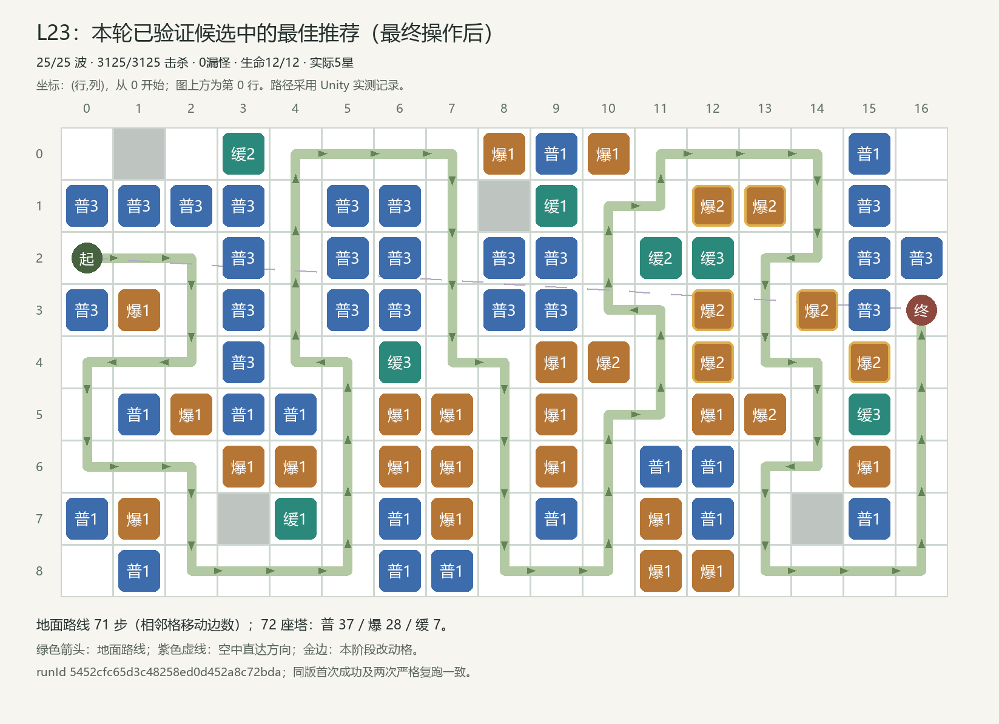
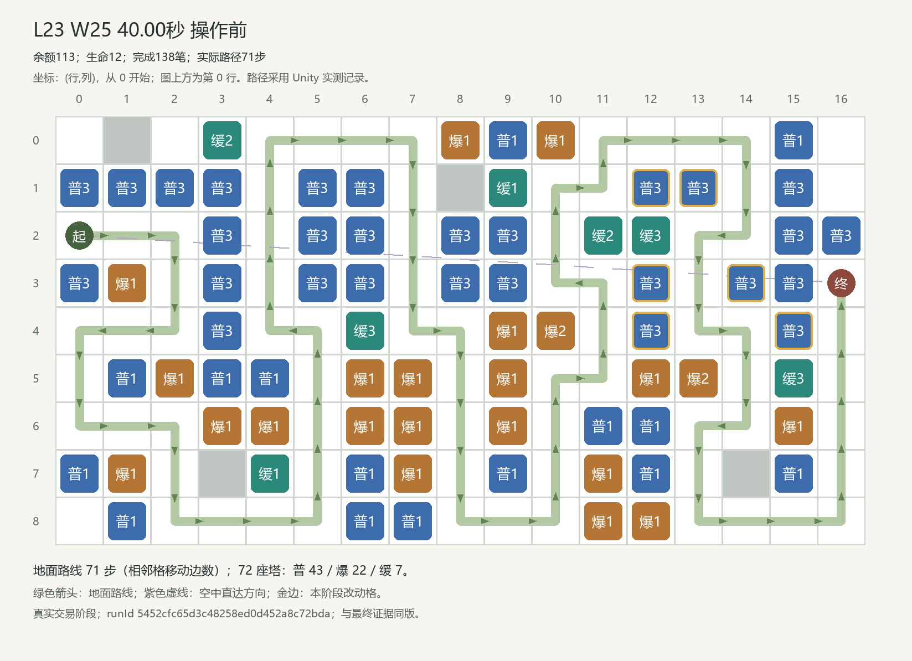
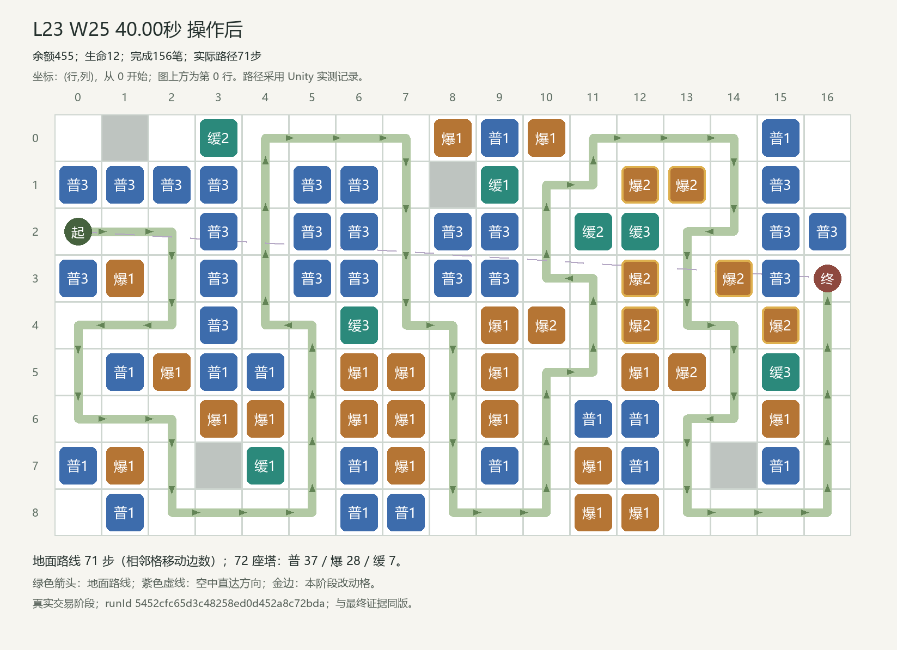

# L23 最佳玩法布局方案与完整逐波操作、测试报告

本方案是本轮已验证候选中的最佳推荐；有限搜索未覆盖全部玩家策略，不声称全局最优。

## 结果摘要

25/25 波 · 3125/3125 击杀 · 0漏怪 · 生命12/12 · 实际5星。实际出生3125、击杀3125、漏怪0、扣血0，终局金币1212；模拟战斗1371.72秒，完整关卡1432.22秒。零漏、正常胜利和五星均由当前正式配置的真实回放及唯一评级入口确认。

## 调整依据与方案选择

地图9行×17列，147个普通建造格。S=(行2,列0)，E=(行3,列16)；空中直达几何距离16.031格，减速后的真实飞行结算以事件记录为准。最终合法地面路线71步，72座塔（普通37、群攻28、减速7）；路线来自Unity寻路。 W5:出生77、战斗34.02秒、开战金30。 W15:出生137、战斗53.28秒、开战金34。 W25:出生197、战斗124.04秒、开战金44。

开发阶段的瓶颈与旧参考分析：本关r2的group72已守住所有空袭，但末波仍漏9只地面怪；保留原折返墙与普通塔覆盖，待37.82秒最后空中结算后再重分配防空投资。另一种旧折返布局末波仍有空漏，不能把两者视为等价。 40秒六处同格出售、建造与升级取得3125全杀，所有18笔交易保持先退款、再建造、再升级的顺序。40秒三次升级仅缩小到一只Boss漏过，未达到零漏。当前推荐六处改造是两种已测试投入之间的选择，不把1212终局金币冒充波前预算。 这些文字保留开发候选语境；最终推荐的实际布局、交易和成绩以下方三次正式记录为准。

最终方案按已完成的同封印五星候选比较：优先较少波中交易，再比较总交易数与战斗时间。当前轨迹156笔交易，其中18笔波中交易，战斗1371.72秒；首次与两次严格复跑使用固定时刻和相同顺序。有限候选中的推荐不等于全局最优。

同最终封印的实质替代：[实际完整结果](../raw-trials/final-suite-4/unity-results.json)索引24，runId `ca6d9191f4dc4cd489779f8ef437d66d`。与推荐方案有3处最终塔位/等级差异，路线71步，158笔交易，完成25波，漏0、生命12、实际5星、战斗1371.54秒；全部158笔现金前缀已对账。这证明至少两类具体合法投资可通关；替代有漏怪时不称零漏五星。

## 首次成功与两次严格复跑

|记录|runId|封印|波/击杀/漏|生命|金币|战斗秒|星级|
|---|---|---|---|---|---:|---:|---:|
|首次|5452cfc65d3c48258ed0d452a8c72bda|0135233bbe9cd3e5595063faf8ef222cfca1c0806565061d900f507fd56db4ce|25/3125/0|12/12|1212|1371.719969|5|
|严格复跑1|a4a6caab5b2544c3aa2395392985faf6|0135233bbe9cd3e5595063faf8ef222cfca1c0806565061d900f507fd56db4ce|25/3125/0|12/12|1212|1371.719969|5|
|严格复跑2|332428f6777841b39b8b9b43f1251174|0135233bbe9cd3e5595063faf8ef222cfca1c0806565061d900f507fd56db4ce|25/3125/0|12/12|1212|1371.719969|5|

All wave, enemy outcome, operation affordability, cash, per-wave boundaries, operation stages, routes, final layout and tower contribution fields; runId, screenshot identity and global spawn serial excluded; numeric tolerance 0.00001。全部相同。原始结果和逐项比较分别见 [三次实测](evidence/three-actual-replays.json)、[一致性记录](reproducibility.json)。

## 当前配置与执行范围

初始金币100，初始生命12，25波；Unity 2022.3.62f3c1，MyTowerGame / unityMCP 8082。通过 BalancePlayModeVerifier.StartBatch，在空闲编辑器进入隔离 PlayMode；使用正式导出，无候选配置，无注资、回血、清怪、跳波或改倍率。步长0.02秒，倍速1，严格按实际时机购买，waitForFunds=false。正式存档与原场景由既有隔离机制保护。

版本：`D04|manual-100g-20261022-r2|manual-final-reference-20261022|94c40a90d02812f22909a2990708f85c22fc132ab1c569d28bc055d60dd94bfd`；封印：`0135233bbe9cd3e5595063faf8ef222cfca1c0806565061d900f507fd56db4ce`；校准状态：`unity_reference_calibrated`；Par=1490000ms。

Par=1490000ms为逐关确定的字面目标；校准依据为开发参考runId `322ebd35b9864779a9403e84bc0195dd` 的1371.72秒，原余量118.28秒。最终推荐实际余量118.28秒，评级由唯一LevelRatingEvaluator真实给出5星；没有修改战斗时钟、开局金或L01门槛。

完整输入和源码指纹：[批次输入清单](../audit/batch-inputs/final-suite-4/input-manifest.json)。运行时加载：[正式封印日志](../audit/runtime-load-final.json)。

## 最终布阵与关键变化

### L23 W25 40.00秒 操作前

### L23 W25 40.00秒 操作后

[真实Unity截图](evidence/screenshots/run21-L23-wave25-at40000-op156.png)

### 最终逐塔清单

|坐标(行,列)|塔型等级|最后投资波/时机/序号|实际职责证据|伤害|对空命中|减速次数|重复生效敌人数|
|---|---|---|---|---:|---:|---:|---:|
|(0, 3)|缓2|W10 / 0.00s / #49|缓速覆盖；阻止捷径0步|0.00|0|18108|808|
|(0, 8)|爆1|W15 / 0.00s / #87|地面群攻；阻止捷径0步|15568.37|0|0|0|
|(0, 9)|普1|W8 / 0.00s / #42|地空单体；阻止捷径0步|404.28|0|0|3|
|(0, 10)|爆1|W14 / 0.00s / #72|地面群攻；阻止捷径0步|1522.31|0|0|0|
|(0, 15)|普1|W9 / 0.00s / #45|地空单体；阻止捷径0步|347.55|0|0|0|
|(1, 0)|普3|W25 / 0.00s / #138|地空单体；阻止捷径0步|7409.96|797|0|0|
|(1, 1)|普3|W24 / 0.00s / #130|地空单体；阻止捷径0步|9128.72|847|0|0|
|(1, 2)|普3|W21 / 0.00s / #114|地空单体；阻止捷径0步|14728.84|892|0|0|
|(1, 3)|普3|W22 / 0.00s / #119|地空单体；阻止捷径0步|16858.68|1257|0|2|
|(1, 5)|普3|W12 / 0.00s / #57|地空单体；阻止捷径0步|21863.32|1001|0|7|
|(1, 6)|普3|W22 / 0.00s / #121|地空单体；阻止捷径0步|10118.73|266|0|6|
|(1, 9)|缓1|W13 / 0.00s / #70|缓速覆盖；阻止捷径0步|0.00|0|5856|51|
|(1, 12)|爆2|W25 / 40.00s / #154|地面群攻；阻止捷径0步|2901.95|0|0|19|
|(1, 13)|爆2|W25 / 40.00s / #152|地面群攻；阻止捷径2步|2647.35|0|0|0|
|(1, 15)|普3|W24 / 0.00s / #132|地空单体；阻止捷径0步|907.35|0|0|0|
|(2, 3)|普3|W20 / 0.00s / #109|地空单体；阻止捷径18步|19952.19|1206|0|2|
|(2, 5)|普3|W16 / 0.00s / #95|地空单体；阻止捷径0步|18789.38|849|0|0|
|(2, 6)|普3|W11 / 0.00s / #52|地空单体；阻止捷径0步|19183.22|650|0|10|
|(2, 8)|普3|W17 / 0.00s / #98|地空单体；阻止捷径0步|8778.82|61|0|2|
|(2, 9)|普3|W19 / 0.00s / #106|地空单体；阻止捷径0步|8346.82|42|0|14|
|(2, 11)|缓2|W25 / 0.00s / #137|缓速覆盖；阻止捷径2步|0.00|0|2359|17|
|(2, 12)|缓3|W10 / 0.00s / #48|缓速覆盖；阻止捷径0步|0.00|0|3403|36|
|(2, 15)|普3|W23 / 0.00s / #123|地空单体；阻止捷径0步|818.90|0|0|0|
|(2, 16)|普3|W25 / 0.00s / #133|地空单体；阻止捷径0步|597.86|0|0|0|
|(3, 0)|普3|W24 / 0.00s / #128|地空单体；阻止捷径4步|10120.89|828|0|0|
|(3, 1)|爆1|W13 / 0.00s / #64|地面群攻；阻止捷径2步|35361.57|0|0|0|
|(3, 3)|普3|W17 / 0.00s / #99|地空单体；阻止捷径16步|23392.39|1314|0|0|
|(3, 5)|普3|W19 / 0.00s / #107|地空单体；阻止捷径0步|17110.17|768|0|7|
|(3, 6)|普3|W11 / 0.00s / #54|地空单体；阻止捷径0步|21331.06|584|0|27|
|(3, 8)|普3|W18 / 0.00s / #102|地空单体；阻止捷径0步|8329.29|57|0|1|
|(3, 9)|普3|W12 / 0.00s / #56|地空单体；阻止捷径0步|7989.04|40|0|5|
|(3, 12)|爆2|W25 / 40.00s / #155|地面群攻；阻止捷径10步|5123.06|0|0|12|
|(3, 14)|爆2|W25 / 40.00s / #151|地面群攻；阻止捷径2步|1585.65|0|0|0|
|(3, 15)|普3|W21 / 0.00s / #115|地空单体；阻止捷径0步|804.14|0|0|1|
|(4, 3)|普3|W23 / 0.00s / #127|地空单体；阻止捷径14步|15614.62|1177|0|9|
|(4, 6)|缓3|W8 / 0.00s / #37|缓速覆盖；阻止捷径10步|0.00|0|52820|662|
|(4, 9)|爆1|W2 / 0.00s / #4|地面群攻；阻止捷径0步|9181.84|0|0|43|
|(4, 10)|爆2|W25 / 0.00s / #136|地面群攻；阻止捷径2步|4821.20|0|0|1|
|(4, 12)|爆2|W25 / 40.00s / #156|地面群攻；阻止捷径12步|5454.53|0|0|11|
|(4, 15)|爆2|W25 / 40.00s / #153|地面群攻；阻止捷径10步|385.67|0|0|1|
|(5, 1)|普1|W14 / 0.00s / #78|地空单体；阻止捷径2步|7105.15|0|0|0|
|(5, 2)|爆1|W14 / 0.00s / #77|地面群攻；阻止捷径4步|35396.89|0|0|61|
|(5, 3)|普1|W6 / 0.00s / #23|地空单体；阻止捷径0步|10649.78|0|0|202|
|(5, 4)|普1|W4 / 0.00s / #17|地空单体；阻止捷径0步|9839.12|0|0|0|
|(5, 6)|爆1|W8 / 0.00s / #41|地面群攻；阻止捷径0步|43120.86|0|0|266|
|(5, 7)|爆1|W13 / 0.00s / #69|地面群攻；阻止捷径0步|9759.95|0|0|0|
|(5, 9)|爆1|W9 / 0.00s / #43|地面群攻；阻止捷径6步|6862.51|0|0|12|
|(5, 12)|爆1|W3 / 0.00s / #9|地面群攻；阻止捷径0步|2821.64|0|0|10|
|(5, 13)|爆2|W25 / 0.00s / #135|地面群攻；阻止捷径2步|3610.55|0|0|10|
|(5, 15)|缓3|W9 / 0.00s / #46|缓速覆盖；阻止捷径8步|0.00|0|114|1|
|(6, 3)|爆1|W6 / 0.00s / #27|地面群攻；阻止捷径0步|44621.20|0|0|451|
|(6, 4)|爆1|W13 / 0.00s / #67|地面群攻；阻止捷径0步|37144.43|0|0|292|
|(6, 6)|爆1|W5 / 0.00s / #19|地面群攻；阻止捷径0步|49664.09|0|0|6|
|(6, 7)|爆1|W14 / 0.00s / #74|地面群攻；阻止捷径0步|6094.21|0|0|0|
|(6, 9)|爆1|W4 / 0.00s / #14|地面群攻；阻止捷径4步|5754.32|0|0|22|
|(6, 11)|普1|W5 / 0.00s / #21|地空单体；阻止捷径0步|1066.91|0|0|0|
|(6, 12)|普1|W5 / 0.00s / #22|地空单体；阻止捷径0步|621.03|0|0|0|
|(6, 15)|爆1|W6 / 0.00s / #24|地面群攻；阻止捷径6步|144.00|0|0|1|
|(7, 0)|普1|W15 / 0.00s / #86|地空单体；阻止捷径0步|6163.48|0|0|127|
|(7, 1)|爆1|W14 / 0.00s / #82|地面群攻；阻止捷径0步|35485.07|0|0|0|
|(7, 4)|缓1|W14 / 0.00s / #80|缓速覆盖；阻止捷径0步|0.00|0|45369|1455|
|(7, 6)|普1|W6 / 0.00s / #30|地空单体；阻止捷径0步|8981.19|0|0|0|
|(7, 7)|爆1|W6 / 0.00s / #29|地面群攻；阻止捷径0步|4767.82|0|0|0|
|(7, 9)|普1|W6 / 0.00s / #31|地空单体；阻止捷径2步|1910.81|0|0|0|
|(7, 11)|爆1|W14 / 0.00s / #79|地面群攻；阻止捷径0步|3348.10|0|0|5|
|(7, 12)|普1|W7 / 0.00s / #36|地空单体；阻止捷径0步|54.00|0|0|0|
|(7, 15)|普1|W6 / 0.00s / #26|地空单体；阻止捷径0步|121.50|0|0|1|
|(8, 1)|普1|W15 / 0.00s / #85|地空单体；阻止捷径0步|6343.64|0|0|0|
|(8, 6)|普1|W6 / 0.00s / #32|地空单体；阻止捷径0步|7106.25|0|0|0|
|(8, 7)|普1|W14 / 0.00s / #83|地空单体；阻止捷径0步|1574.89|0|0|0|
|(8, 11)|爆1|W15 / 0.00s / #84|地面群攻；阻止捷径0步|3595.06|0|0|0|
|(8, 12)|爆1|W8 / 0.00s / #38|地面群攻；阻止捷径0步|36.00|0|0|0|

## W1—W25 完整操作

“波前”指该波启动前的准备/结算阶段；波中时刻从该波 combatStartSeconds 起算。相同时刻的交易必须保持编号顺序。

|波|实际时机|序号/动作|坐标|等级变化|支出/退款|操作后余额|
|---:|---|---|---|---|---:|---:|
|1|波前|#1 建造|(3,6)|空格 → 普1|支出32|68|
|1|波前|#2 建造|(2,6)|空格 → 普1|支出32|36|
|1|波前|#3 建造|(3,3)|空格 → 普1|支出32|4|
|2|波前|#4 建造|(4,9)|空格 → 爆1|支出44|96|
|2|波前|#5 建造|(2,12)|空格 → 缓1|支出30|66|
|2|波前|#6 建造|(3,12)|空格 → 普1|支出32|34|
|2|波前|#7 建造|(4,15)|空格 → 普1|支出32|2|
|3|波前|#8 建造|(2,9)|空格 → 普1|支出32|130|
|3|波前|#9 建造|(5,12)|空格 → 爆1|支出44|86|
|3|波前|#10 建造|(1,3)|空格 → 普1|支出32|54|
|3|波前|#11 建造|(2,15)|空格 → 普1|支出32|22|
|4|波前|#12 建造|(1,5)|空格 → 普1|支出32|170|
|4|波前|#13 建造|(3,9)|空格 → 普1|支出32|138|
|4|波前|#14 建造|(6,9)|空格 → 爆1|支出44|94|
|4|波前|#15 建造|(4,6)|空格 → 缓1|支出30|64|
|4|波前|#16 建造|(4,3)|空格 → 普1|支出32|32|
|4|波前|#17 建造|(5,4)|空格 → 普1|支出32|0|
|5|波前|#18 建造|(1,13)|空格 → 普1|支出32|170|
|5|波前|#19 建造|(6,6)|空格 → 爆1|支出44|126|
|5|波前|#20 建造|(1,12)|空格 → 普1|支出32|94|
|5|波前|#21 建造|(6,11)|空格 → 普1|支出32|62|
|5|波前|#22 建造|(6,12)|空格 → 普1|支出32|30|
|6|波前|#23 建造|(5,3)|空格 → 普1|支出32|325|
|6|波前|#24 建造|(6,15)|空格 → 爆1|支出44|281|
|6|波前|#25 建造|(5,15)|空格 → 缓1|支出30|251|
|6|波前|#26 建造|(7,15)|空格 → 普1|支出32|219|
|6|波前|#27 建造|(6,3)|空格 → 爆1|支出44|175|
|6|波前|#28 建造|(1,15)|空格 → 普1|支出32|143|
|6|波前|#29 建造|(7,7)|空格 → 爆1|支出44|99|
|6|波前|#30 建造|(7,6)|空格 → 普1|支出32|67|
|6|波前|#31 建造|(7,9)|空格 → 普1|支出32|35|
|6|波前|#32 建造|(8,6)|空格 → 普1|支出32|3|
|7|波前|#33 升级|(4,6)|缓1 → 缓2|支出85|245|
|7|波前|#34 升级|(2,12)|缓1 → 缓2|支出85|160|
|7|波前|#35 升级|(5,15)|缓1 → 缓2|支出85|75|
|7|波前|#36 建造|(7,12)|空格 → 普1|支出32|43|
|8|波前|#37 升级|(4,6)|缓2 → 缓3|支出170|205|
|8|波前|#38 建造|(8,12)|空格 → 爆1|支出44|161|
|8|波前|#39 建造|(0,3)|空格 → 缓1|支出30|131|
|8|波前|#40 建造|(2,3)|空格 → 普1|支出32|99|
|8|波前|#41 建造|(5,6)|空格 → 爆1|支出44|55|
|8|波前|#42 建造|(0,9)|空格 → 普1|支出32|23|
|9|波前|#43 建造|(5,9)|空格 → 爆1|支出44|348|
|9|波前|#44 建造|(3,15)|空格 → 普1|支出32|316|
|9|波前|#45 建造|(0,15)|空格 → 普1|支出32|284|
|9|波前|#46 升级|(5,15)|缓2 → 缓3|支出170|114|
|9|波前|#47 建造|(4,12)|空格 → 普1|支出32|82|
|10|波前|#48 升级|(2,12)|缓2 → 缓3|支出170|327|
|10|波前|#49 升级|(0,3)|缓1 → 缓2|支出85|242|
|10|波前|#50 升级|(1,5)|普1 → 普2|支出90|152|
|10|波前|#51 升级|(2,6)|普1 → 普2|支出90|62|
|11|波前|#52 升级|(2,6)|普2 → 普3|支出180|297|
|11|波前|#53 升级|(3,6)|普1 → 普2|支出90|207|
|11|波前|#54 升级|(3,6)|普2 → 普3|支出180|27|
|12|波前|#55 升级|(3,9)|普1 → 普2|支出90|384|
|12|波前|#56 升级|(3,9)|普2 → 普3|支出180|204|
|12|波前|#57 升级|(1,5)|普2 → 普3|支出180|24|
|13|波前|#58 建造|(2,5)|空格 → 普1|支出32|470|
|13|波前|#59 建造|(4,10)|空格 → 爆1|支出44|426|
|13|波前|#60 建造|(2,11)|空格 → 缓1|支出30|396|
|13|波前|#61 建造|(3,14)|空格 → 普1|支出32|364|
|13|波前|#62 建造|(5,13)|空格 → 爆1|支出44|320|
|13|波前|#63 建造|(2,8)|空格 → 普1|支出32|288|
|13|波前|#64 建造|(3,1)|空格 → 爆1|支出44|244|
|13|波前|#65 建造|(3,5)|空格 → 普1|支出32|212|
|13|波前|#66 建造|(3,8)|空格 → 普1|支出32|180|
|13|波前|#67 建造|(6,4)|空格 → 爆1|支出44|136|
|13|波前|#68 建造|(1,6)|空格 → 普1|支出32|104|
|13|波前|#69 建造|(5,7)|空格 → 爆1|支出44|60|
|13|波前|#70 建造|(1,9)|空格 → 缓1|支出30|30|
|14|波前|#71 建造|(1,2)|空格 → 普1|支出32|468|
|14|波前|#72 建造|(0,10)|空格 → 爆1|支出44|424|
|14|波前|#73 建造|(1,1)|空格 → 普1|支出32|392|
|14|波前|#74 建造|(6,7)|空格 → 爆1|支出44|348|
|14|波前|#75 建造|(2,16)|空格 → 普1|支出32|316|
|14|波前|#76 建造|(3,0)|空格 → 普1|支出32|284|
|14|波前|#77 建造|(5,2)|空格 → 爆1|支出44|240|
|14|波前|#78 建造|(5,1)|空格 → 普1|支出32|208|
|14|波前|#79 建造|(7,11)|空格 → 爆1|支出44|164|
|14|波前|#80 建造|(7,4)|空格 → 缓1|支出30|134|
|14|波前|#81 建造|(1,0)|空格 → 普1|支出32|102|
|14|波前|#82 建造|(7,1)|空格 → 爆1|支出44|58|
|14|波前|#83 建造|(8,7)|空格 → 普1|支出32|26|
|15|波前|#84 建造|(8,11)|空格 → 爆1|支出44|502|
|15|波前|#85 建造|(8,1)|空格 → 普1|支出32|470|
|15|波前|#86 建造|(7,0)|空格 → 普1|支出32|438|
|15|波前|#87 建造|(0,8)|空格 → 爆1|支出44|394|
|15|波前|#88 升级|(3,14)|普1 → 普2|支出90|304|
|15|波前|#89 升级|(2,5)|普1 → 普2|支出90|214|
|15|波前|#90 升级|(2,3)|普1 → 普2|支出90|124|
|15|波前|#91 升级|(3,12)|普1 → 普2|支出90|34|
|16|波前|#92 升级|(3,8)|普1 → 普2|支出90|500|
|16|波前|#93 升级|(3,5)|普1 → 普2|支出90|410|
|16|波前|#94 升级|(3,3)|普1 → 普2|支出90|320|
|16|波前|#95 升级|(2,5)|普2 → 普3|支出180|140|
|16|波前|#96 升级|(2,8)|普1 → 普2|支出90|50|
|17|波前|#97 升级|(3,12)|普2 → 普3|支出180|469|
|17|波前|#98 升级|(2,8)|普2 → 普3|支出180|289|
|17|波前|#99 升级|(3,3)|普2 → 普3|支出180|109|
|17|波前|#100 升级|(1,6)|普1 → 普2|支出90|19|
|18|波前|#101 升级|(4,12)|普1 → 普2|支出90|504|
|18|波前|#102 升级|(3,8)|普2 → 普3|支出180|324|
|18|波前|#103 升级|(4,12)|普2 → 普3|支出180|144|
|18|波前|#104 升级|(1,12)|普1 → 普2|支出90|54|
|19|波前|#105 升级|(2,9)|普1 → 普2|支出90|567|
|19|波前|#106 升级|(2,9)|普2 → 普3|支出180|387|
|19|波前|#107 升级|(3,5)|普2 → 普3|支出180|207|
|19|波前|#108 升级|(3,14)|普2 → 普3|支出180|27|
|20|波前|#109 升级|(2,3)|普2 → 普3|支出180|465|
|20|波前|#110 升级|(3,15)|普1 → 普2|支出90|375|
|20|波前|#111 升级|(4,15)|普1 → 普2|支出90|285|
|20|波前|#112 升级|(1,12)|普2 → 普3|支出180|105|
|20|波前|#113 升级|(1,2)|普1 → 普2|支出90|15|
|21|波前|#114 升级|(1,2)|普2 → 普3|支出180|459|
|21|波前|#115 升级|(3,15)|普2 → 普3|支出180|279|
|21|波前|#116 升级|(4,15)|普2 → 普3|支出180|99|
|21|波前|#117 升级|(2,15)|普1 → 普2|支出90|9|
|22|波前|#118 升级|(1,3)|普1 → 普2|支出90|587|
|22|波前|#119 升级|(1,3)|普2 → 普3|支出180|407|
|22|波前|#120 升级|(1,13)|普1 → 普2|支出90|317|
|22|波前|#121 升级|(1,6)|普2 → 普3|支出180|137|
|22|波前|#122 升级|(3,0)|普1 → 普2|支出90|47|
|23|波前|#123 升级|(2,15)|普2 → 普3|支出180|566|
|23|波前|#124 升级|(1,13)|普2 → 普3|支出180|386|
|23|波前|#125 升级|(1,1)|普1 → 普2|支出90|296|
|23|波前|#126 升级|(4,3)|普1 → 普2|支出90|206|
|23|波前|#127 升级|(4,3)|普2 → 普3|支出180|26|
|24|波前|#128 升级|(3,0)|普2 → 普3|支出180|604|
|24|波前|#129 升级|(2,16)|普1 → 普2|支出90|514|
|24|波前|#130 升级|(1,1)|普2 → 普3|支出180|334|
|24|波前|#131 升级|(1,15)|普1 → 普2|支出90|244|
|24|波前|#132 升级|(1,15)|普2 → 普3|支出180|64|
|25|波前|#133 升级|(2,16)|普2 → 普3|支出180|619|
|25|波前|#134 升级|(1,0)|普1 → 普2|支出90|529|
|25|波前|#135 升级|(5,13)|爆1 → 爆2|支出110|419|
|25|波前|#136 升级|(4,10)|爆1 → 爆2|支出110|309|
|25|波前|#137 升级|(2,11)|缓1 → 缓2|支出85|224|
|25|波前|#138 升级|(1,0)|普2 → 普3|支出180|44|
|25|本波40.00秒|#139 出售|(3,14)|普3 → 空格|退款211|324|
|25|本波40.00秒|#140 出售|(1,13)|普3 → 空格|退款211|535|
|25|本波40.00秒|#141 出售|(4,15)|普3 → 空格|退款211|746|
|25|本波40.00秒|#142 出售|(1,12)|普3 → 空格|退款211|957|
|25|本波40.00秒|#143 出售|(3,12)|普3 → 空格|退款211|1168|
|25|本波40.00秒|#144 出售|(4,12)|普3 → 空格|退款211|1379|
|25|本波40.00秒|#145 建造|(3,14)|空格 → 爆1|支出44|1335|
|25|本波40.00秒|#146 建造|(1,13)|空格 → 爆1|支出44|1291|
|25|本波40.00秒|#147 建造|(4,15)|空格 → 爆1|支出44|1247|
|25|本波40.00秒|#148 建造|(1,12)|空格 → 爆1|支出44|1203|
|25|本波40.00秒|#149 建造|(3,12)|空格 → 爆1|支出44|1159|
|25|本波40.00秒|#150 建造|(4,12)|空格 → 爆1|支出44|1115|
|25|本波40.00秒|#151 升级|(3,14)|爆1 → 爆2|支出110|1005|
|25|本波40.00秒|#152 升级|(1,13)|爆1 → 爆2|支出110|895|
|25|本波40.00秒|#153 升级|(4,15)|爆1 → 爆2|支出110|785|
|25|本波40.00秒|#154 升级|(1,12)|爆1 → 爆2|支出110|675|
|25|本波40.00秒|#155 升级|(3,12)|爆1 → 爆2|支出110|565|
|25|本波40.00秒|#156 升级|(4,12)|爆1 → 爆2|支出110|455|

## 逐波结果与现金流

波前金是上一波结束余额；开战金已经扣除本波准备期操作。波中击杀金只在对应敌人实际结算后可用。

|波|波前金|开战金|击杀金|清波金|建造|升级|退款|清波结余|生/杀/漏|扣血/生命|战斗秒|峰值/暂缓|
|---:|---:|---:|---:|---:|---:|---:|---:|---:|---|---|---:|---|
|1|100|4|106|30|96|0|0|140|53/53/0|0 / 12|23.82|15 / 0|
|2|140|2|118|42|138|0|0|162|59/59/0|0 / 12|25.90|19 / 0|
|3|162|22|130|50|140|0|0|202|65/65/0|0 / 12|27.18|30 / 0|
|4|202|0|142|60|202|0|0|202|71/71/0|0 / 12|30.84|15 / 0|
|5|202|30|277|50|172|0|0|357|77/77/0|0 / 12|34.02|33 / 0|
|6|357|3|269|58|354|0|0|330|83/83/0|0 / 12|34.56|34 / 0|
|7|330|43|288|44|32|255|0|375|89/89/0|0 / 12|41.28|24 / 0|
|8|375|23|309|60|182|170|0|392|95/95/0|0 / 12|39.28|40 / 0|
|9|392|82|325|90|140|170|0|497|101/101/0|0 / 12|31.24|65 / 0|
|10|497|62|347|68|0|435|0|477|107/107/0|0 / 12|47.84|56 / 0|
|11|477|27|385|62|0|450|0|474|113/113/0|0 / 12|48.06|49 / 0|
|12|474|24|406|72|0|450|0|502|119/119/0|0 / 12|46.06|53 / 0|
|13|502|30|424|46|472|0|0|500|125/125/0|0 / 12|56.18|35 / 0|
|14|500|26|448|72|474|0|0|546|131/131/0|0 / 12|49.66|51 / 0|
|15|546|34|476|80|152|360|0|590|137/137/0|0 / 12|53.28|77 / 0|
|16|590|50|487|112|0|540|0|649|143/143/0|0 / 12|48.48|81 / 0|
|17|649|19|509|66|0|630|0|594|149/149/0|0 / 12|61.86|58 / 0|
|18|594|54|527|76|0|540|0|657|155/155/0|0 / 12|61.00|66 / 0|
|19|657|27|550|68|0|630|0|645|161/161/0|0 / 12|67.32|67 / 0|
|20|645|15|576|48|0|630|0|639|167/167/0|0 / 12|86.74|77 / 0|
|21|639|9|590|78|0|630|0|677|173/173/0|0 / 12|83.66|98 / 0|
|22|677|47|611|88|0|630|0|746|179/179/0|0 / 12|80.22|104 / 0|
|23|746|26|632|126|0|720|0|784|185/185/0|0 / 12|77.86|117 / 0|
|24|784|64|653|82|0|720|0|799|191/191/0|0 / 12|91.34|77 / 0|
|25|799|44|698|128|264|1415|1266|1212|197/197/0|0 / 12|124.04|138 / 0|

逐关复核目标：W5开战15～50金，W25开战20～85金。斜线重型队列需终段转换，波前预留低级补塔，正常退款承担群攻资金。 当前实测W5开战30，W25准备前799、开战44、结算1212；最小交易后余额0。区间以开发观察为基础确定，属于复核目标，不冒充事前预测。普通/对空首次升级成本90，原轨迹在W4 0.00s（现金阈值首次达到）首次观察到前置等级已存在且现金足够；实际在W10 0.00s升级。 群攻首次升级成本110，原轨迹在W13 0.00s（现金阈值首次达到）首次观察到前置等级已存在且现金足够；实际在W25 0.00s升级。 减速首次升级成本85，原轨迹在W4 20.48s（现金阈值首次达到）首次观察到前置等级已存在且现金足够；实际在W7 0.00s升级。 该阈值只说明原轨迹上现金和前置塔等级，不证明提前购买后其他施工仍可完成；更早投资需要另一条真实回放。替代与对照可能保留更多现金，不能仅凭终局金币证明紧凑或宽松。

关键升级现金阈值还覆盖各类型首次到达三级以及全部波中升级，完整观测见[关键升级可负担阈值](evidence/upgrade-cash-thresholds.json)。

|操作|坐标(行,列)|目标塔/级|实际升级|首次前置等级与现金足够|成本/当时现金|
|---:|---|---|---|---|---:|
|#50|(1,5)|普通2|W10 0.00s|W4 0.00s，现金阈值首次达到|90 / 170|
|#52|(2,6)|普通3|W11 0.00s|W10 29.66s，现金阈值首次达到|180 / 181|
|#135|(5,13)|群攻2|W25 0.00s|W13 0.00s，现金阈值首次达到|110 / 320|
|#33|(4,6)|减速2|W7 0.00s|W4 20.48s，现金阈值首次达到|85 / 86|
|#37|(4,6)|减速3|W8 0.00s|W7 0.00s，现金阈值首次达到|170 / 245|
|#151|(3,14)|群攻2|W25 40.00s|W25 40.00s，现金阈值首次达到|110 / 1335|
|#152|(1,13)|群攻2|W25 40.00s|W25 40.00s，现金阈值首次达到|110 / 1291|
|#153|(4,15)|群攻2|W25 40.00s|W25 40.00s，现金阈值首次达到|110 / 1247|
|#154|(1,12)|群攻2|W25 40.00s|W25 40.00s，现金阈值首次达到|110 / 1203|
|#155|(3,12)|群攻2|W25 40.00s|W25 40.00s，现金阈值首次达到|110 / 1159|
|#156|(4,12)|群攻2|W25 40.00s|W25 40.00s，现金阈值首次达到|110 / 1115|

## 搜索范围与全部对照

本关已归档23次真实试验，按批次为：campaign-r1-L13-L30-and-refinements 6次、comparisons-r4-u 3次、final-suite-4 7次、followups-r2-h 3次、references-r2-a 2次、targeted-r2-d 2次。全部实际候选含失败、非法、取消或超时，见候选索引；这些状态不计为成功。搜索包括折返/短路、三塔配比、升级顺序、一次合法出售改造和实测资金再投资，未穷举无限塔位/逐帧操作空间。当前封印另有保留几何改变减速配资、地面专用火力、减少稳定路墙三类对照；早期normal/power分别只买最多8塔，mistake只买1塔，只是受限投资对照，不能代表全部玩家。 `final-control-ground-only-L23`：4波、漏0、生命12、0星、状态operation_rejected、未完成操作140（[原始](../raw-trials/final-suite-4/unity-results.json)索引25）；`final-control-slow-allocation-L23`：24波、漏8、生命0、0星、状态finished、未完成操作0（[原始](../raw-trials/final-suite-4/unity-results.json)索引26）；`final-control-fewer-walls-L23`：24波、漏5、生命0、0星、状态finished、未完成操作0（[原始](../raw-trials/final-suite-4/unity-results.json)索引27） 三类对照按本批最初参考的坐标与投资构造，原参考来源是 raw-trials/targeted-r2-d/unity-results.json 索引3；若比较后改选其他候选为主推荐，此处保留这些对照的实际原参照对象。 减少路墙对照实际删除6处稳定1级塔位：[[5, 1], [5, 2], [5, 9], [6, 9], [6, 15], [7, 9]]。 本关减速配资对照的实际请求规则：将原减速建造替换为普通1并省去减速升级，保留差额现金。

|批次/策略|波数|漏怪|生命|星|状态|操作数|原始结果|
|---|---:|---:|---:|---:|---|---:|---|
|campaign-r1-L13-L30-and-refinements / campaign-r1-greedy-mixed|19|12|0|0|operation_incomplete|87|[结果](../raw-trials/campaign-r1-L13-L30-and-refinements/unity-results.json)|
|campaign-r1-L13-L30-and-refinements / campaign-r1-air-upgrades|14|9|0|0|finished|60|[结果](../raw-trials/campaign-r1-L13-L30-and-refinements/unity-results.json)|
|campaign-r1-L13-L30-and-refinements / campaign-r1-folded-maze|22|12|0|0|finished|104|[结果](../raw-trials/campaign-r1-L13-L30-and-refinements/unity-results.json)|
|campaign-r1-L13-L30-and-refinements / normal|4|12|0|0|finished|13|[结果](../raw-trials/campaign-r1-L13-L30-and-refinements/unity-results.json)|
|campaign-r1-L13-L30-and-refinements / power|8|12|0|0|finished|21|[结果](../raw-trials/campaign-r1-L13-L30-and-refinements/unity-results.json)|
|campaign-r1-L13-L30-and-refinements / mistake|0|12|0|0|finished|1|[结果](../raw-trials/campaign-r1-L13-L30-and-refinements/unity-results.json)|
|references-r2-a / refined-r2-group72|24|9|0|0|finished|138|[结果](../raw-trials/references-r2-a/unity-results.json)|
|references-r2-a / r2-preserved-folded-maze|24|12|0|0|finished|104|[结果](../raw-trials/references-r2-a/unity-results.json)|
|targeted-r2-d / ground-r2-c-upgrade3-at-40000|25|1|8|2|finished|141|[结果](../raw-trials/targeted-r2-d/unity-results.json)|
|targeted-r2-d / ground-r2-c-convert6-at-40000|25|0|12|3|finished|156|[结果](../raw-trials/targeted-r2-d/unity-results.json)|
|followups-r2-h / normal|4|12|0|0|finished|13|[结果](../raw-trials/followups-r2-h/unity-results.json)|
|followups-r2-h / power|8|12|0|0|finished|21|[结果](../raw-trials/followups-r2-h/unity-results.json)|
|followups-r2-h / mistake|0|12|0|0|finished|1|[结果](../raw-trials/followups-r2-h/unity-results.json)|
|comparisons-r4-u / comparisons-r4-u-alternatives-r2-m-40|25|0|12|5|finished|157|[结果](../raw-trials/comparisons-r4-u/unity-results.json)|
|comparisons-r4-u / comparisons-r4-u-alternatives-r2-m-41|25|0|12|5|finished|158|[结果](../raw-trials/comparisons-r4-u/unity-results.json)|
|comparisons-r4-u / comparisons-r4-u-no-slow-same-geometry|24|8|0|0|finished|148|[结果](../raw-trials/comparisons-r4-u/unity-results.json)|
|final-suite-4 / final-reference-L23-0|25|0|12|5|finished|156|[结果](../raw-trials/final-suite-4/unity-results.json)|
|final-suite-4 / final-reference-L23-1|25|0|12|5|finished|156|[结果](../raw-trials/final-suite-4/unity-results.json)|
|final-suite-4 / final-reference-L23-2|25|0|12|5|finished|156|[结果](../raw-trials/final-suite-4/unity-results.json)|
|final-suite-4 / final-alternative-L23|25|0|12|5|finished|158|[结果](../raw-trials/final-suite-4/unity-results.json)|
|final-suite-4 / final-control-ground-only-L23|4|0|12|0|operation_rejected|16|[结果](../raw-trials/final-suite-4/unity-results.json)|
|final-suite-4 / final-control-slow-allocation-L23|24|8|0|0|finished|148|[结果](../raw-trials/final-suite-4/unity-results.json)|
|final-suite-4 / final-control-fewer-walls-L23|24|5|0|0|finished|150|[结果](../raw-trials/final-suite-4/unity-results.json)|

开发候选和失败保留原始封印与版本；本报告最终五星结论只引用上方同版三次严格回放。完整索引：[JSON](trial-index.json)、[CSV](trial-index.csv)。

## 总账与证据完整性

`100 + 实际击杀10283 + 清波1756 + 出售退款1266 − 建造2818 − 升级9375 = 1212`。实际结算事件共3125条，已核对全部156个操作前缀，最低操作后余额0。所有逐波与逐笔余额均一致，无负余额。

[独立事件对账和现金流](evidence/cashflow-and-prefixes.json) · [完整实际操作](best-operations.json) · [可回放操作](evidence/replay-operations.json) · [最佳完整结果](best-result.json)

## 操作可执行性与限制

W25 40.00s，18笔顺序交易；该波最后空中结算37.82s，距本波结束84.04s 已认证的是这些离散时刻与顺序；没有把最后空中结算和本次操作之间的间隔冒充连续安全窗口。

验证为Unity2022.3.62f3c1编辑器内0.02秒固定步长、真实GameClock、正式数据与正常现金的隔离PlayMode。未验证Android实际帧率、手动鼠标/触控照做或连续时机容错范围。暂停与建造输入路径已有静态代码边界记录，未做人工暂停交易认证。不能从同一模拟时刻脚本顺序执行推断玩家无需暂停就能完成集中交易。

固定步长脚本运行成功不等于已验证手动触控。相同时刻多笔交易按列表顺序执行，期间模拟不推进；人工是否可利用当前暂停交互完成这些操作，仍应按已验证的操作范围理解，不能由脚本结果推断。

## 原始证据与配置明细

[全部25波正式变体、顺序及源位置](设计与725波明细.md) · [首轮及两次复跑](evidence/three-actual-replays.json) · [正式配置审计](../audit/formal-integrity-final.json) · [30关总索引](../README.md)

- [W1实际截图](evidence/screenshots/run21-D04-L23-wave1.png)
- [W10实际截图](evidence/screenshots/run21-D04-L23-wave10.png)
- [W25实际截图](evidence/screenshots/run21-D04-L23-wave25.png)
