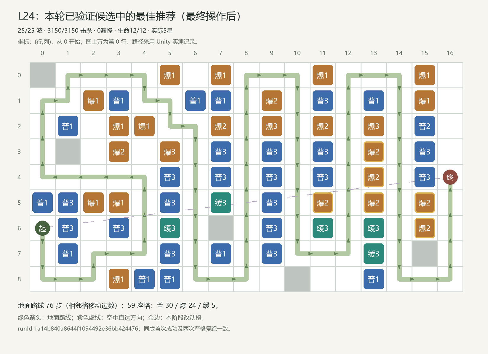
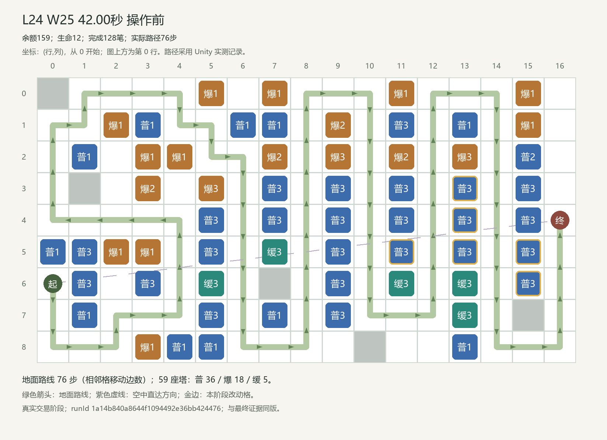
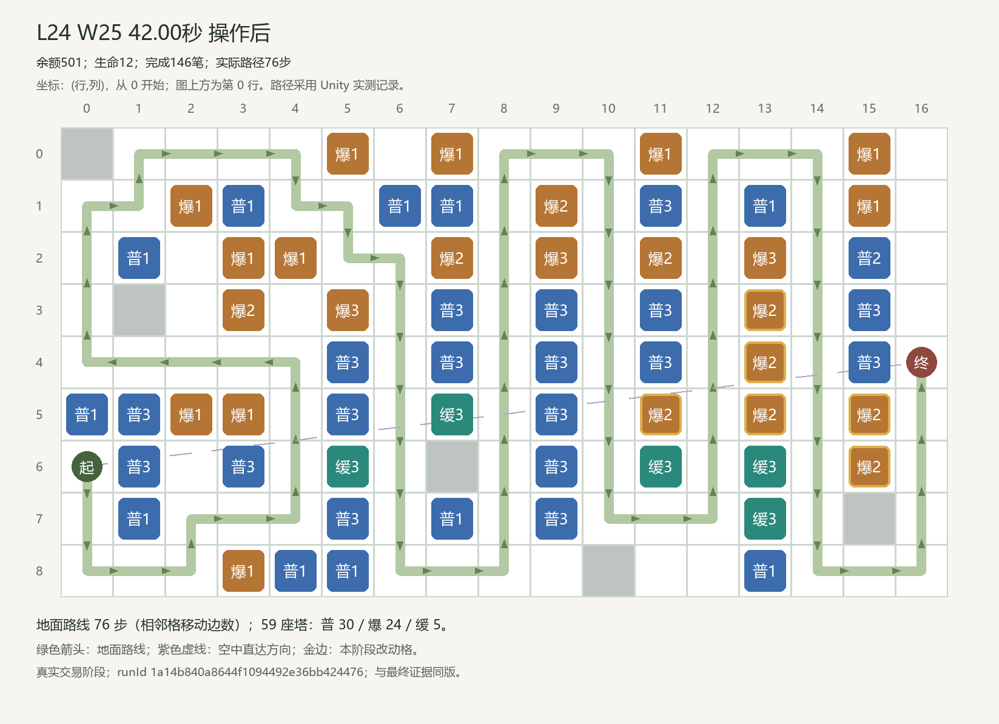

# L24 最佳玩法布局方案与完整逐波操作、测试报告

本方案是本轮已验证候选中的最佳推荐；有限搜索未覆盖全部玩家策略，不声称全局最优。

## 结果摘要

25/25 波 · 3150/3150 击杀 · 0漏怪 · 生命12/12 · 实际5星。实际出生3150、击杀3150、漏怪0、扣血0，终局金币1264；模拟战斗1365.62秒，完整关卡1426.12秒。零漏、正常胜利和五星均由当前正式配置的真实回放及唯一评级入口确认。

## 调整依据与方案选择

地图9行×17列，146个普通建造格。S=(行6,列0)，E=(行4,列16)；空中直达几何距离16.125格，减速后的真实飞行结算以事件记录为准。最终合法地面路线76步，59座塔（普通30、群攻24、减速5）；路线来自Unity寻路。 W5:出生78、战斗29.06秒、开战金10。 W15:出生138、战斗61.12秒、开战金69。 W25:出生198、战斗127.88秒、开战金85。

开发阶段的瓶颈与旧参考分析：本关较长地路与末段重型怪相互作用。三种末波配置均实际零漏：六处转换、九处转换，以及六处转换后增加地面/减速覆盖。增加投入并未自动降低操作负担。 当前推荐六处同格转换，146笔交易中18笔波中交易，战斗1365.62秒；九处转换虽更快却多9笔交易。优先保留较少动态施工的版本，最后空中结算后的真实43秒操作点需按严格回放记录执行。 这些文字保留开发候选语境；最终推荐的实际布局、交易和成绩以下方三次正式记录为准。

最终方案按已完成的同封印五星候选比较：优先较少波中交易，再比较总交易数与战斗时间。当前轨迹146笔交易，其中18笔波中交易，战斗1365.62秒；首次与两次严格复跑使用固定时刻和相同顺序。有限候选中的推荐不等于全局最优。

同最终封印的实质替代：[实际完整结果](../raw-trials/final-suite-4/unity-results.json)索引31，runId `45c28ee80cc5451bae1a09d46c46ef0d`。与推荐方案有17处最终塔位/等级差异，路线76步，157笔交易，完成25波，漏0、生命12、实际5星、战斗1367.12秒；全部157笔现金前缀已对账。这证明至少两类具体合法投资可通关；替代有漏怪时不称零漏五星。

## 首次成功与两次严格复跑

|记录|runId|封印|波/击杀/漏|生命|金币|战斗秒|星级|
|---|---|---|---|---|---:|---:|---:|
|首次|1a14b840a8644f1094492e36bb424476|0135233bbe9cd3e5595063faf8ef222cfca1c0806565061d900f507fd56db4ce|25/3150/0|12/12|1264|1365.619969|5|
|严格复跑1|9db01bceabde4944b60f09d1ac431a9d|0135233bbe9cd3e5595063faf8ef222cfca1c0806565061d900f507fd56db4ce|25/3150/0|12/12|1264|1365.619969|5|
|严格复跑2|e873e7a4cffe41d096a53daff2b714f1|0135233bbe9cd3e5595063faf8ef222cfca1c0806565061d900f507fd56db4ce|25/3150/0|12/12|1264|1365.619969|5|

All wave, enemy outcome, operation affordability, cash, per-wave boundaries, operation stages, routes, final layout and tower contribution fields; runId, screenshot identity and global spawn serial excluded; numeric tolerance 0.00001。全部相同。原始结果和逐项比较分别见 [三次实测](evidence/three-actual-replays.json)、[一致性记录](reproducibility.json)。

## 当前配置与执行范围

初始金币100，初始生命12，25波；Unity 2022.3.62f3c1，MyTowerGame / unityMCP 8082。通过 BalancePlayModeVerifier.StartBatch，在空闲编辑器进入隔离 PlayMode；使用正式导出，无候选配置，无注资、回血、清怪、跳波或改倍率。步长0.02秒，倍速1，严格按实际时机购买，waitForFunds=false。正式存档与原场景由既有隔离机制保护。

版本：`D04|manual-100g-20261022-r3|manual-final-reference-20261022|19f250e832d09af19a1135375d266be69a60d4d28bbce38af9f2094222bdc11a`；封印：`0135233bbe9cd3e5595063faf8ef222cfca1c0806565061d900f507fd56db4ce`；校准状态：`unity_reference_calibrated`；Par=1470000ms。

Par=1470000ms为逐关确定的字面目标；校准依据为开发参考runId `4d734b03c2f24212be34b8cfa80c41bd` 的1365.62秒，原余量104.38秒。最终推荐实际余量104.38秒，评级由唯一LevelRatingEvaluator真实给出5星；没有修改战斗时钟、开局金或L01门槛。

完整输入和源码指纹：[批次输入清单](../audit/batch-inputs/final-suite-4/input-manifest.json)。运行时加载：[正式封印日志](../audit/runtime-load-final.json)。

## 最终布阵与关键变化

### L24 W25 42.00秒 操作前

### L24 W25 42.00秒 操作后

[真实Unity截图](evidence/screenshots/run28-L24-wave25-at42000-op146.png)

### 最终逐塔清单

|坐标(行,列)|塔型等级|最后投资波/时机/序号|实际职责证据|伤害|对空命中|减速次数|重复生效敌人数|
|---|---|---|---|---:|---:|---:|---:|
|(0, 5)|爆1|W25 / 0.00s / #125|地面群攻；阻止捷径0步|3107.20|0|0|0|
|(0, 7)|爆1|W9 / 0.00s / #52|地面群攻；阻止捷径0步|21440.17|0|0|0|
|(0, 11)|爆1|W8 / 0.00s / #43|地面群攻；阻止捷径14步|18634.28|0|0|89|
|(0, 15)|爆1|W9 / 0.00s / #49|地面群攻；阻止捷径8步|2123.00|0|0|0|
|(1, 2)|爆1|W25 / 0.00s / #119|地面群攻；阻止捷径4步|3044.32|0|0|0|
|(1, 3)|普1|W8 / 0.00s / #42|地空单体；阻止捷径0步|7844.38|0|0|0|
|(1, 6)|普1|W25 / 0.00s / #124|地空单体；阻止捷径0步|614.46|0|0|0|
|(1, 7)|普1|W8 / 0.00s / #40|地空单体；阻止捷径0步|9356.03|0|0|120|
|(1, 9)|爆2|W25 / 0.00s / #128|地面群攻；阻止捷径2步|4659.88|0|0|0|
|(1, 11)|普3|W23 / 0.00s / #108|地空单体；阻止捷径12步|8565.00|0|0|32|
|(1, 13)|普1|W25 / 0.00s / #120|地空单体；阻止捷径2步|413.46|0|0|0|
|(1, 15)|爆1|W8 / 0.00s / #38|地面群攻；阻止捷径8步|1885.85|0|0|0|
|(2, 1)|普1|W6 / 0.00s / #30|地空单体；阻止捷径2步|560.70|0|0|0|
|(2, 3)|爆1|W6 / 0.00s / #29|地面群攻；阻止捷径0步|38152.90|0|0|16|
|(2, 4)|爆1|W25 / 0.00s / #117|地面群攻；阻止捷径12步|3132.80|0|0|0|
|(2, 7)|爆2|W22 / 0.00s / #106|地面群攻；阻止捷径12步|48468.83|0|0|253|
|(2, 9)|爆3|W24 / 0.00s / #114|地面群攻；阻止捷径4步|35851.55|0|0|8|
|(2, 11)|爆2|W23 / 0.00s / #107|地面群攻；阻止捷径10步|20254.85|0|0|80|
|(2, 13)|爆3|W24 / 0.00s / #113|地面群攻；阻止捷径4步|7432.99|0|0|2|
|(2, 15)|普2|W24 / 0.00s / #115|地空单体；阻止捷径8步|1033.26|0|0|0|
|(3, 3)|爆2|W24 / 0.00s / #112|地面群攻；阻止捷径0步|49737.52|0|0|0|
|(3, 5)|爆3|W25 / 0.00s / #116|地面群攻；阻止捷径14步|74098.06|0|0|25|
|(3, 7)|普3|W22 / 0.00s / #102|地空单体；阻止捷径10步|14972.36|337|0|48|
|(3, 9)|普3|W17 / 0.00s / #81|地空单体；阻止捷径6步|15362.99|334|0|6|
|(3, 11)|普3|W18 / 0.00s / #83|地空单体；阻止捷径8步|11483.27|137|0|20|
|(3, 13)|爆2|W25 / 42.00s / #145|地面群攻；阻止捷径6步|2100.68|0|0|6|
|(3, 15)|普3|W20 / 0.00s / #93|地空单体；阻止捷径8步|1902.73|20|0|0|
|(4, 5)|普3|W16 / 0.00s / #76|地空单体；阻止捷径16步|22002.12|1211|0|0|
|(4, 7)|普3|W17 / 0.00s / #78|地空单体；阻止捷径8步|20583.49|1081|0|1|
|(4, 9)|普3|W14 / 0.00s / #69|地空单体；阻止捷径8步|19113.28|718|0|12|
|(4, 11)|普3|W14 / 0.00s / #67|地空单体；阻止捷径6步|11961.95|232|0|11|
|(4, 13)|爆2|W25 / 42.00s / #144|地面群攻；阻止捷径8步|2775.25|0|0|13|
|(4, 15)|普3|W19 / 0.00s / #89|地空单体；阻止捷径8步|1587.98|27|0|1|
|(5, 0)|普1|W25 / 0.00s / #118|地空单体；阻止捷径12步|664.86|61|0|0|
|(5, 1)|普3|W21 / 0.00s / #97|地空单体；阻止捷径0步|16847.49|1243|0|0|
|(5, 2)|爆1|W25 / 0.00s / #123|地面群攻；阻止捷径4步|2728.00|0|0|0|
|(5, 3)|爆1|W2 / 0.00s / #4|地面群攻；阻止捷径0步|52638.53|0|0|0|
|(5, 5)|普3|W20 / 0.00s / #92|地空单体；阻止捷径18步|17304.18|1145|0|0|
|(5, 7)|缓3|W10 / 0.00s / #56|缓速覆盖；阻止捷径6步|0.00|0|87524|142|
|(5, 9)|普3|W16 / 0.00s / #75|地空单体；阻止捷径10步|19558.47|827|0|10|
|(5, 11)|爆2|W25 / 42.00s / #143|地面群攻；阻止捷径4步|3925.31|0|0|6|
|(5, 13)|爆2|W25 / 42.00s / #146|地面群攻；阻止捷径10步|3738.09|0|0|19|
|(5, 15)|爆2|W25 / 42.00s / #142|地面群攻；阻止捷径6步|1112.73|0|0|1|
|(6, 1)|普3|W22 / 0.00s / #103|地空单体；阻止捷径2步|14747.48|1237|0|42|
|(6, 3)|普3|W23 / 0.00s / #111|地空单体；阻止捷径0步|11504.74|1270|0|0|
|(6, 5)|缓3|W7 / 0.00s / #34|缓速覆盖；阻止捷径20步|0.00|0|60201|1581|
|(6, 9)|普3|W16 / 0.00s / #77|地空单体；阻止捷径12步|19203.52|747|0|17|
|(6, 11)|缓3|W12 / 0.00s / #60|缓速覆盖；阻止捷径2步|0.00|0|20449|0|
|(6, 13)|缓3|W11 / 0.00s / #57|缓速覆盖；阻止捷径12步|0.00|0|9597|36|
|(6, 15)|爆2|W25 / 42.00s / #141|地面群攻；阻止捷径4步|1224.64|0|0|1|
|(7, 1)|普1|W5 / 0.00s / #20|地空单体；阻止捷径2步|9795.12|1172|0|0|
|(7, 5)|普3|W23 / 0.00s / #110|地空单体；阻止捷径22步|14272.32|1120|0|0|
|(7, 7)|普1|W25 / 0.00s / #122|地空单体；阻止捷径2步|878.16|56|0|0|
|(7, 9)|普3|W21 / 0.00s / #99|地空单体；阻止捷径14步|13714.05|156|0|33|
|(7, 13)|缓3|W11 / 0.00s / #58|缓速覆盖；阻止捷径14步|0.00|0|7833|20|
|(8, 3)|爆1|W25 / 0.00s / #127|地面群攻；阻止捷径0步|4477.60|0|0|0|
|(8, 4)|普1|W25 / 0.00s / #126|地空单体；阻止捷径0步|494.46|0|0|0|
|(8, 5)|普1|W9 / 0.00s / #53|地空单体；阻止捷径0步|7017.84|0|0|6|
|(8, 13)|普1|W9 / 0.00s / #46|地空单体；阻止捷径14步|2287.04|0|0|0|

## W1—W25 完整操作

“波前”指该波启动前的准备/结算阶段；波中时刻从该波 combatStartSeconds 起算。相同时刻的交易必须保持编号顺序。

|波|实际时机|序号/动作|坐标|等级变化|支出/退款|操作后余额|
|---:|---|---|---|---|---:|---:|
|1|波前|#1 建造|(4,11)|空格 → 普1|支出32|68|
|1|波前|#2 建造|(5,9)|空格 → 普1|支出32|36|
|1|波前|#3 建造|(4,7)|空格 → 普1|支出32|4|
|2|波前|#4 建造|(5,3)|空格 → 爆1|支出44|100|
|2|波前|#5 建造|(6,5)|空格 → 缓1|支出30|70|
|2|波前|#6 建造|(5,13)|空格 → 普1|支出32|38|
|2|波前|#7 建造|(3,9)|空格 → 普1|支出32|6|
|3|波前|#8 建造|(5,11)|空格 → 普1|支出32|136|
|3|波前|#9 建造|(2,11)|空格 → 爆1|支出44|92|
|3|波前|#10 建造|(3,13)|空格 → 普1|支出32|60|
|3|波前|#11 建造|(6,9)|空格 → 普1|支出32|28|
|4|波前|#12 建造|(4,5)|空格 → 普1|支出32|180|
|4|波前|#13 建造|(5,15)|空格 → 普1|支出32|148|
|4|波前|#14 建造|(3,5)|空格 → 爆1|支出44|104|
|4|波前|#15 建造|(6,11)|空格 → 缓1|支出30|74|
|4|波前|#16 建造|(5,1)|空格 → 普1|支出32|42|
|4|波前|#17 建造|(3,7)|空格 → 普1|支出32|10|
|5|波前|#18 建造|(3,15)|空格 → 普1|支出32|182|
|5|波前|#19 建造|(2,9)|空格 → 爆1|支出44|138|
|5|波前|#20 建造|(7,1)|空格 → 普1|支出32|106|
|5|波前|#21 建造|(6,1)|空格 → 普1|支出32|74|
|5|波前|#22 建造|(6,3)|空格 → 普1|支出32|42|
|5|波前|#23 建造|(7,5)|空格 → 普1|支出32|10|
|6|波前|#24 建造|(3,3)|空格 → 爆1|支出44|300|
|6|波前|#25 建造|(6,13)|空格 → 缓1|支出30|270|
|6|波前|#26 建造|(6,15)|空格 → 普1|支出32|238|
|6|波前|#27 建造|(2,13)|空格 → 爆1|支出44|194|
|6|波前|#28 建造|(1,11)|空格 → 普1|支出32|162|
|6|波前|#29 建造|(2,3)|空格 → 爆1|支出44|118|
|6|波前|#30 建造|(2,1)|空格 → 普1|支出32|86|
|6|波前|#31 升级|(6,5)|缓1 → 缓2|支出85|1|
|7|波前|#32 升级|(6,13)|缓1 → 缓2|支出85|271|
|7|波前|#33 升级|(4,11)|普1 → 普2|支出90|181|
|7|波前|#34 升级|(6,5)|缓2 → 缓3|支出170|11|
|8|波前|#35 建造|(7,9)|空格 → 普1|支出32|327|
|8|波前|#36 建造|(4,15)|空格 → 普1|支出32|295|
|8|波前|#37 建造|(4,13)|空格 → 普1|支出32|263|
|8|波前|#38 建造|(1,15)|空格 → 爆1|支出44|219|
|8|波前|#39 建造|(7,13)|空格 → 缓1|支出30|189|
|8|波前|#40 建造|(1,7)|空格 → 普1|支出32|157|
|8|波前|#41 建造|(2,7)|空格 → 爆1|支出44|113|
|8|波前|#42 建造|(1,3)|空格 → 普1|支出32|81|
|8|波前|#43 建造|(0,11)|空格 → 爆1|支出44|37|
|8|波前|#44 建造|(4,9)|空格 → 普1|支出32|5|
|9|波前|#45 建造|(3,11)|空格 → 普1|支出32|348|
|9|波前|#46 建造|(8,13)|空格 → 普1|支出32|316|
|9|波前|#47 升级|(6,11)|缓1 → 缓2|支出85|231|
|9|波前|#48 建造|(2,15)|空格 → 普1|支出32|199|
|9|波前|#49 建造|(0,15)|空格 → 爆1|支出44|155|
|9|波前|#50 建造|(5,7)|空格 → 缓1|支出30|125|
|9|波前|#51 建造|(5,5)|空格 → 普1|支出32|93|
|9|波前|#52 建造|(0,7)|空格 → 爆1|支出44|49|
|9|波前|#53 建造|(8,5)|空格 → 普1|支出32|17|
|10|波前|#54 升级|(5,7)|缓1 → 缓2|支出85|308|
|10|波前|#55 升级|(7,13)|缓1 → 缓2|支出85|223|
|10|波前|#56 升级|(5,7)|缓2 → 缓3|支出170|53|
|11|波前|#57 升级|(6,13)|缓2 → 缓3|支出170|302|
|11|波前|#58 升级|(7,13)|缓2 → 缓3|支出170|132|
|11|波前|#59 升级|(5,11)|普1 → 普2|支出90|42|
|12|波前|#60 升级|(6,11)|缓2 → 缓3|支出170|326|
|12|波前|#61 升级|(5,11)|普2 → 普3|支出180|146|
|12|波前|#62 升级|(4,13)|普1 → 普2|支出90|56|
|13|波前|#63 升级|(4,5)|普1 → 普2|支出90|485|
|13|波前|#64 升级|(3,13)|普1 → 普2|支出90|395|
|13|波前|#65 升级|(4,13)|普2 → 普3|支出180|215|
|13|波前|#66 升级|(3,13)|普2 → 普3|支出180|35|
|14|波前|#67 升级|(4,11)|普2 → 普3|支出180|350|
|14|波前|#68 升级|(4,9)|普1 → 普2|支出90|260|
|14|波前|#69 升级|(4,9)|普2 → 普3|支出180|80|
|15|波前|#70 升级|(6,9)|普1 → 普2|支出90|519|
|15|波前|#71 升级|(5,13)|普1 → 普2|支出90|429|
|15|波前|#72 升级|(5,13)|普2 → 普3|支出180|249|
|15|波前|#73 升级|(4,7)|普1 → 普2|支出90|159|
|15|波前|#74 升级|(5,9)|普1 → 普2|支出90|69|
|16|波前|#75 升级|(5,9)|普2 → 普3|支出180|449|
|16|波前|#76 升级|(4,5)|普2 → 普3|支出180|269|
|16|波前|#77 升级|(6,9)|普2 → 普3|支出180|89|
|17|波前|#78 升级|(4,7)|普2 → 普3|支出180|449|
|17|波前|#79 升级|(5,15)|普1 → 普2|支出90|359|
|17|波前|#80 升级|(3,9)|普1 → 普2|支出90|269|
|17|波前|#81 升级|(3,9)|普2 → 普3|支出180|89|
|18|波前|#82 升级|(3,11)|普1 → 普2|支出90|587|
|18|波前|#83 升级|(3,11)|普2 → 普3|支出180|407|
|18|波前|#84 升级|(6,15)|普1 → 普2|支出90|317|
|18|波前|#85 升级|(6,15)|普2 → 普3|支出180|137|
|18|波前|#86 升级|(4,15)|普1 → 普2|支出90|47|
|19|波前|#87 升级|(5,15)|普2 → 普3|支出180|469|
|19|波前|#88 升级|(5,1)|普1 → 普2|支出90|379|
|19|波前|#89 升级|(4,15)|普2 → 普3|支出180|199|
|19|波前|#90 升级|(5,5)|普1 → 普2|支出90|109|
|19|波前|#91 升级|(3,15)|普1 → 普2|支出90|19|
|20|波前|#92 升级|(5,5)|普2 → 普3|支出180|518|
|20|波前|#93 升级|(3,15)|普2 → 普3|支出180|338|
|20|波前|#94 升级|(2,13)|爆1 → 爆2|支出110|228|
|20|波前|#95 升级|(2,9)|爆1 → 爆2|支出110|118|
|20|波前|#96 升级|(3,5)|爆1 → 爆2|支出110|8|
|21|波前|#97 升级|(5,1)|普2 → 普3|支出180|498|
|21|波前|#98 升级|(7,9)|普1 → 普2|支出90|408|
|21|波前|#99 升级|(7,9)|普2 → 普3|支出180|228|
|21|波前|#100 升级|(6,1)|普1 → 普2|支出90|138|
|21|波前|#101 升级|(3,7)|普1 → 普2|支出90|48|
|22|波前|#102 升级|(3,7)|普2 → 普3|支出180|537|
|22|波前|#103 升级|(6,1)|普2 → 普3|支出180|357|
|22|波前|#104 升级|(1,11)|普1 → 普2|支出90|267|
|22|波前|#105 升级|(7,5)|普1 → 普2|支出90|177|
|22|波前|#106 升级|(2,7)|爆1 → 爆2|支出110|67|
|23|波前|#107 升级|(2,11)|爆1 → 爆2|支出110|654|
|23|波前|#108 升级|(1,11)|普2 → 普3|支出180|474|
|23|波前|#109 升级|(6,3)|普1 → 普2|支出90|384|
|23|波前|#110 升级|(7,5)|普2 → 普3|支出180|204|
|23|波前|#111 升级|(6,3)|普2 → 普3|支出180|24|
|24|波前|#112 升级|(3,3)|爆1 → 爆2|支出110|598|
|24|波前|#113 升级|(2,13)|爆2 → 爆3|支出210|388|
|24|波前|#114 升级|(2,9)|爆2 → 爆3|支出210|178|
|24|波前|#115 升级|(2,15)|普1 → 普2|支出90|88|
|25|波前|#116 升级|(3,5)|爆2 → 爆3|支出210|619|
|25|波前|#117 建造|(2,4)|空格 → 爆1|支出44|575|
|25|波前|#118 建造|(5,0)|空格 → 普1|支出32|543|
|25|波前|#119 建造|(1,2)|空格 → 爆1|支出44|499|
|25|波前|#120 建造|(1,13)|空格 → 普1|支出32|467|
|25|波前|#121 建造|(1,9)|空格 → 爆1|支出44|423|
|25|波前|#122 建造|(7,7)|空格 → 普1|支出32|391|
|25|波前|#123 建造|(5,2)|空格 → 爆1|支出44|347|
|25|波前|#124 建造|(1,6)|空格 → 普1|支出32|315|
|25|波前|#125 建造|(0,5)|空格 → 爆1|支出44|271|
|25|波前|#126 建造|(8,4)|空格 → 普1|支出32|239|
|25|波前|#127 建造|(8,3)|空格 → 爆1|支出44|195|
|25|波前|#128 升级|(1,9)|爆1 → 爆2|支出110|85|
|25|本波42.00秒|#129 出售|(6,15)|普3 → 空格|退款211|370|
|25|本波42.00秒|#130 出售|(5,15)|普3 → 空格|退款211|581|
|25|本波42.00秒|#131 出售|(5,11)|普3 → 空格|退款211|792|
|25|本波42.00秒|#132 出售|(4,13)|普3 → 空格|退款211|1003|
|25|本波42.00秒|#133 出售|(3,13)|普3 → 空格|退款211|1214|
|25|本波42.00秒|#134 出售|(5,13)|普3 → 空格|退款211|1425|
|25|本波42.00秒|#135 建造|(6,15)|空格 → 爆1|支出44|1381|
|25|本波42.00秒|#136 建造|(5,15)|空格 → 爆1|支出44|1337|
|25|本波42.00秒|#137 建造|(5,11)|空格 → 爆1|支出44|1293|
|25|本波42.00秒|#138 建造|(4,13)|空格 → 爆1|支出44|1249|
|25|本波42.00秒|#139 建造|(3,13)|空格 → 爆1|支出44|1205|
|25|本波42.00秒|#140 建造|(5,13)|空格 → 爆1|支出44|1161|
|25|本波42.00秒|#141 升级|(6,15)|爆1 → 爆2|支出110|1051|
|25|本波42.00秒|#142 升级|(5,15)|爆1 → 爆2|支出110|941|
|25|本波42.00秒|#143 升级|(5,11)|爆1 → 爆2|支出110|831|
|25|本波42.00秒|#144 升级|(4,13)|爆1 → 爆2|支出110|721|
|25|本波42.00秒|#145 升级|(3,13)|爆1 → 爆2|支出110|611|
|25|本波42.00秒|#146 升级|(5,13)|爆1 → 爆2|支出110|501|

## 逐波结果与现金流

波前金是上一波结束余额；开战金已经扣除本波准备期操作。波中击杀金只在对应敌人实际结算后可用。

|波|波前金|开战金|击杀金|清波金|建造|升级|退款|清波结余|生/杀/漏|扣血/生命|战斗秒|峰值/暂缓|
|---:|---:|---:|---:|---:|---:|---:|---:|---:|---|---|---:|---|
|1|100|4|108|32|96|0|0|144|54/54/0|0 / 12|28.94|30 / 0|
|2|144|6|120|42|138|0|0|168|60/60/0|0 / 12|21.64|11 / 0|
|3|168|28|132|52|140|0|0|212|66/66/0|0 / 12|21.72|15 / 0|
|4|212|10|144|60|202|0|0|214|72/72/0|0 / 12|30.36|13 / 0|
|5|214|10|282|52|204|0|0|344|78/78/0|0 / 12|29.06|28 / 0|
|6|344|1|271|84|258|85|0|356|84/84/0|0 / 12|20.36|36 / 0|
|7|356|11|290|58|0|345|0|359|90/90/0|0 / 12|31.58|20 / 0|
|8|359|5|309|66|354|0|0|380|96/96/0|0 / 12|31.98|24 / 0|
|9|380|17|330|46|278|85|0|393|102/102/0|0 / 12|42.82|17 / 0|
|10|393|53|349|70|0|340|0|472|108/108/0|0 / 12|40.26|40 / 0|
|11|472|42|390|64|0|430|0|496|114/114/0|0 / 12|42.36|38 / 0|
|12|496|56|413|106|0|440|0|575|120/120/0|0 / 12|31.40|70 / 0|
|13|575|35|429|66|0|540|0|530|126/126/0|0 / 12|46.42|46 / 0|
|14|530|80|453|76|0|450|0|609|132/132/0|0 / 12|49.04|60 / 0|
|15|609|69|476|84|0|540|0|629|138/138/0|0 / 12|61.12|85 / 0|
|16|629|89|492|48|0|540|0|629|144/144/0|0 / 12|71.42|60 / 0|
|17|629|89|510|78|0|540|0|677|150/150/0|0 / 12|63.32|78 / 0|
|18|677|47|532|70|0|630|0|649|156/156/0|0 / 12|67.96|74 / 0|
|19|649|19|555|124|0|630|0|698|162/162/0|0 / 12|64.78|127 / 0|
|20|698|8|578|92|0|690|0|678|168/168/0|0 / 12|87.20|110 / 0|
|21|678|48|595|74|0|630|0|717|174/174/0|0 / 12|91.76|103 / 0|
|22|717|67|613|84|0|650|0|764|180/180/0|0 / 12|88.46|108 / 0|
|23|764|24|634|50|0|740|0|708|186/186/0|0 / 12|90.44|72 / 0|
|24|708|88|655|86|0|620|0|829|192/192/0|0 / 12|83.34|97 / 0|
|25|829|85|703|134|688|980|1266|1264|198/198/0|0 / 12|127.88|141 / 0|

逐关复核目标：W5开战0～30金，W25开战55～120金。较长地路换取群攻覆盖，六处转换降低交易数，末波留一次低级升级以内。 当前实测W5开战10，W25准备前829、开战85、结算1264；最小交易后余额1。区间以开发观察为基础确定，属于复核目标，不冒充事前预测。普通/对空首次升级成本90，原轨迹在W1 25.24s（现金阈值首次达到）首次观察到前置等级已存在且现金足够；实际在W7 0.00s升级。 群攻首次升级成本110，原轨迹在W6 0.00s（现金阈值首次达到）首次观察到前置等级已存在且现金足够；实际在W20 0.00s升级。 减速首次升级成本85，原轨迹在W2 15.16s（现金阈值首次达到）首次观察到前置等级已存在且现金足够；实际在W6 0.00s升级。 该阈值只说明原轨迹上现金和前置塔等级，不证明提前购买后其他施工仍可完成；更早投资需要另一条真实回放。替代与对照可能保留更多现金，不能仅凭终局金币证明紧凑或宽松。

关键升级现金阈值还覆盖各类型首次到达三级以及全部波中升级，完整观测见[关键升级可负担阈值](evidence/upgrade-cash-thresholds.json)。

|操作|坐标(行,列)|目标塔/级|实际升级|首次前置等级与现金足够|成本/当时现金|
|---:|---|---|---|---|---:|
|#33|(4,11)|普通2|W7 0.00s|W1 25.24s，现金阈值首次达到|90 / 90|
|#61|(5,11)|普通3|W12 0.00s|W11 24.80s，现金阈值首次达到|180 / 184|
|#94|(2,13)|群攻2|W20 0.00s|W6 0.00s，现金阈值首次达到|110 / 194|
|#113|(2,13)|群攻3|W24 0.00s|W20 0.00s，现金阈值首次达到|210 / 228|
|#31|(6,5)|减速2|W6 0.00s|W2 15.16s，现金阈值首次达到|85 / 86|
|#34|(6,5)|减速3|W7 0.00s|W6 15.86s，现金阈值首次达到|170 / 174|
|#141|(6,15)|群攻2|W25 42.00s|W25 42.00s，现金阈值首次达到|110 / 1381|
|#142|(5,15)|群攻2|W25 42.00s|W25 42.00s，现金阈值首次达到|110 / 1337|
|#143|(5,11)|群攻2|W25 42.00s|W25 42.00s，现金阈值首次达到|110 / 1293|
|#144|(4,13)|群攻2|W25 42.00s|W25 42.00s，现金阈值首次达到|110 / 1249|
|#145|(3,13)|群攻2|W25 42.00s|W25 42.00s，现金阈值首次达到|110 / 1205|
|#146|(5,13)|群攻2|W25 42.00s|W25 42.00s，现金阈值首次达到|110 / 1161|

## 搜索范围与全部对照

本关已归档32次真实试验，按批次为：campaign-r1-L13-L30-and-refinements 6次、comparisons-r4-u 1次、final-suite-4 7次、followups-r2-h 5次、references-r2-a 1次、references-r3-q 3次、targeted-r2-d 1次、targeted-r2-n 8次。全部实际候选含失败、非法、取消或超时，见候选索引；这些状态不计为成功。搜索包括折返/短路、三塔配比、升级顺序、一次合法出售改造和实测资金再投资，未穷举无限塔位/逐帧操作空间。当前封印另有保留几何改变减速配资、地面专用火力、减少稳定路墙三类对照；早期normal/power分别只买最多8塔，mistake只买1塔，只是受限投资对照，不能代表全部玩家。 `final-control-ground-only-L24`：4波、漏12、生命0、0星、状态operation_incomplete、未完成操作124（[原始](../raw-trials/final-suite-4/unity-results.json)索引32）；`final-control-slow-allocation-L24`：24波、漏7、生命0、0星、状态finished、未完成操作0（[原始](../raw-trials/final-suite-4/unity-results.json)索引33）；`final-control-fewer-walls-L24`：18波、漏11、生命0、0星、状态operation_incomplete、未完成操作53（[原始](../raw-trials/final-suite-4/unity-results.json)索引34） 三类对照按本批最初参考的坐标与投资构造，原参考来源是 raw-trials/references-r3-q/unity-results.json 索引5；若比较后改选其他候选为主推荐，此处保留这些对照的实际原参照对象。 减少路墙对照实际删除6处稳定1级塔位：[[0, 11], [0, 15], [1, 15], [2, 4], [5, 0], [8, 13]]。 本关减速配资对照的实际请求规则：将原减速建造替换为普通1并省去减速升级，保留差额现金。

|批次/策略|波数|漏怪|生命|星|状态|操作数|原始结果|
|---|---:|---:|---:|---:|---|---:|---|
|campaign-r1-L13-L30-and-refinements / campaign-r1-greedy-mixed|18|9|0|0|operation_incomplete|83|[结果](../raw-trials/campaign-r1-L13-L30-and-refinements/unity-results.json)|
|campaign-r1-L13-L30-and-refinements / campaign-r1-air-upgrades|0|12|0|0|finished|3|[结果](../raw-trials/campaign-r1-L13-L30-and-refinements/unity-results.json)|
|campaign-r1-L13-L30-and-refinements / campaign-r1-folded-maze|24|12|0|0|finished|120|[结果](../raw-trials/campaign-r1-L13-L30-and-refinements/unity-results.json)|
|campaign-r1-L13-L30-and-refinements / normal|4|12|0|0|finished|13|[结果](../raw-trials/campaign-r1-L13-L30-and-refinements/unity-results.json)|
|campaign-r1-L13-L30-and-refinements / power|5|12|0|0|finished|14|[结果](../raw-trials/campaign-r1-L13-L30-and-refinements/unity-results.json)|
|campaign-r1-L13-L30-and-refinements / mistake|0|12|0|0|finished|1|[结果](../raw-trials/campaign-r1-L13-L30-and-refinements/unity-results.json)|
|references-r2-a / r2-preserved-folded-maze|24|12|0|0|finished|120|[结果](../raw-trials/references-r2-a/unity-results.json)|
|targeted-r2-d / ground-r2-c-convert6-at-43000|24|9|0|0|finished|138|[结果](../raw-trials/targeted-r2-d/unity-results.json)|
|followups-r2-h / normal|4|12|0|0|finished|13|[结果](../raw-trials/followups-r2-h/unity-results.json)|
|followups-r2-h / power|5|12|0|0|finished|14|[结果](../raw-trials/followups-r2-h/unity-results.json)|
|followups-r2-h / mistake|0|12|0|0|finished|1|[结果](../raw-trials/followups-r2-h/unity-results.json)|
|followups-r2-h / route-r2-g-mixed-route-retain-air|24|12|0|0|finished|128|[结果](../raw-trials/followups-r2-h/unity-results.json)|
|followups-r2-h / route-r2-g-ordinary-route-late6|24|8|0|0|finished|147|[结果](../raw-trials/followups-r2-h/unity-results.json)|
|targeted-r2-n / reinvest-r2-j-from-101-prepare-group|24|11|0|0|finished|129|[结果](../raw-trials/targeted-r2-n/unity-results.json)|
|targeted-r2-n / reinvest-r2-j-from-101-prepare-group-slow|25|7|1|1|finished|130|[结果](../raw-trials/targeted-r2-n/unity-results.json)|
|targeted-r2-n / reinvest-r2-j-from-101-earned-group-slow|25|4|8|2|finished|132|[结果](../raw-trials/targeted-r2-n/unity-results.json)|
|targeted-r2-n / reinvest-r2-j-from-102-prepare-group|24|8|0|0|finished|148|[结果](../raw-trials/targeted-r2-n/unity-results.json)|
|targeted-r2-n / reinvest-r2-j-from-102-prepare-group-slow|24|8|0|0|finished|148|[结果](../raw-trials/targeted-r2-n/unity-results.json)|
|targeted-r2-n / reinvest-r2-j-from-102-earned-group-slow|25|1|8|2|finished|157|[结果](../raw-trials/targeted-r2-n/unity-results.json)|
|targeted-r2-n / convert-r2-l-from-101-convert6|25|1|8|2|finished|146|[结果](../raw-trials/targeted-r2-n/unity-results.json)|
|targeted-r2-n / convert-r2-l-from-101-convert9|25|1|8|2|finished|155|[结果](../raw-trials/targeted-r2-n/unity-results.json)|
|references-r3-q / references-r3-q-targeted-r2-n-12|25|0|12|3|finished|157|[结果](../raw-trials/references-r3-q/unity-results.json)|
|references-r3-q / references-r3-q-targeted-r2-n-36|25|0|12|3|finished|146|[结果](../raw-trials/references-r3-q/unity-results.json)|
|references-r3-q / references-r3-q-targeted-r2-n-37|25|0|12|3|finished|155|[结果](../raw-trials/references-r3-q/unity-results.json)|
|comparisons-r4-u / comparisons-r4-u-no-slow-same-geometry|24|7|0|0|finished|136|[结果](../raw-trials/comparisons-r4-u/unity-results.json)|
|final-suite-4 / final-reference-L24-0|25|0|12|5|finished|146|[结果](../raw-trials/final-suite-4/unity-results.json)|
|final-suite-4 / final-reference-L24-1|25|0|12|5|finished|146|[结果](../raw-trials/final-suite-4/unity-results.json)|
|final-suite-4 / final-reference-L24-2|25|0|12|5|finished|146|[结果](../raw-trials/final-suite-4/unity-results.json)|
|final-suite-4 / final-alternative-L24|25|0|12|5|finished|157|[结果](../raw-trials/final-suite-4/unity-results.json)|
|final-suite-4 / final-control-ground-only-L24|4|12|0|0|operation_incomplete|22|[结果](../raw-trials/final-suite-4/unity-results.json)|
|final-suite-4 / final-control-slow-allocation-L24|24|7|0|0|finished|136|[结果](../raw-trials/final-suite-4/unity-results.json)|
|final-suite-4 / final-control-fewer-walls-L24|18|11|0|0|operation_incomplete|87|[结果](../raw-trials/final-suite-4/unity-results.json)|

开发候选和失败保留原始封印与版本；本报告最终五星结论只引用上方同版三次严格回放。完整索引：[JSON](trial-index.json)、[CSV](trial-index.csv)。

## 总账与证据完整性

`100 + 实际击杀10363 + 清波1798 + 出售退款1266 − 建造2358 − 升级9905 = 1264`。实际结算事件共3150条，已核对全部146个操作前缀，最低操作后余额1。所有逐波与逐笔余额均一致，无负余额。

[独立事件对账和现金流](evidence/cashflow-and-prefixes.json) · [完整实际操作](best-operations.json) · [可回放操作](evidence/replay-operations.json) · [最佳完整结果](best-result.json)

## 操作可执行性与限制

W25 42.00s，18笔顺序交易；该波最后空中结算40.96s，距本波结束85.88s 已认证的是这些离散时刻与顺序；没有把最后空中结算和本次操作之间的间隔冒充连续安全窗口。

验证为Unity2022.3.62f3c1编辑器内0.02秒固定步长、真实GameClock、正式数据与正常现金的隔离PlayMode。未验证Android实际帧率、手动鼠标/触控照做或连续时机容错范围。暂停与建造输入路径已有静态代码边界记录，未做人工暂停交易认证。不能从同一模拟时刻脚本顺序执行推断玩家无需暂停就能完成集中交易。

固定步长脚本运行成功不等于已验证手动触控。相同时刻多笔交易按列表顺序执行，期间模拟不推进；人工是否可利用当前暂停交互完成这些操作，仍应按已验证的操作范围理解，不能由脚本结果推断。

## 原始证据与配置明细

[全部25波正式变体、顺序及源位置](设计与725波明细.md) · [首轮及两次复跑](evidence/three-actual-replays.json) · [正式配置审计](../audit/formal-integrity-final.json) · [30关总索引](../README.md)

- [W1实际截图](evidence/screenshots/run28-D04-L24-wave1.png)
- [W10实际截图](evidence/screenshots/run28-D04-L24-wave10.png)
- [W25实际截图](evidence/screenshots/run28-D04-L24-wave25.png)
