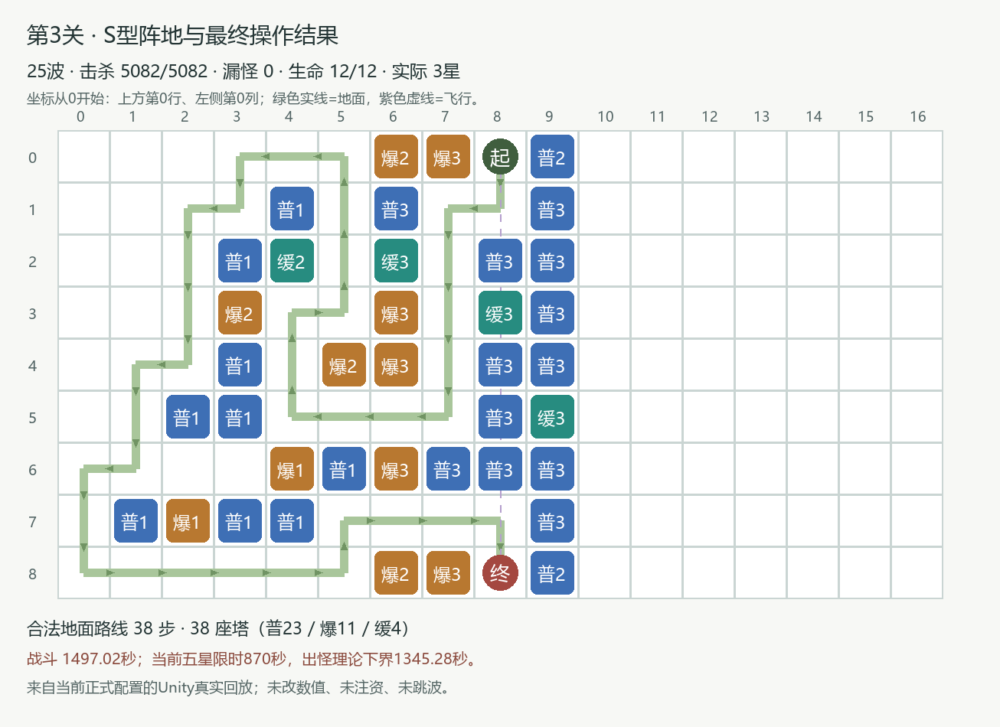

# 第3关：当前模型S型阵地与完整操作

## 结果

当前正式模型：25波，5082只怪，其中1180只飞行；初始100金币，12生命，击杀奖励按原值80%累计结算。未改任何关卡、怪物、塔、金币和评级数值。

已验证方案：完成25/25波，击杀5082/5082，漏怪0，生命12/12，实际评级3星，评级有效=True。战斗1497.02秒，关卡总时1557.52秒，剩余133金币。记录ID：4a6988c7e26d43ffb4c2f46af259f9cd。

## 为什么当前不能五星

各波最后一只怪的计划出生时间合计1345.28秒（保守扣除每波一帧20毫秒仍至少1344.78秒），已超过五星870秒和四星1000.5秒。正常流程逐波清场后再开下一波，因此即使瞬间全灭全部怪，仍无法满足五星时间条件。当前满血零漏实际最多三星；本报告不把三星称作五星。

唯一评级入口实测原因：Five-star combat time exceeded, Four-star combat time exceeded。

## 阵型

最终38座塔；地面合法路径38步。多次折返的S型走廊使群攻和减速反复覆盖；中央第8、9列负责直线空袭。飞行怪不会跟地面S路绕行。

## 玩家操作说明

- 坐标用（行,列），从0开始；左上角（0,0），入口（0,8），出口（8,8）。
- 使用普通关卡3开局，初始100金币；不要使用调试胜利、加钱、回血或跳波。
- “波前”指该波准备/上一波结算阶段。后续自动开波只有2.5秒，建议清波后立即按P暂停，按顺序完成该组交易后继续；游戏暂停时放置和升级入口仍可用。
- “波内x秒”从该波开始计时；如按金币操作，等金币达到该笔花费即可执行。相同时刻保持序号顺序。波内也可用正常P暂停按钮完成点击。
- 放置：点塔型按钮→点指定格；升级：点现有塔→升级。卖塔不是本方案必要操作。
- 表中余额为真实结算后余额；整数金币不足时不能提前购买，小数奖励自动累计。完整机器回放使用同目录best-operations.json。

## W1—W25完整操作

|序号|波次|时机|动作|坐标（行,列）|目标塔|花费|操作后余额|
|---:|---:|---|---|---|---|---:|---:|
|1|1|波前|建造|(6,8)|普通1级|32|68|
|2|1|波前|建造|(5,8)|普通1级|32|36|
|3|1|波前|建造|(4,8)|普通1级|32|4|
|4|2|波前|建造|(8,7)|火力（群攻）1级|44|36|
|5|2|波前|建造|(3,8)|减速1级|30|6|
|6|3|波前|建造|(2,8)|普通1级|32|65|
|7|3|波前|建造|(0,7)|火力（群攻）1级|44|21|
|8|3|波内3.02秒|建造|(1,9)|普通1级|32|0|
|9|4|波前|建造|(6,7)|普通1级|32|51|
|10|4|波前|建造|(4,6)|火力（群攻）1级|44|7|
|11|4|波内7.10秒|建造|(2,9)|普通1级|32|1|
|12|5|波前|建造|(7,9)|普通1级|32|52|
|13|5|波前|建造|(3,9)|普通1级|32|20|
|14|5|波内9.48秒|建造|(3,6)|火力（群攻）1级|44|2|
|15|5|波内16.44秒|建造|(5,9)|减速1级|30|0|
|16|6|波前|建造|(4,9)|普通1级|32|93|
|17|6|波前|建造|(8,6)|火力（群攻）1级|44|49|
|18|6|波前|建造|(6,9)|普通1级|32|17|
|19|7|波前|建造|(0,9)|普通1级|32|169|
|20|7|波前|建造|(6,6)|火力（群攻）1级|44|125|
|21|7|波前|建造|(6,5)|普通1级|32|93|
|22|7|波前|建造|(7,4)|普通1级|32|61|
|23|8|波前|建造|(7,3)|普通1级|32|232|
|24|8|波前|建造|(7,2)|火力（群攻）1级|44|188|
|25|8|波前|建造|(2,6)|减速1级|30|158|
|26|8|波前|建造|(7,1)|普通1级|32|126|
|27|8|波前|升级|(3,8)|减速2级|85|41|
|28|9|波前|升级|(5,9)|减速2级|85|178|
|29|9|波前|升级|(2,6)|减速2级|85|93|
|30|9|波前|升级|(4,8)|普通2级|90|3|
|31|10|波前|建造|(6,4)|火力（群攻）1级|44|184|
|32|10|波前|升级|(3,8)|减速3级|170|14|
|33|11|波前|升级|(5,9)|减速3级|170|92|
|34|11|波前|升级|(6,8)|普通2级|90|2|
|35|12|波前|建造|(8,9)|普通1级|32|256|
|36|12|波前|建造|(5,2)|普通1级|32|224|
|37|12|波前|建造|(4,5)|火力（群攻）1级|44|180|
|38|12|波前|建造|(1,6)|普通1级|32|148|
|39|12|波前|建造|(5,3)|普通1级|32|116|
|40|12|波前|建造|(4,3)|普通1级|32|84|
|41|13|波前|建造|(3,3)|火力（群攻）1级|44|335|
|42|13|波前|建造|(2,4)|减速1级|30|305|
|43|13|波前|建造|(1,4)|普通1级|32|273|
|44|13|波前|建造|(0,6)|火力（群攻）1级|44|229|
|45|13|波前|建造|(2,3)|普通1级|32|197|
|46|13|波前|升级|(2,6)|减速3级|170|27|
|47|14|波前|升级|(5,8)|普通2级|90|259|
|48|14|波前|升级|(2,8)|普通2级|90|169|
|49|14|波前|升级|(6,9)|普通2级|90|79|
|50|15|波前|升级|(3,9)|普通2级|90|336|
|51|15|波前|升级|(4,9)|普通2级|90|246|
|52|15|波前|升级|(6,7)|普通2级|90|156|
|53|15|波前|升级|(0,7)|火力（群攻）2级|110|46|
|54|16|波前|升级|(2,9)|普通2级|90|308|
|55|16|波前|升级|(3,6)|火力（群攻）2级|110|198|
|56|16|波前|升级|(4,6)|火力（群攻）2级|110|88|
|57|16|波前|升级|(2,4)|减速2级|85|3|
|58|17|波前|升级|(5,8)|普通3级|180|188|
|59|17|波前|升级|(6,8)|普通3级|180|8|
|60|18|波前|升级|(4,8)|普通3级|180|218|
|61|18|波前|升级|(7,9)|普通2级|90|128|
|62|18|波前|升级|(1,9)|普通2级|90|38|
|63|19|波前|升级|(2,9)|普通3级|180|255|
|64|19|波前|升级|(6,7)|普通3级|180|75|
|65|20|波前|升级|(2,8)|普通3级|180|316|
|66|20|波前|升级|(4,9)|普通3级|180|136|
|67|20|波前|升级|(8,7)|火力（群攻）2级|110|26|
|68|21|波前|升级|(6,9)|普通3级|180|289|
|69|21|波前|升级|(3,9)|普通3级|180|109|
|70|21|波前|升级|(0,9)|普通2级|90|19|
|71|22|波前|升级|(3,6)|火力（群攻）3级|210|254|
|72|22|波前|升级|(6,6)|火力（群攻）2级|110|144|
|73|22|波前|升级|(4,5)|火力（群攻）2级|110|34|
|74|23|波前|升级|(4,6)|火力（群攻）3级|210|292|
|75|23|波前|升级|(0,6)|火力（群攻）2级|110|182|
|76|23|波前|升级|(1,9)|普通3级|180|2|
|77|24|波前|升级|(7,9)|普通3级|180|303|
|78|24|波前|升级|(3,3)|火力（群攻）2级|110|193|
|79|24|波前|升级|(8,9)|普通2级|90|103|
|80|24|波前|升级|(1,6)|普通2级|90|13|
|81|25|波前|升级|(0,7)|火力（群攻）3级|210|308|
|82|25|波前|升级|(1,6)|普通3级|180|128|
|83|25|波前|升级|(8,6)|火力（群攻）2级|110|18|
|84|25|波内53.16秒|升级|(6,6)|火力（群攻）3级|210|1|
|85|25|波内83.66秒|升级|(8,7)|火力（群攻）3级|210|2|

## 逐波成绩

|波|出生|击杀|漏怪|生命|波内战斗秒|击杀金币|清波金币|结算金币|
|---:|---:|---:|---:|---:|---:|---:|---:|---:|
|1|33|33|0|12|16.52|52|24|80|
|2|39|39|0|12|18.82|63|28|97|
|3|45|45|0|12|12.48|62|32|83|
|4|51|51|0|12|16.44|71|38|84|
|5|114|114|0|12|39.74|147|32|125|
|6|126|126|0|12|40.58|150|34|201|
|7|138|138|0|12|41.48|165|38|264|
|8|150|150|0|12|33.24|178|44|263|
|9|162|162|0|12|55.68|193|32|228|
|10|174|174|0|12|48.54|208|40|262|
|11|186|186|0|12|59.42|250|36|288|
|12|198|198|0|12|70.80|265|30|379|
|13|210|210|0|12|61.54|282|40|349|
|14|222|222|0|12|46.14|299|48|426|
|15|234|234|0|12|73.68|314|38|398|
|16|246|246|0|12|67.92|331|34|368|
|17|258|258|0|12|60.48|346|44|398|
|18|270|270|0|12|83.96|363|34|435|
|19|282|282|0|12|77.38|381|40|496|
|20|294|294|0|12|79.28|393|50|469|
|21|306|306|0|12|100.86|413|32|464|
|22|318|318|0|12|81.44|426|42|502|
|23|330|330|0|12|95.96|443|38|483|
|24|342|342|0|12|119.26|461|44|518|
|25|354|354|0|12|95.38|481|54|133|

## 最终逐塔清单

|行|列|塔|总伤害|对空命中|减速应用|
|---:|---:|---|---:|---:|---:|
|0|6|火力（群攻）2级|105371.4|0|0|
|0|7|火力（群攻）3级|171685.4|0|0|
|0|9|普通2级|17448.9|1716|0|
|1|4|普通1级|1122.9|0|0|
|1|6|普通3级|13762.2|260|0|
|1|9|普通3级|22443.5|1878|0|
|2|3|普通1级|1640.2|0|0|
|2|4|减速2级|0.0|0|16987|
|2|6|减速3级|0.0|0|94520|
|2|8|普通3级|26494.2|1929|0|
|2|9|普通3级|25961.0|1901|0|
|3|3|火力（群攻）2级|14607.0|0|0|
|3|6|火力（群攻）3级|120186.3|0|0|
|3|8|减速3级|0.0|0|97429|
|3|9|普通3级|20303.6|1488|0|
|4|3|普通1级|2375.5|0|0|
|4|5|火力（群攻）2级|38083.4|0|0|
|4|6|火力（群攻）3级|102393.2|0|0|
|4|8|普通3级|24286.1|1045|0|
|4|9|普通3级|16372.8|766|0|
|5|2|普通1级|758.7|0|0|
|5|3|普通1级|2485.1|0|0|
|5|8|普通3级|19304.8|429|0|
|5|9|减速3级|0.0|0|18275|
|6|4|火力（群攻）1级|15022.9|0|0|
|6|5|普通1级|3184.1|0|0|
|6|6|火力（群攻）3级|38134.8|0|0|
|6|7|普通3级|14510.6|152|0|
|6|8|普通3级|13985.7|207|0|
|6|9|普通3级|3147.0|157|0|
|7|1|普通1级|714.8|0|0|
|7|2|火力（群攻）1级|2673.9|0|0|
|7|3|普通1级|604.7|0|0|
|7|4|普通1级|567.3|0|0|
|7|9|普通3级|578.8|27|0|
|8|6|火力（群攻）2级|2332.6|0|0|
|8|7|火力（群攻）3级|1779.4|0|0|
|8|9|普通2级|146.7|3|0|

## 搜索与复核范围

截至本报告生成，已有34次实际Unity回放记录（含失败、拒绝和筛选）；细节见trial-index.json。另有4292次纯几何布局检查，只证明路线合法性与长度，不算游戏通关。比较了旧参考、增补防空、左右镜像及不同墙距S形、升级比例等策略。有限搜索不是全部合法局面的数学穷举，不声称全局最优。

当前选定记录固定步长0.02秒、速度1，加载正式Assets/ConfigJson，没有candidateDirectory。每笔交易调用正常TryBuild/TryUpgrade，资金来自开局、击杀和清波。隔离测试存档路径：C:/Users/78296/AppData/LocalLow/lzyfreedomtower/freedomtower\BalanceTests\replay-416f208f5d3c441083b13aa4bbb7b080\freetower.db；不覆盖玩家正式存档。

输入runtimeContentHash：101b6927c3404c448c06c5582367b2e52c51d3dad0cc18a08f5d85c19b949b00；planHash：3c7ed73a1b8c2647570edf18b352d947747d3c7bd15c3844fba5a30c6055ad3a。

证据：selected-result.json保存唯一评级和完整指标；operations-with-cash.json保存每笔花费余额；final-layout.json保存实际地面路径和所有塔位；完整操作流水.csv为可筛选流水。三次严格资金验证结果已保存于reproducibility.json和three-strict-replays.json。

## 严格复跑与操作容错

|记录|是否原操作时刻|有效|击杀|漏怪|生命|星级|战斗秒|同初次关键数据一致|
|---|---|---|---:|---:|---:|---:|---:|---|
|严格复跑1|True|True|5082|0|12/12|3|1497.02|True|
|严格复跑2|True|True|5082|0|12/12|3|1497.02|True|
|全部波内操作延后0.5秒|否，统一延后|True|5082|0|12/12|3|1496.50|时机不同，不要求逐项一致|

严格复跑没有等待资金兜底：每笔操作到达时刻必须已有足够整数金币；失败则立即拒绝。浮点数对比容差0.00001，排除runId、spawnSerial等身份与观测元数据。

## 观测与验证限制

这是Unity真实场景和游戏系统的固定步长回放，非外部简化模拟器。正常的放置、升级、寻路、自动开波、击杀金币和唯一评级入口均参与运行。它不是逐次鼠标拖拽录像；操作表用于玩家照做，P暂停是已有正常功能。

为减少搜索耗时，后期关闭了仅编辑器使用的“离开射程后重新进入”观测计数；没有改伤害、目标选择、速度、资金、时钟和出怪。不能把后期repeatEffectEnemies=0解释为没有重复覆盖。实际伤害、对空命中、金币、结算和路径仍完整记录。

本轮未修改C#、配置源表或导出JSON；指纹核对见unchanged-input-verification.json。编辑器历史Unity Remote环境检查异常单独保留；没有清空控制台。

## 已保留的最终场景与文件

Unity仍处于本工程Main场景的Play Mode、GameOver通关状态，保留38座塔、133金币、12/12生命。保留的是波内操作统一晚0.5秒的成功复跑，战斗1496.50秒；标准操作流程和逐塔数据以1497.02秒的选定记录为准，最终塔位、等级相同。仅关闭结算弹窗以便直接查看阵地，没有切关或退出游戏。

- [真实结算截图](L03-最终结算.png)：5082击杀、0漏怪、12/12生命、实际三星。
- [实际最终阵地截图](L03-final-board.png)：清除结算弹窗后的38塔S型阵地。
- [标注塔位与等级的布阵图](最终布阵图.png)：可对照完整操作表照做。

编辑器资源状态接口返回了过期快照，因此同时通过execute_code直接读取当前EditorApplication确认：isPlaying=true、isCompiling=false、isUpdating=false、scriptCompilationFailed=false。正式配置SHA256日志已核对；临时纯观测回调开关已恢复false。完整证据见editor-final-verification.json和editor-board-preservation.json。
