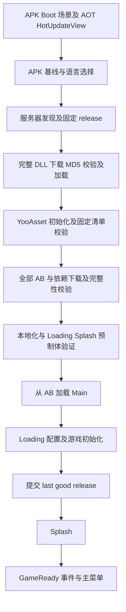

# MyTowerGame 启动、热更新与多语言重构交付记录

2026-10-19 后续回归更正：此前只验证直接 Main，遗漏编辑器 Boot 和真正无缓存的离线首启；用户反馈后已修复模拟版本隔离、APK 内置清单缓存及重试按钮父节点隐藏。当前交付为独立测试 APK 3.1.7，更新验证至 3.1.9，最终 14 项启动/恢复场景与 46 个 HTTP 有效载荷通过。当前源码、产物及边界请以 [BootStartupRegressionReport.md](E:/MyTowerGame/Docs/BootStartupRegressionReport.md) 为准。下文保留原交付的历史版本与证据，不代表其旧 APK 包含此次修复。

验证日期：2026-10-19。工程 `E:\MyTowerGame`，Unity `2022.3.62f3c1`，YooAsset `3.0.6`，HybridCLR 沿用现有安装。

代码、场景、资源迁移、构建发布工具及 MuMu 正常／故障恢复矩阵已实现并实测。清理测试标记后的 APK 已完成启动、更新、无更新及离线回归。34 份纳入验收的 Android 场景记录满足各自预期，最终服务器 46 个有效载荷通过真实 HTTP 全内容 MD5 复核。编辑器直接 Main 已实测 Ready、配置成功、Launcher 唯一且控制台无错误。此前阻塞的最终 MCP 复核已恢复并完成，本次约定的实现、构建、测试与证据交付闭环全部完成；实测范围限制见末节。

## 交付物与精确版本

| 项目 | 实际产物／值 |
|---|---|
| 最终无测试标记 APK | [final-clean.apk](E:/MyTowerGame/Builds/BootRefactor/final-clean.apk)，108,603,662 字节，Development、IL2CPP、ARM64 |
| APK SHA256 | `b65e4f0facae9fa03508e35bb306648540dc64bf5a01983c21139fec87bea040` |
| APK 内置基线 | `3.1.0-a35bea05bb302c24`；资源 `3.1.0`；manifest MD5 `24779de2deaf4dd0b513e2430b1b1fd3` |
| 最终实际 HTTP 发布 | `3.1.1-ef80cc51a8777aa7`；资源 `3.1.1`；manifest MD5 `9e28949dd54888b8c3cc4940be54dc4d` |
| 最终 AOT signature | `4120caf0f699c9ea9208de278fabb926b0fb3ecade0b813d278ed315ac4c07eb` |
| 最终 Runtime DLL MD5 | `c9cb474e925f556e8b30df4f0cff299d`；3.1.0 与 3.1.1 的全部 DLL 一致 |
| 当前服务描述符快照 | [actual-served-release.json](E:/MyTowerGame/Builds/BootRefactor/actual-served-release.json) |
| 自动汇总与 HTTP 哈希 | [final-evidence-index.json](E:/MyTowerGame/Builds/BootRefactor/final-evidence-index.json) |
| 最终无标记录屏 | [startup.mp4](E:/MyTowerGame/Builds/BootRefactor/35-clean-final-visual/startup.mp4)、[逐帧总览](E:/MyTowerGame/Builds/BootRefactor/35-clean-final-visual/contact-sheet.png) |
| 最终不可变发布包 | [final-release-3.1.1.zip](E:/MyTowerGame/Builds/BootRefactor/final-release-3.1.1.zip)，包含 49 个文件；SHA256 见 `delivery-artifacts.json` |
| AB 可见更新录屏 | [startup.mp4](E:/MyTowerGame/Builds/BootRefactor/33-ab-visual-record/startup.mp4)、[逐帧总览](E:/MyTowerGame/Builds/BootRefactor/33-ab-visual-record/contact-sheet.png) |
| 完整原始需求 | [BootHotUpdateRefactorPrompt.md](E:/MyTowerGame/Docs/BootHotUpdateRefactorPrompt.md) |

## 实际启动链与生命周期



Boot 的 HotUpdateView 直接配置在 Boot Canvas，首帧让出后才进行 IO／DLL 工作。AOT 符号与本地字体随 APK 可用，未挂 Runtime TextLocalizer。DLL 与 AB 阶段持续使用这一个页面；没有切换第二套默认更新 UI。Main 加载前不实例化 Launcher 及游戏管理器。主菜单由 Splash 结束后的 `ConfigLoadedEvent(true)` 放行。

原 BootLoader 外层固定 60 秒场景等待已移除。下载与暂停由内部阶段管理；总进度与阶段进度分离，DLL 完成处总体约 32%，AB 校验结束才显示更新完成。总量未知使用不确定进度。AB 传输时显示文件数、字节、速度及暂停／继续；不适用阶段隐藏操作。失败按钮绑定当前阶段的恢复动作，避免重复请求。

`41-clean-boot-before-dll/startup.mp4` 对 release 请求施加 1.2 秒延迟：4.8–6.4 秒逐帧可见繁体中文“遊戲更新／正在檢查更新”、总体 5%，之后日志才出现 DLLReady，再进入资源阶段。故障已解除。录屏最前面的 Made with Unity 是引擎原生启动标识，产品 SplashView 仍在 Loading 之后。

## 修改文件及职责

以下路径均相对于 `E:\MyTowerGame`；保留了已有 Configs／Launcher 配置重试修复及其他未提交工作。

| 文件／资源 | 最终职责 |
|---|---|
| `Assets/AOTAssembly/BootLoader.cs` | 首屏、服务器覆盖与发现、固定 release、DLL 重试、程序集失败后的重启提示、等待资源闸门 |
| `BootReleaseStore.cs`、`BootUpdateSession.cs` | schema 2 发布选择／暂存／原子提交；页面状态、进度和操作协议 |
| `BootLocalization.cs`、`BootUiFontProvider.cs`、`BootUiSymbolKeeper.cs` | 最小三语言基线、旧语言存档只读兼容、本地字体与 IL2CPP API 保留 |
| `HotUpdateView.cs`、`SqliteNative.cs`、`AssemblyAccess.cs` | 原脚本保留 GUID 移入 AOT；首屏可用；SQLite P/Invoke 在 AOT 中执行 |
| `HotUpdateAssembler.cs`、`HotUpdateDllDownloader.cs` | 固定 DLL 目录、完整 MD5 集、Range 续传、有限重试、暂存后原子落盘；AOT 元数据只取对应 APK |
| `Assets/Scripts/HotUpdateEntry.cs`、`Core/Res/BootHotUpdateGate.cs` | DLLReady、统一 AB 完整性闸门、启动资产验证、通过后加载 Main |
| `Core/Res/YooAssetResLoader.cs` | YooAsset 3.0.6 API、固定资源版本／manifest MD5、High 校验、全依赖下载、同版本补齐、暂停超时补偿及诊断计数 |
| `Launcher.cs`、`Data/Configs.cs` | Loading → 有界配置重试 → 成功提交 → Splash → GameReady；全表成功才设 IsLoaded；配置预加载引用只持有一次 |
| `Localization/LanguageManager.cs` | 在 Loading 之前加载新词表／settings，刷新字典及字体；保留玩家选择与格式错误回退 |
| `Core/UI/UIManager.cs`、`Core/Res/ResTable.cs` | HotUpdateView 可从本地 Resources 使用；Loading／Splash 通过 YooAsset 取当前版本，错误不得静默取旧副本 |
| `Assets/HotUpdateUI/LoadingView.prefab`、`SplashView.prefab` | 保留 meta／GUID，从 Resources 迁至 AB 收集目录 |
| `Assets/Localization/LocalizationSettings.asset` | 数据迁至 AB；类型本身仍属于 AOT |
| `Assets/Scenes/Boot.unity`、`BundleCollectorSetting.asset` | AOT Canvas／EventSystem；APK 只启用 Boot；Main 与启动 UI 正确收集，包含特殊无后缀依赖包 |
| `Assets/link.xml`、`HybridCLRGenerate/*` | AOT、TMP、UI 等裁剪保留及当前构建生成产物 |
| `Assets/Editor/BootReleaseBuilder.cs` | 首屏依赖与 Build Settings 检查、AOT 签名、不可变发布、APK 基线及构建一致性闸门 |
| `Assets/Editor/BuildApk.cs` | DLL／AB 完成后写匹配的 APK baseline，再构建 APK |
| `Assets/Editor/HotUpdate/HotUpdateDeployer.cs`、`HotUpdateSettings.cs` | payloads inventory、文件完整性、最后更新指针；HTTP PUT 后 GET 全量 MD5；版本扫描读取 release.json |
| `Assets/Editor/LocalizationPrefabBinder.cs`、`LocalizationPrefabCleaner.cs`、`UIPrefabBuilder.cs`、`YooAsset/AddMainSceneCollector.cs` | 生成器、绑定器及收集路径跟随迁移，避免重新生成旧 Resources 架构 |
| `.workbuddy/tools/deploy_free_tower_cdn.py` | 接收已暂存的完整 release，校验 inventory／DLL／manifest，复制内容后原子激活；不再平铺 loose AB |
| `.workbuddy/tools/boot_validation*.py`、`boot_fault_matrix.py`、`boot_record.py`、`boot_evidence_audit.py` | 独立测试包、隔离故障、ADB 日志截图录屏及证据复核 |

## AOT 与热更能力边界

| 内容 | 更新方式 |
|---|---|
| Boot 场景、HotUpdateView 结构／脚本／内置字体／最小启动文案、发布协议、SQLite native wrapper | 新 APK。本次 AOT 变化必须重发 APK，不能仅发 DLL 给旧 APK |
| 热更 DLL 行为、Loading／Splash 脚本 | 完整且匹配的 DLL 集；固定在一次进程启动内 |
| Loading／Splash 布局、图片、字体、翻译、本地化图片 | AB 更新，使用当前 release 的依赖；已用可见变化实测 |
| 现有语言的默认值、支持语言列表、字体映射、翻译及图片 | AB 更新；玩家保存的选择优先于新的默认值 |
| 新增 Language 枚举项、修改 AOT LocalizationSettings 类型／序列化结构、增加新的 AOT API 需求 | 新 APK；不能声称这些结构可任意远更 |

Boot 优先只读 SQLite 的 `kv_store`／`settings.language`（`sensitive=0`），再兼容旧 JSON 和 PlayerPrefs。无法读取时使用可靠本地基线；字体检查包含 fallback fonts，缺字则用英文。没有额外的 Boot 远程本地化缓存格式，故首屏不依赖损坏的下载词表。

AB 就绪后读取 `LocalizationSettings` 和 `tblocalization`，首次 Loading 前构建词典并触发语言刷新。缺 key／空翻译回退英文，再交由控件保留原文本；格式化异常尝试英文格式，仍失败则回退原文本；缺字体保留可用字体；空支持列表走现有语言回退。TextLocalizer、ImageLocalizer 与语言切换事件继续工作。测试 32 实际显示 `Volume 80%`，未因 `{99}` 错误崩溃。

## 发布、兼容与恢复策略

`release.json` 的 `schema=2`、`playerApi=2`，同时固定 `aotSignature`、完整 DLL 名称／MD5 集、`resourceVersion`、精确 `manifestMd5`、`id` 和 `contentRoot=releases/{id}`。每个 release 内附 `payloads.json`，记录全部有效载荷的路径、大小和 MD5；也包含 32 位无扩展名 unitymonos／unityshaders 包。

DLL 暂存目录依据整个描述符的 SHA256 隔离。任何 DLL 404／校验失败均阻止 Assembly.Load，不能把新旧 DLL 随意混用。程序集一旦开始加载，加载异常要求重启进程；资源重试只能修复已固定 release，不能同进程卸载或切换程序集。AOT 元数据只来自对应 APK、按 AOT signature 分目录。

YooAsset 初始化后核对实际磁盘 manifest MD5；使用固定资源版本、High 内容校验和全部依赖下载。相同版本仍检查缺失／损坏缓存。只有全部资源、启动预制体及本地化通过才加载 Main。配置全部成功后才原子提交 `active.json` 为 last-good；`File.Replace(temp,target,null)` 避免 Android FUSE 备份 hard-link 问题。完整缓存才能离线进入；离线不完整保留更新页，恢复网络后可修复同版本。

DLL 按文件有限重试并保留可续传临时文件。AB 失败可重试、传输期间可暂停／继续；暂停不消耗外层总下载期限。配置最多自动尝试 3 次，失败后受控返回更新页，重验同一版本后重新读表。重试不会重复 acquire 配置预加载引用；测试 28 的三次诊断均为 `handles=43 locations=43 bundleRefs=1`，前两次失败、第三次成功，Splash／GameReady 各一次。

## 构建与部署操作

1. 首次／AOT 改动：使用 `Tools/塔防/启动重构/配置 Boot 首屏` 检查启动壳；再使用 `Tools/塔防/7. 一键完整构建（DLL ▸ AB ▸ APK）`。它先完成 HybridCLR DLL／元数据及 AB，生成对应 `Assets/StreamingAssets/boot-release.json`，再构建 APK。BuildGuard 阻止 Boot 丢失、热更脚本进入首屏、AOT／DLL／内置版本／manifest 不一致。
2. 仅热更：打开 `Tools/塔防/10. 一键热更…（DLL▸AB▸部署▸验证）`，明确本次版本与部署目标。AOT 签名变化会拒绝作为普通热更发布，必须先新 APK。只构建 AB 不代表已部署成功。
3. 需要定向隔离发布时，在已核对身份的 Unity Editor 上执行以下真实入口；版本应选未使用的新版本，示例为本次已生成的 3.1.1，不应重新发布不同内容覆盖同版本：

```csharp
var report = new FTProject.EditorTools.EditorUtil.Report();
bool ok = FTProject.EditorTools.FTYooAssetSetupWizard.BuildRealBundlesCore("3.1.1", false, report);
if (!ok || report.Errors > 0) throw new System.Exception(report.Text);
FTProject.EditorTools.BootReleaseBuilder.Publish("3.1.1", "Builds/BootRefactor/Server", false);
```

4. DLL 改动需先 `HybridCLR.Editor.Commands.CompileDllCommand.CompileDll(BuildTarget.Android,true)`，再 `HybridCLRDllCopier.Copy(report)` 与 `HybridCLRMd5Generator.Generate(report)`，然后发布完整描述符；DLL-only 可以保留原资源版本，但其 manifest 必须完全一致。正常生产发布优先使用上述一键面板。
5. `HotUpdateDeployer.BuildPlan` 先暂存到 `Library/FTBootReleaseStage/{version}`；`DeployLocal` 对全部文件复制与 MD5 核对后才原子更新根 `release.json`；`UploadAll` PUT 每个文件后 GET 真实内容 MD5，全部通过才上传根指针；`VerifyHttp` 再次 GET 验证所有项。不要手工先改 FreeTower.version 或 release.json 再补文件。
6. 离线脚本部署已暂存完整发布的实际命令：`python .workbuddy/tools/deploy_free_tower_cdn.py --source Library/FTBootReleaseStage/3.1.0 --destination Builds/BootRefactor/ScriptDeploy`。命令只演示隔离目录；本任务未向正式远端发布。

AB 构建会更新 StreamingAssets/yoo。构建热更后若还要重打原基线 APK，须恢复与 boot-release.json 匹配的完整内置基线，或通过完整构建生成一套新基线；本次最终源码已恢复内置 `3.1.0`，服务激活 `3.1.1`，两者界限明确。

## MuMu 环境、真实前后版本与测试矩阵

现场发现 MuMu 安装于 `C:\Program Files\Netease\MuMu`，实例 0“MuMu安卓设备”，Android 15.0，ADB `127.0.0.1:16384`、设备 `SM_A5560`。ARM64 测试 APK 在该模拟器中实际运行。独立包 `com.ftproject.freedomtower.bootvalidation2`，versionName `1.0`／versionCode `1`；原包 `com.lzyfreedomtower.freedomtower` 未卸载或清数据。测试包首装 12:11:52，最终覆盖安装 12:36:14，语言存档保留。

隔离 HTTP 服务端口 18000，根为 `E:\MyTowerGame\Builds\BootRefactor\Server`，测试包 `server.txt=http://127.0.0.1:18000`，通过 `adb reverse tcp:18000 tcp:18000` 访问。不可达测试真实移除 reverse，再恢复；损坏／404／延迟／断流只作用于该隔离服务。原 8000 服务及正式远端没有被激活测试版本。请求证据在 `Builds/BootRefactor/requests.jsonl`；最终 `faults.json={}`。

主矩阵使用 `final-baseline.apk`，AOT signature `db4f2824ba06b6af20b2fad8966ee17f31b2fc7c302a3fad793133c6558abc4a`。它与最终 clean APK 的差异包括测试辅助代码清理、首屏字体 fallback 检查及 Android 原子替换修正；不能把主矩阵说成全部由最终 APK 重跑。

| 版本目的 | 不可变 release ID | 真实变化与证据 |
|---|---|---|
| 主矩阵基线 | `3.0.0-56f1383948952a07` | final-baseline-release.json |
| DLL-only | `3.0.0-bc02593173a5d0c1` | Runtime MD5 `6988dc59e2c5275c458820ee0502556d`，运行日志出现 DLL_V4；资源 manifest 不变 |
| AB-only | `3.0.1-c3bd714f7c35720f` | 全部 DLL 与基线相同；Loading 绿色 Logo／新文案，Splash 繁中图片为绿色六边形；默认繁中、列表反序、字体映射更新 |
| DLL+AB | `3.0.2-66b768bcd602f093` | V4 DLL 加联合更新 V5 文案；新默认英文没有覆盖玩家简中选择 |
| 本地化容错 | `3.0.3-ad485b5fe22a83a1` | 干净 Runtime 加缺 key、空翻译、坏格式、空字体／列表的 AB；成功进入菜单 |
| 最终干净回归 | `3.1.0-a35bea05bb302c24` → `3.1.1-ef80cc51a8777aa7` | 测试标记全部清理；同内容资源的新版本／新清单真实下发，DLL 集未变；完成在线及离线回归 |

下面“通过”包括按预期阻止错误版本进入 Main；不是把所有故障都当作应成功进游戏。证据前缀统一为 `E:\MyTowerGame\Builds\BootRefactor\`，每个 Android 场景含 `result.json`、`logcat.txt` 和截图。

| 需求编号／场景 | 实测结果 | 证据目录 |
|---|---|---|
| 1 首次安装、无缓存 | 通过；独立包新装，GameReady 一次 | `10-final-first-install` |
| 2 无更新 | 通过；正确复用、完成提交 | `11-final-no-update`、`38-clean-final-no-update` |
| 3 仅 DLL | 通过；真实 DLL 下载后出现 DLL_V4，manifest 不变 | `21-dll-kill-restart`、`dll-v4-release.json` |
| 4 仅启动 UI／AB | 通过；DLL 完全不变，可见新 Logo／文案／图片 | `22-prepare-baseline-for-ab`、`26-ab-pause-resume-recovery`、`33-ab-visual-record` |
| 5 DLL 与 AB 联合 | 通过；正确固定同一组合 | `27-combined-kill-restart` |
| 6 下载断网／断流 | 通过；有限重试、阻塞 Main，恢复可继续 | `20-dll-network-interruption`、`25-ab-network-interruption`、`26-ab-pause-resume-recovery` |
| 7 更新中杀进程 | 通过；DLL／AB 两个阶段分别验证，重启后完成，DLL 有 Range 请求 | `21-dll-kill-restart`、`27-combined-kill-restart`、`requests.jsonl` |
| 8 不可达／超时／版本或清单缺失 | 通过；完整本地组合离线可用；新清单 404 阻止 Main | `14-server-unreachable-offline`、`15-release-timeout-offline`、`16-release-missing-offline`、`17b-manifest-missing` |
| 9 部分 DLL 失败／校验失败 | 通过；全部 DLL 校验成功前不加载；损坏重试仍阻塞 | `18-dll-404`、`19-dll-checksum` |
| 10 AB 缺失／损坏／同版本补齐 | 通过；CRC 检出，在线同版本修复 | `23-ab-404`、`24-ab-corruption`、`29-*`、`30-*` |
| 11 兼容性不匹配 | 通过；AOT 不匹配在 DLLReady 前阻止，manifest 不匹配在 Main 前阻止 | `12-incompatible-apk`、`13-incompatible-manifest` |
| 12 完整资源离线 | 通过；基线与更新后的 last-good 均实际验证 | `14-server-unreachable-offline`、`36-clean-final-offline`、`39-clean-update-offline` |
| 13 不完整资源离线与恢复 | 通过；真正损坏／删除独立包缓存后离线阻塞，恢复网络点击 Retry，同进程同版本补齐 | `29-corrupt-cache-offline-blocked`、`29-delete-cache-offline-blocked`、对应 `30-*` |
| 14 失败／重试／暂停继续 | 通过；暂停截图显示总体 61%／阶段 43% 和 Resume，恢复成功 | `26-ab-pause-resume-recovery` |
| 15 配置失败受控恢复 | 通过；测试包前两次 tbaudio 读取失败，第三次成功；引用计数不增长 | `28-config-transient-recovery` |
| 16 Loading → Splash → 主菜单 | 通过；日志序列与录屏逐帧一致，无提前 GameReady | `33-ab-visual-record`、`35-clean-final-visual`、`37-clean-final-update` |
| 17 切换／持久化／重启／刷新 | 通过；实际 UI 英文／简中切换保存、重启恢复；最终繁中选择保持 | `31-language-english-restart`、`31-language-simplified-restart`、`34-*` 至 `39-*` |
| 18 翻译／字体／图片／语言配置热更 | 通过；AB-only 不换 DLL，Loading／Splash 可见变化；保存选择不被新默认覆盖 | `26-*`、`27-*`、`33-ab-visual-record`；容错 `32-localization-fallback` |
| 19 missing／布局／裁剪／句柄 | 采样内通过；未见 missing script、布局错误、MissingMethodException／NullReferenceException／FATAL；配置三次重试计数稳定 | 各 `logcat.txt`／`issues`，`28-config-transient-recovery`；长期泄漏证明见限制 |
| 20 编辑器直接 Main | 通过；Ready、Configs=true、loader=true、Launcher=1、HotUpdateView=0，控制台零错误 | `40-editor-main/result.json`、`console.json`、`result.png` |

初次 `17-manifest-missing` 的断言文本写错，`matched=false`，原始证据保留。修正断言为实际 `HttpCode=404` 后在 `17b-manifest-missing` 通过，不将原失败结果隐藏。证据汇总显式记录此排除原因。

## 发布工具验证与问题修复闭环

本地部署 49 项文件校验零失败（含有效载荷、inventory、不可变描述符及根指针）。对隔离 URL `http://127.0.0.1:18000/upload-proof` 注入 GET 内容损坏，UploadAll 立即返回 MD5 mismatch，旧 `release.json` 保持 `previous-activation`；解除后重传成功，再对全部 49 项 HTTP GET 校验零失败。另故意破坏本地 inventory 指向的 bundle，BuildPlanFromCdn 返回错误且空计划；Python 脚本也拒绝并保留旧指针，恢复文件后部署成功。证据：`deploy-local.txt`、`deploy-http-failure.txt`、`deploy-http-success.txt`、`deploy-inventory-rejection.txt`、`deploy-python.json`。

`release-comparison.json` 额外复核 AB-only 的全部 DLL 与基线一致，DLL-only 仅 Runtime 哈希改变且资源 manifest 不变，联合更新的 DLL 集与 DLL-only 相同。`served-dll-md5.txt` 来自最终 HTTP 实际响应，与描述符的六个 DLL 校验值一致；`migrated-guids.json` 核对五组迁移前后 GUID 均保留。

已实际发现并修复：漏发无后缀特殊包引起 404；HotUpdateUI collector GUID／重复收集；热更层 byte[] SQLite P/Invoke 不支持；IL2CPP 裁剪缺 UI／字体方法；错误文本超屏；资源未完整或配置失败前过早提交；配置重试重复 acquire；只固定版本号未核对实际 manifest；部署提前激活指针；Android FUSE 备份 hard-link；字体 fallback 存在却误显示英文。相关场景均在上述记录中重跑。

## 最终状态、限制与复核

最终 `Assets` 内已无 DLL_V4／ValidationConfigFailures／AB UPDATE／COMBINED／FALLBACK TEST 等临时标记；原 Loading／Splash／语言资源已恢复。实验发布与故障二进制仅留在隔离证据目录。工程包名／产品名恢复 `com.lzyfreedomtower.freedomtower`／`freedomtower`，development 编辑器选项恢复 false，当前场景恢复 Boot，正式应用及其存档未清除。未提交、回滚或发布正式远端。

最终 clean APK 的 34–39 及 41 共七个场景全部通过；3.1.1 回归验证的是清理后新版本及精确清单的切换，内容与 3.1.0 相同，不能冒称它又重复了一轮带可见标记的差异下载测试。可见差异及完整故障矩阵分别由主矩阵 APK 完成。三次配置重试句柄计数稳定说明该恢复路径未增加引用，不构成长时间全游戏零内存泄漏证明。仅验证本机 MuMu／Development APK，未做其他 Android 真机、iOS 或正式发布包的长期测试。

已完成最终 C# 强制 MCP 验证：恢复连接后从现场实例列表重新选定 MyTowerGame，核对 `projectRoot=E:/MyTowerGame`、`unityVersion=2022.3.62f3c1`，再次 force／all／compile=request／wait_for_ready 刷新；重载后重新选实例核对身份，确认 is_compiling=false、is_domain_reload_pending=false、is_updating=false、ready_for_tools=true；scriptCompilationFailed=false，read_console(error) 为 0。AOT signature、六个 DLL 的 MD5 与最终 APK 基线一致，内置版本为 3.1.0；Boot 为当前场景、未在 Play，包名／产品名及 development=false 均确认恢复。原始现场结果见 `Builds/BootRefactor/final-mcp-verification.json`。

历史阻塞保留于 `final-mcp-status.json`：曾出现刷新等待 60 秒超时、Editor 命令 TimeoutError，以及窗口捕获／恢复的 FrameArrived timeout／GetCursorPos 拒绝访问。用户继续任务后连接已恢复，完成了上述全部现场复核；该项现已关闭，无待用户开启或补验事项。恢复后再次运行证据审计，34 个 Android 场景与 46 个实际 HTTP 有效载荷仍为零失败，APK 与发布 ZIP 的 SHA256 未变。`git diff --check` 通过。

可重复证据校验：在 `E:\MyTowerGame` 执行 `python .workbuddy/tools/boot_evidence_audit.py`，会复查 34 个选定场景的预期与顺序、APK 内置描述符、实际服务器指针和 46 个有效载荷 MD5，并重写 `final-evidence-index.json`；故障服务必须处于本次隔离端口且 faults.json 为空。
