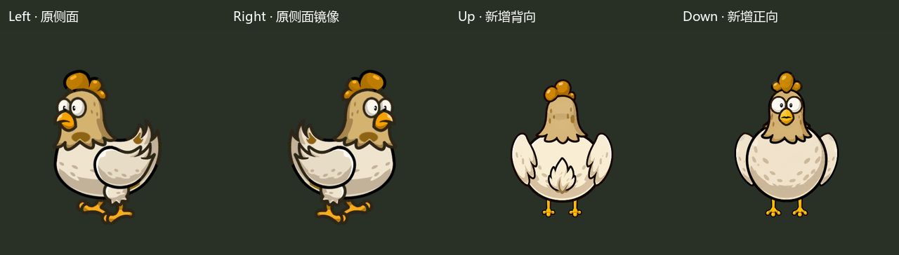
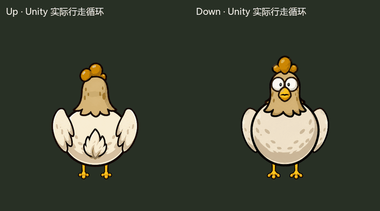

# AdvancedHen 四方向示例 · R3 已通过

2026-10-22 用户明确回复：“通过。继续按照规则处理后续的10个预制体。” 本页保留原 R3 交付证据；后续接入及共享代码回归记录见 [Batch01_10](../Batch01_10/README.md)。原菜单9的69项历史检查包含“Bat未配置”的当时前提，Bat接入后使用新批次的通用审核工具回归 AdvancedHen，避免覆盖原R3证据。

2026-10-22，E:/MyTowerGame，Unity 2022.3.62f3c1。本轮移除 AdvancedHen **全部方向**的地面阴影，并补画朝上背向后躯的尾羽。只修改本例，其他118个战斗prefab保持会话前本地基线；后续逐个处理时也遵循全方向无阴影规则，仍须先通过本例审核。

| 审核材料 | 内容 |
|---|---|
| [R2/R3 对照](revision_comparison.png) | 真实Unity渲染；新增后躯中央上翘尾羽，去除旧地面阴影 |
| [原图与当前方向](original_vs_new.png) | 原图集/接入前原角色/当前Up/Down；原参考截图含历史阴影，当前战斗角色已移除 |
| [上下行走循环](up_down_walk.gif) | 每向10张实际PNG，20fps、0.5秒；尾羽随身体自然起伏 |
| [行走连续转弯](walk_turn.gif) | 180张Unity实际帧、9秒，全方向无阴影 |
| [攻击受击死亡复用](attack_death_reuse.gif) | 128张源帧、6.4秒；实际动画事件、淡出、自动回收及同实例再生 |
| [当前12分件](parts_comparison.png) | 尾羽合入Up_Body，其余11切片像素不变 |
| [原始帧](frames/) | 不经过GIF调色板的实际渲染PNG |

尾羽参考原侧面的上翘形状，设计成后躯中央的小束分层米白羽毛，以赭色根部和重叠线连接腰臀；保持下腹遮住腿根。尾羽合入Up_Body，随现有躯干动画、白闪和死亡透明度一起变化，不新增独立更新或运行渲染器。上下三个表情继续使用金黄鸡冠，正面翅膀和腿位保留R2修正。

阴影通过接入工具删除战斗prefab中的Shadow节点，在Left/Right/Up/Down都不存在，回收复用也不恢复。原始图集、源prefab和共享资源保留作参考。规则记录在 [DIRECTION_ART_RULES.md](DIRECTION_ART_RULES.md)，待后续敌人获得逐个处理授权后应用。

## Unity复现

1. 先协调并行任务的Unity使用窗口，保存当前场景，等待编译完成并退出其他Play。
2. `Tools > 塔防 > 敌人方向示例 > 5. AdvancedHen 运行审核演示`：创建不落盘的隔离场景与内存配置，不写关卡表或已有场景。
3. Game视图检查纯Up出生及Right/Down/Left连续转弯；菜单6暂停/恢复，7切换1/2/3倍速，8攻击。
4. 菜单9运行69项检查；10四向静态、11转弯、12攻击死亡复用、13上下循环，采集入口仅在该真实Play演示中运行。
5. 退出Play自动恢复之前已保存场景。本轮交接时已恢复Boot dirty=false。之后并行任务可继续运行，验证文件记录的是交接时状态。

运行检查和采集会更新本目录证据，`review_media.py`只合成Docs中帧。固定0.05秒采集与跨真实帧的暂停/倍速观察分别记录，后者见pause_speed_checks.txt。

## 重复接入

非Play且编译结束时，仅使用菜单 `1. 接入 AdvancedHen 上下方向`。它导入12切片、重建本例专用动画/控制器/Profile，删除本例Shadow节点并保存本例prefab；缺图会报错。已有MonsterPrefabBuilder的ApplyIfConfigured钩子会在未来重建时再次去除Shadow并重新应用方向配置，不运行全量重建。

重新打包时，在协调好的Assets修改窗口显式运行 `prepare_atlas.py`：使用固定R2图集基底与revision_03/body_tail.png，重新生成只改变Up_Body的PNG；12切片rect/pivot/PPU和原GUID不变，再运行菜单1。它不调用图片API。`revision_03/pack_art.py`单独运行只写Docs；offline_pose/walk明确是离线草图，不作为Unity验证证据。

## 验证与审核

- **69/69 PASS**，含四方向均无Shadow、对象池复用不恢复Shadow；攻击/死亡头、受击、血条、飞行和未配置Bat兼容均重跑。
- 本例真资源四向静态/上下循环/转弯/动作重新采集；尾羽在行走与死亡中可见且连接后躯。
- 编译通过、交接前控制台错误0；AssetDatabase依赖和当前YooAsset收集覆盖重新检查。
- R3没有修改3个Enemy运行脚本；除DirectionVisual和移除的Shadow三组件外，其余36个prefab组件语义相同；其他118个prefab字节不变。
- 未做APK/真机、发布包回读、全关卡长期战斗及118个敌人逐个运行回归。

详见 [验证记录](VALIDATION.md)、[修改清单](CHANGE_LIST.md)、[R3精确变化与SHA256](revision_03/changed_assets_sha256.json)、[全实现指纹](implementation_fingerprint.json)、[范围审计](scope_summary.txt)。R1/R2完整交付与实现备份分别存放history/revision_01和history/revision_02。

AdvancedHen R3 已获得明确审核通过；授权的下一批严格限于 Bat 至 BoarMounted 的10个角色，按文件名顺序逐个接入和验证。当前状态见 progress.json 与后续批次目录。
