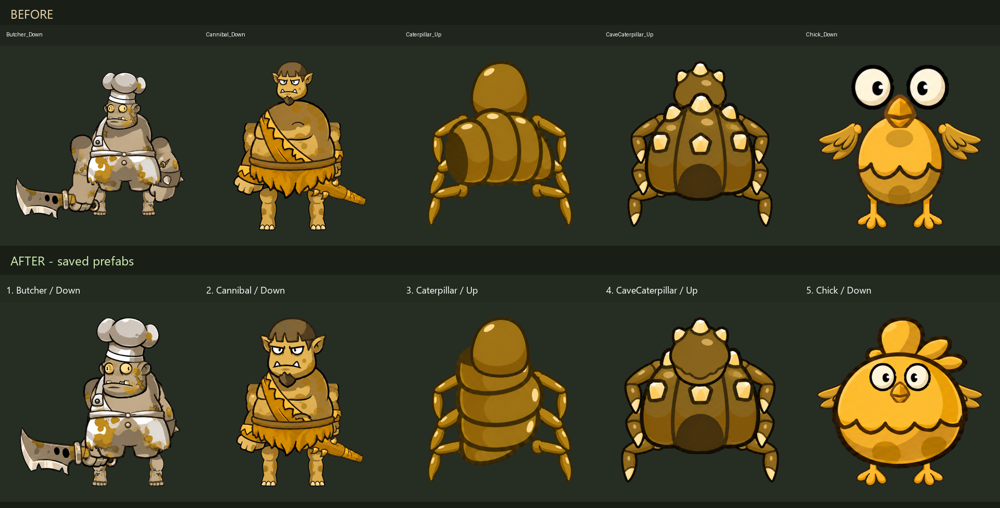

# DOCX 中五个敌人方向资源修正（2026-10-30）

来源：`C:/Users/Administrator/Desktop/新建 DOCX 文档 (2).docx` 中按文档顺序出现的五张嵌入截图。
已结合历史方向适配记录与当前磁盘、Unity 实例核对，五张图均能定位到本工程实际预制体。当前 Sprite 引用对应各自角色；本次处理截图所示方向的比例、拼装、身体轴向与遮挡问题。

## 预制体和图片对应

| 文档顺序 | 角色 / 方向 | 战斗预制体 | 当前方向图集 | 原始侧向图片 |
|---|---|---|---|---|
| 1 | Butcher / Down | [Enemy_Butcher.prefab](E:/MyTowerGame/Assets/Prefabs/Enemy/Enemy_Butcher.prefab) | [Butcher_Directions.png](E:/MyTowerGame/Assets/_UIAssets/Monsters/Giants/Butcher/Directions/Butcher_Directions.png) | [Butcher.png](E:/MyTowerGame/Assets/_UIAssets/Monsters/Giants/Butcher/Butcher.png) |
| 2 | Cannibal / Down | [Enemy_Cannibal.prefab](E:/MyTowerGame/Assets/Prefabs/Enemy/Enemy_Cannibal.prefab) | [Cannibal_Directions.png](E:/MyTowerGame/Assets/_UIAssets/Monsters/Giants/Cannibal/Directions/Cannibal_Directions.png) | [Cannibal.png](E:/MyTowerGame/Assets/_UIAssets/Monsters/Giants/Cannibal/Cannibal.png) |
| 3 | Caterpillar / Up | [Enemy_Caterpillar.prefab](E:/MyTowerGame/Assets/Prefabs/Enemy/Enemy_Caterpillar.prefab) | [Caterpillar_Directions.png](E:/MyTowerGame/Assets/_UIAssets/Monsters/Insects/Caterpillar/Directions/Caterpillar_Directions.png) | [Caterpillar.png](E:/MyTowerGame/Assets/_UIAssets/Monsters/Insects/Caterpillar/Caterpillar.png) |
| 4 | CaveCaterpillar / Up | [Enemy_CaveCaterpillar.prefab](E:/MyTowerGame/Assets/Prefabs/Enemy/Enemy_CaveCaterpillar.prefab) | [CaveCaterpillar_Directions.png](E:/MyTowerGame/Assets/_UIAssets/Monsters/Insects/CaveCaterpillar/Directions/CaveCaterpillar_Directions.png) | [CaveCaterpillar.png](E:/MyTowerGame/Assets/_UIAssets/Monsters/Insects/CaveCaterpillar/CaveCaterpillar.png) |
| 5 | Chick / Down | [Enemy_Chick.prefab](E:/MyTowerGame/Assets/Prefabs/Enemy/Enemy_Chick.prefab) | [Chick_Directions.png](E:/MyTowerGame/Assets/_UIAssets/Monsters/Birds/Chick/Directions/Chick_Directions.png) | [Chick.png](E:/MyTowerGame/Assets/_UIAssets/Monsters/Birds/Chick/Chick.png) |

每个预制体经 `EnemyDirectionalVisual.Profile` 引用同角色的 `<Name>_Directions.asset`，其中的 Sprite 引用对应表中的 `<Name>_Directions.png` 切片。截图部件位于 `DirectionVisual/<方向>/Motion/<部件>/Sprite`。完整路径与 GUID 见 [resource_mapping.json](resource_mapping.json)。

## 本次调整

- **Butcher / Down**：头部放大并下移；双臂上移、向肩部收拢，改善头肩和躯干连接。
- **Cannibal / Down**：头部放大并下移，消除小头悬浮在肩部上方的观感。
- **Caterpillar / Up**：Up_Body 按顺时针旋转 90°，由横向腹部改为纵向；重新适配缩放并将头部绘制到身体前面。
- **CaveCaterpillar / Up**：背向头部下移、略微放大，调整绘制顺序，改善头身衔接。
- **Chick / Down**：复用自身已有的完整黄色身体和头冠轮廓补齐 Down_Body；调整身体、五官比例及翅膀层级。

位置调整同步到现有动画曲线，并同步维护 `.layout.json`，避免动画播放或从布局重建时恢复旧位置。毛毛虫新的身体矩形同步到切片清单和 TextureImporter；沿用原 GUID、Sprite 名称与内部 ID。小鸡只替换 Down_Body 切片内容。

本次共改动 30 个生产资源文件：5 个预制体、5 个布局、2 张方向图集、1 个切片清单、1 个贴图 meta、16 个动画片段；未新增或修改参与编译的 C#。逐文件前后 SHA256 见 [validation.json](validation.json)。原始侧向图片、其他方向切片、控制器、Profile 与动画事件保留。

## 编辑器结果和验收范围

已重新选定并核对 `E:/MyTowerGame` / Unity `2022.3.62f3c1`。复用现场已有的 MyTowerGame MCP 服务 `8088`，未操作其他工程的连接。

已完成目标资源导入、已保存预制体的离线渲染、动画曲线范围比对，以及 Unity 刷新和编译检查。20 个既有方向片段中，仅 16 个片段的 36 条目标位置曲线改变；其他曲线、时长、事件和 Sprite 对象引用一致。

最终编辑器空闲、资源更新完成、工具就绪，`scriptCompilationFailed=false`，控制台错误 0。开工前两条指向已不存在的 `CodexGalleryBridge_20261030.cs` 的 CS0246，在本次刷新编译后已消失，未清空控制台或修改该历史脚本。

本次未进入 Play Mode、未运行关卡或设备测试。对照图来自隔离的已保存预制体预览，五个角色仍待用户美术验收；历史 Play 帧和旧 GIF 反映调整前版本。
