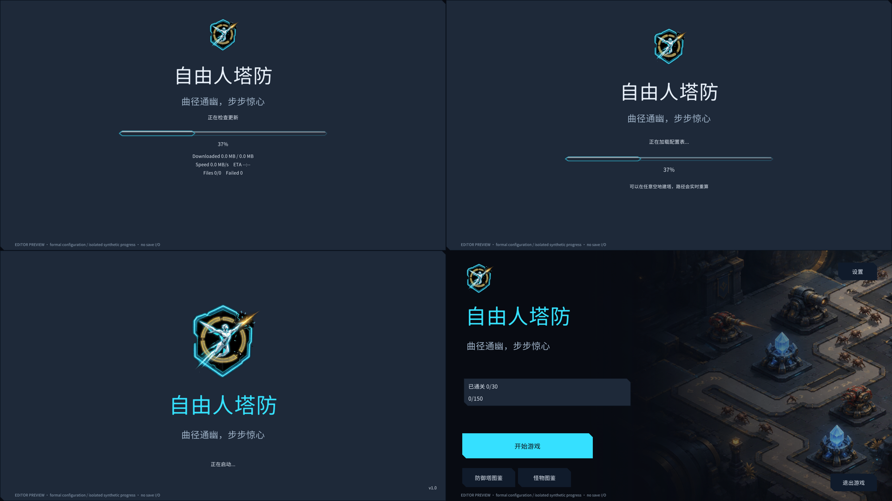

# 字号层级优化（2026-11-02）

已按“游戏名称最大、slogan 次之、其他文字更小”调整 HotUpdateView、LoadingView、SplashView 和 MainMenuView，实际预制体和生成器同步更新。

## 字号与布局

以下为 TMP 逻辑画布基准字号，实际显示随分辨率缩放；长英文保留自适应缩小能力。

| 页面 | 游戏名称 | Slogan | 状态、辅助信息与按钮 |
| --- | --- | --- | --- |
| HotUpdateView | 104 | 40 | 状态、进度和失败提示 22；下载详情 20；按钮 24 |
| LoadingView | 104 | 40 | 加载状态 22；百分比 24；提示 20；恢复按钮 24 |
| SplashView | 112 | 40 | 启动提示 22；版本号 18 |
| MainMenuView | 96 | 40 | 统计 24；主操作 28；次要按钮 24；版本号 18 |

品牌标题和 slogan 分别保留 72、32 的自适应下限，保持其与其他文字的字号差距。同步调整标题和 slogan 的文本框高度、Logo 与文字间距，主菜单副标题区域扩大至 88 高，所有文案继续受文本框与底图边界约束。

生成规则位于 `Assets/Editor/TacticalForgePrefabBuilder.cs`，辅助文字字号统一由 `ApplyBrandTypography` 设置；`UIPrefabBuilder` 初始字号和 `TacticalForgeLayout` 主菜单布局已同步。热更新页运行时失败提示字号上限同步为 22，避免覆盖生成值。

## 检查结果

- 通过 FishTestGame 的 8088 MCP 刷新并完成编译：`scriptCompilationFailed=false`，编辑器已就绪。
- 四页 × 简中、繁中、英文 × 1920×1080、1440×1080，共 24 组预览；另含三种语言的加载失败与完成状态，共 30 组。
- 完成 222 次可见文本检查、198 次底图边界检查，文字越界、截断、底板遮字均为 0。
- 调整前后控制台保留相同的两条 `EventController.cs` 错误（112 行的 `something error here`、140 行的 `InvalidCastException`）。本轮字体修改没有新增编译错误或 UI 异常，未清空历史日志。

检查使用实际预制体的隔离编辑器渲染，未进入播放模式；Android 真机显示效果仍由用户验收。

证据：[文字边界结果](evidence/typography/text-bounds-summary.json) · [编译及控制台结果](evidence/typography/editor-compilation.json)。

## 效果图

| 页面 | 简体中文 | English |
| --- | --- | --- |
| 热更新 | [查看](evidence/typography/HotUpdateView-zh-Hans.png) | [查看](evidence/typography/HotUpdateView-en.png) |
| 加载 | [查看](evidence/typography/LoadingView-zh-Hans.png) | [查看](evidence/typography/LoadingView-en.png) |
| 开屏 | [查看](evidence/typography/SplashView-zh-Hans.png) | [查看](evidence/typography/SplashView-en.png) |
| 主菜单 | [查看](evidence/typography/MainMenuView-zh-Hans.png) | [查看](evidence/typography/MainMenuView-en.png) |

[繁体加载失败状态](evidence/typography/LoadingView-failed-zh-Hant.png)。
